# Cocos Native 引擎代码库指南 · 主索引

> 目标读者：**AI 模型 / 新接手的开发者**。本文件是理解 `native/cocos/` C++ 后端的总入口，用最短篇幅建立整体心智模型，并指向每个子模块的独立文档。
>
> 根目录：`E:/AIProMax/github/cocos4-vulkan/native/cocos/`
> 语言标准：C++17 · 跨平台（Windows / Android / iOS / macOS / OpenHarmony / Linux）· 本仓库渲染重点为 **Vulkan**。
>
> 本文已内联原「架构深入」文档的核心内容：顶层模块划分、应用/引擎装配、GFX 渲染层与多后端、场景层、脚本绑定层、平台层与模块依赖关系。时序图（启动流程、渲染帧、脚本绑定）现统一收录于 [application.md](./application.md)。

---

## 0. 如何使用本指南

1. 先读本文（第 1~3 节）建立整体心智模型。
2. 想深入了解渲染/GFX/管线，跳到第 4 节，再读 [renderer.md](./renderer.md)（GFX 抽象、多后端与渲染管线深度所在）。
3. 需要动某个模块时，跳到第 7 节「模块地图」，点进对应的 `模块名.md`。
4. 想看启动/渲染/脚本的时序流程，见 [application.md](./application.md)。

---

## 1. 顶层模块划分

`native/cocos` 是引擎核心，按职责分为如下几大层次（高层依赖低层；`base`/`math` 为最底基础设施，被几乎所有模块依赖）：

| 分层 | 目录 | 职责 |
| --- | --- | --- |
| 应用层 | `application/` | 应用生命周期管理、程序入口（`CocosApplication`） |
| 引擎层 | `engine/` | 引擎主循环、子系统装配（`Engine`） |
| 平台层 | `platform/` | 跨平台抽象（窗口、屏幕、系统、输入、XR） |
| 脚本绑定层 | `bindings/` | JS ↔ C++ 双向绑定（JSB），多 JS 引擎后端 |
| 场景层 | `scene/`、`core/` | 渲染场景图（`Root` / `RenderScene` / `Camera` / `Model` / `Light`） |
| 渲染层 | `renderer/` | GFX 图形抽象 + 多后端 + 渲染管线 + FrameGraph |
| 高层功能模块 | `2d/`、`3d/`、`ui/`、`physics/`、`gi/`、`audio/`、`network/`、`primitive/` | 具体游戏功能子系统 |
| 基础设施 | `base/`、`math/`、`core/`、`profiler/` | 内存管理、容器、数学库、性能分析 |

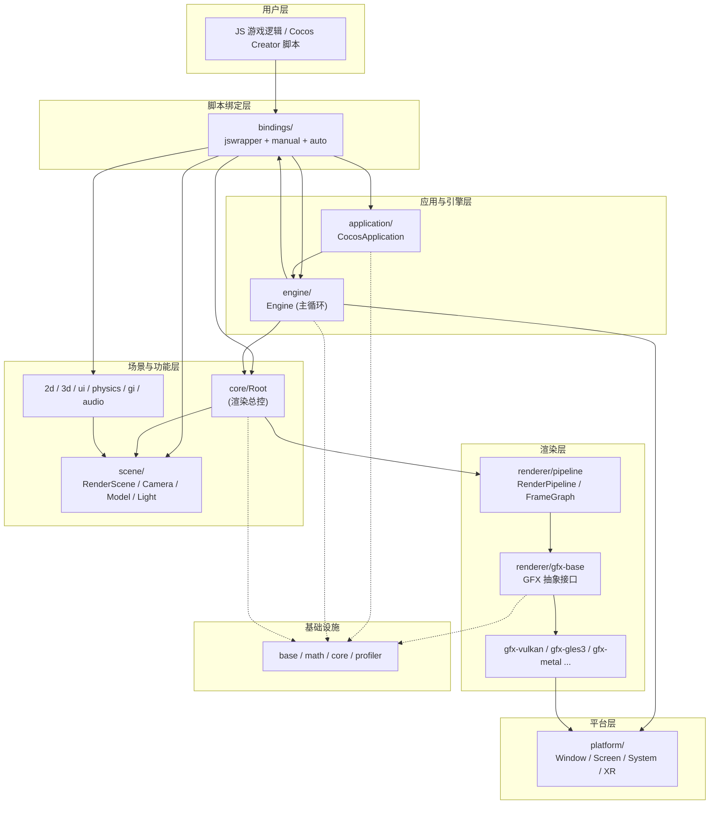

---

## 2. 代码结构（分层视图）

上面是「模块契约」视角；下面这张图从「代码目录分层」视角再次组织，二者互为补充：

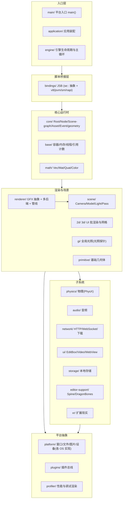

**分层原则**：上层依赖下层；`base`/`math` 是最底座（几乎被所有模块依赖）；`platform` 用「接口 + 各 OS 实现」隔离系统差异；`bindings` 把 C++ 能力暴露给 JS（Cocos Creator 脚本层）。

---

## 3. 应用与引擎装配关系

启动核心链路：`ApplicationManager` → `CocosApplication` → `BaseEngine`(`Engine`) → 各子系统。

- `CocosApplication` 通过 `BaseEngine::createEngine()` 创建引擎实例，负责监听引擎状态事件（START/RESUME/PAUSE/CLOSE），并驱动脚本引擎启动。
- `Engine` 在 `init()` 中集中装配子系统：`Scheduler`、`FileUtils`、`GFX Device`、`ProgramLib`、`BuiltinResMgr`、`Event Dispatcher` 等，并持有 `se::ScriptEngine`。

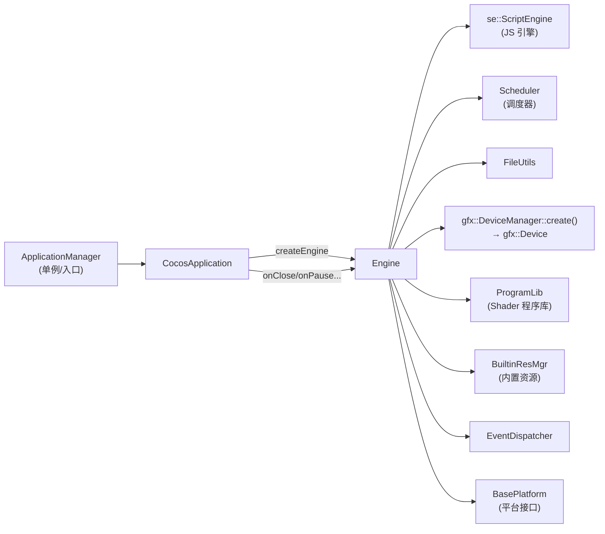

引擎持有的核心成员（见 `Engine.cpp::init/destroy`）：

| 成员 | 类型 | 作用 |
| --- | --- | --- |
| `_scriptEngine` | `se::ScriptEngine*` | JS 虚拟机与绑定注册中心 |
| `_scheduler` | `Scheduler` | 帧调度、定时器、跨线程任务 |
| `_gfxDevice` | `gfx::Device*` | 图形设备（经 DeviceManager 创建） |
| `_programLib` | `ProgramLib*` | Shader 程序缓存/编译 |
| `_builtinResMgr` | `BuiltinResMgr*` | 内置材质/贴图等资源 |
| `_fs` | `FileUtils*` | 文件系统抽象 |

---

## 4. 运行流程（启动 → 每帧）

### 4.1 启动装配链

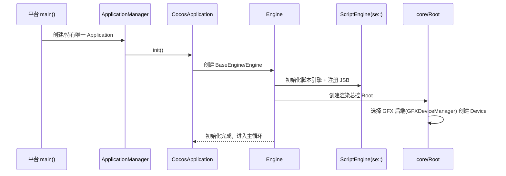

### 4.2 每帧 tick

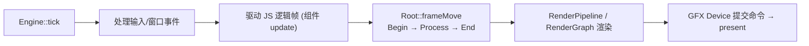

- **入口**：`main/` 里各平台的 `main()` → `application/` 装配 → `engine/Engine.cpp` 主循环。完整时序见 [application.md](./application.md)。
- **渲染总控**：`core/Root` 的 `frameMove` 串起相机、场景、管线。详见 [core.md](./core.md)。
- **渲染落地**：`renderer/` 的管线层组织绘制命令，GFX 层提交给 Vulkan。深度内容见 [renderer.md](./renderer.md)。

---

## 5. 渲染层架构（GFX 抽象 + 多后端）

渲染层是本仓库的重点。核心是 **GFX（Graphics Foundation eXtension）图形抽象层**：上层统一面向 `gfx-base` 的抽象接口编程，运行期由 `DeviceManager` 选择具体后端实现。

### 5.1 GFX 后端选择与装饰器链

`GFXDeviceManager` 按平台能力顺序尝试创建后端设备，并可叠加**代理层**与**校验层**（装饰器模式）：

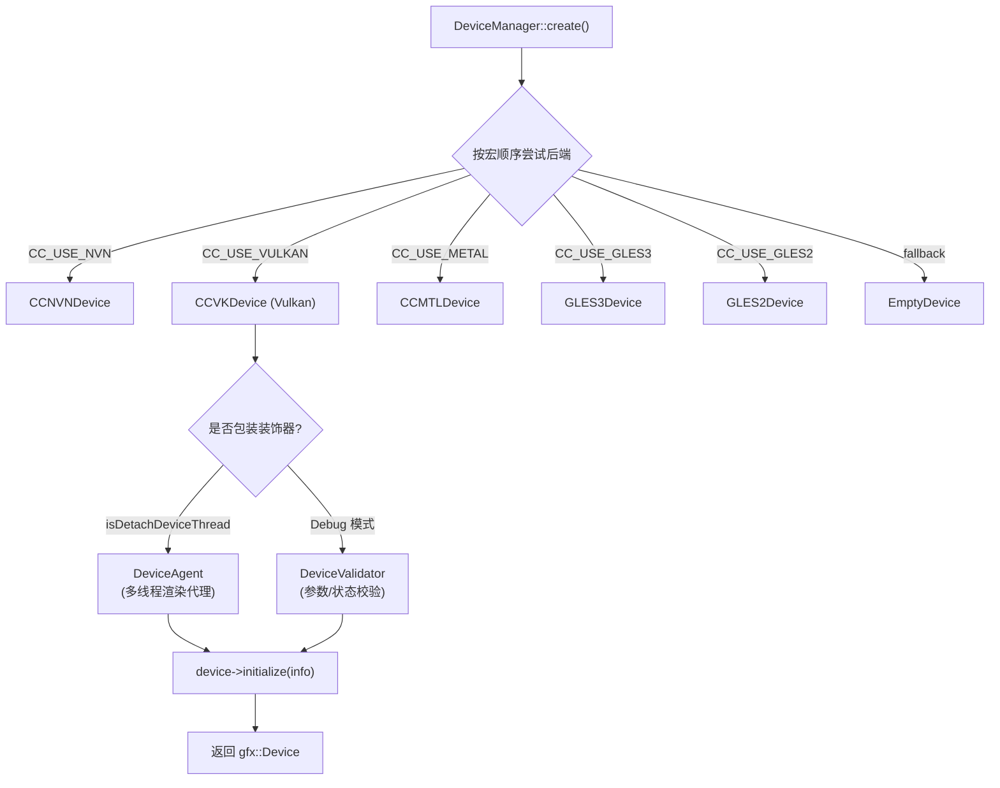

- **后端优先级**：NVN → Vulkan → Metal → GLES3 → GLES2 → Empty。Android 8 (SDK≤27) 会跳过 Vulkan。
- **DeviceAgent**（`gfx-agent/`）：在支持线程分离时包装真实设备，实现主线程 / 渲染线程解耦的命令代理。
- **DeviceValidator**（`gfx-validator/`）：Debug 构建下包装设备做接口调用校验。

### 5.2 GFX 后端目录

| 目录 | 后端 |
| --- | --- |
| `gfx-base/` | 抽象接口层（Device/Buffer/Texture/CommandBuffer/RenderPass/Shader...） |
| `gfx-vulkan/` | Vulkan 实现（本仓库重点） |
| `gfx-gles3/`、`gfx-gles2/`、`gfx-gles-common/` | OpenGL ES 实现 |
| `gfx-metal/` | Apple Metal 实现 |
| `gfx-wgpu/` | WebGPU 实现 |
| `gfx-agent/` | 多线程渲染命令代理 |
| `gfx-validator/` | 调试期接口校验层 |
| `gfx-empty/` | 空实现（编辑器/无渲染环境兜底） |

### 5.3 GFX 抽象接口核心对象

`gfx-base` 定义了一整套图形资源抽象（见目录内 `GFX*.h`）：

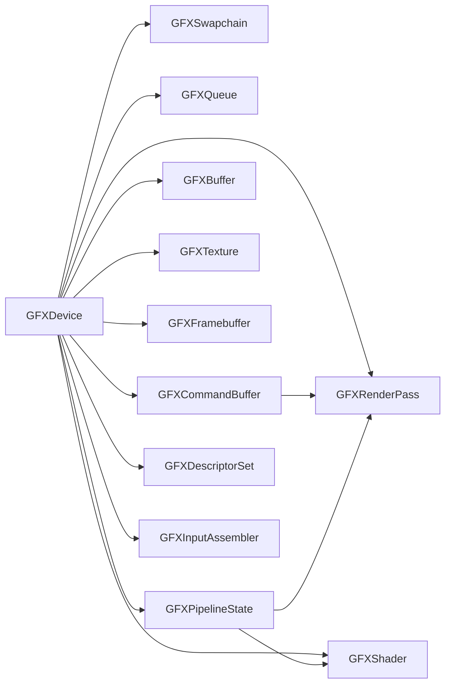

### 5.4 渲染管线（pipeline）

`renderer/pipeline` 提供渲染管线组织：`RenderPipeline` → `RenderFlow` → `RenderStage` → `RenderQueue`，并支持**自定义管线**（`pipeline/custom`，即 `PipelineRuntime` / `render::Pipeline` 接口）。

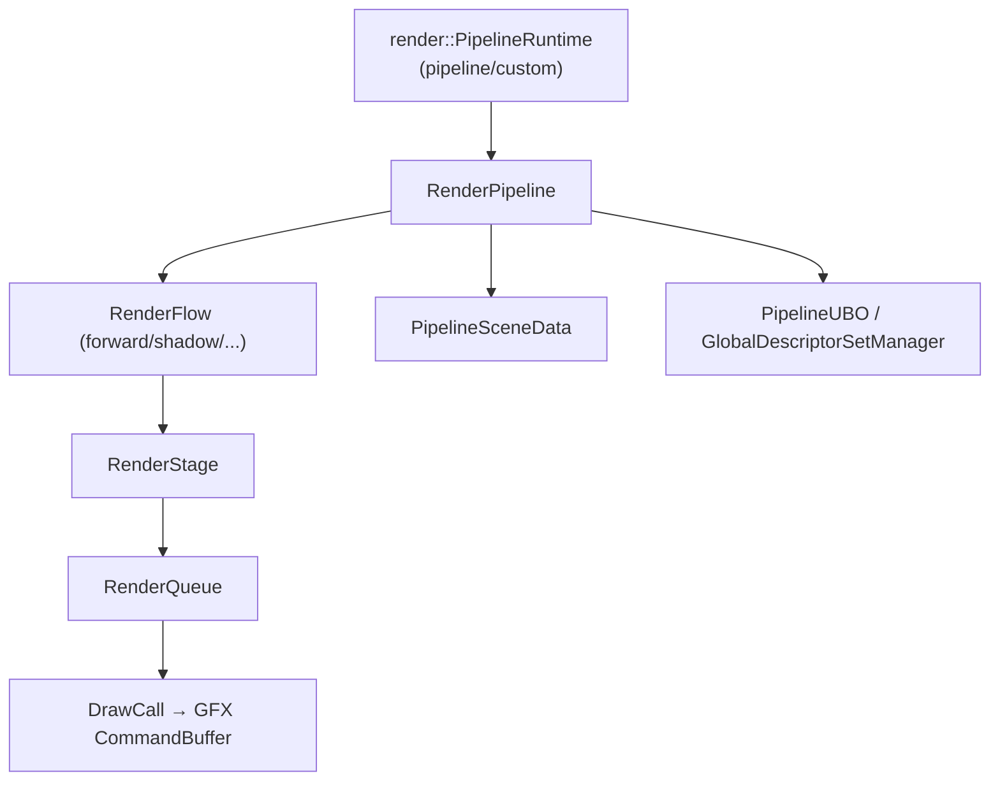

> `Root` 通过 `_usesCustomPipeline` 标志决定使用传统 `RenderPipeline` 还是自定义管线 `PipelineRuntime`（默认 `true`）。GFX 与管线的完整细节见 [renderer.md](./renderer.md)。

---

## 6. 场景层架构（Root 渲染总控）

`Root` 是渲染域的总控对象（C++ 侧无 Director，其职能由 Root + JS 层协作承担），管理窗口、场景、相机、管线，并驱动每帧的 `frameMove`。

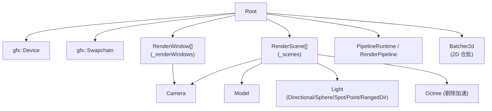

`RenderScene` 聚合渲染对象：`Model`、`Camera`、各类 `Light`、`DrawBatch2D`、`LODGroup`、`Octree`。详见 [scene.md](./scene.md) 与 [core.md](./core.md)。

---

## 7. 模块地图（全部 23 个）

> 规模＝该模块 `.h/.cpp/.mm/.c` 文件数（约数），用于判断复杂度。

### 核心运行时
| 模块 | 规模 | 一句话职责 | 文档 |
| --- | --- | --- | --- |
| `base` | ~104 | 容器、内存、线程、引用计数、日志等基础设施 | [base.md](./base.md) |
| `core` | ~159 | Root/Node/场景图/资源(Asset)/事件/几何，运行时中枢 | [core.md](./core.md) |
| `math` | ~23 | Vec/Mat/Quat/Color 数学库 | [math.md](./math.md) |
| `application` | ~7 | 应用装配与生命周期（含 engine/main 启动链与时序） | [application.md](./application.md) |

### 渲染与场景
| 模块 | 规模 | 一句话职责 | 文档 |
| --- | --- | --- | --- |
| `renderer` | ~604 | GFX 图形抽象 + 多后端(Vulkan…) + 渲染管线（深度见此文档） | [renderer.md](./renderer.md) |
| `scene` | ~53 | 渲染场景对象：Camera/Model/Light/Pass/RenderScene | [scene.md](./scene.md) |
| `2d` | ~12 | 2D/UI 批渲染（Batcher2d） | [2d.md](./2d.md) |
| `3d` | ~22 | 3D 网格资源、蒙皮/形变模型 | [3d.md](./3d.md) |
| `gi` | ~13 | 全局光照（光照探针 Light Probe） | [gi.md](./gi.md) |
| `primitive` | ~25 | 程序化基础几何体（Box/Sphere…） | [primitive.md](./primitive.md) |
| `ui` | ~21 | 原生 UI 控件：EditBox/VideoPlayer/WebView | [ui.md](./ui.md) |

### 子系统
| 模块 | 规模 | 一句话职责 | 文档 |
| --- | --- | --- | --- |
| `physics` | ~66 | 物理引擎抽象 + PhysX 后端 | [physics.md](./physics.md) |
| `audio` | ~101 | 音频播放/解码（多平台后端） | [audio.md](./audio.md) |
| `network` | ~28 | HTTP/WebSocket/下载器 | [network.md](./network.md) |
| `storage` | ~3 | 本地键值存储(SQLite) | [storage.md](./storage.md) |
| `editor-support` | ~442 | Spine / DragonBones 骨骼动画运行时 | [editor-support.md](./editor-support.md) |
| `xr` | ~2 | XR 远程预览 | [xr.md](./xr.md) |

### 平台与工具
| 模块 | 规模 | 一句话职责 | 文档 |
| --- | --- | --- | --- |
| `platform` | ~252 | 窗口/文件/图片/设备的接口 + 各 OS 实现 | [platform.md](./platform.md) |
| `bindings` | ~190 | JSB 脚本绑定（se:: 抽象 + 多 JS 引擎） | [bindings.md](./bindings.md) |
| `plugins` | ~5 | 插件事件总线 | [plugins.md](./plugins.md) |
| `profiler` | ~5 | 性能统计与调试渲染 | [profiler.md](./profiler.md) |
| `main` | ~1 | 平台入口占位（并入 application 文档） | [application.md](./application.md) |

---

## 8. 脚本绑定层架构（JSB）

`bindings/` 将 C++ 引擎能力暴露给 JS，是 Cocos Creator 脚本运行的桥梁。

```mermaid
graph TD
    subgraph 抽象封装
        SEAPI["jswrapper/SeApi.h<br/>(se:: 统一抽象)"]
        VALUE["Value / Object / Class / State"]
    end
    subgraph JS 引擎后端(编译期择一)
        V8["v8/ (默认)"]
        SM["sm/ (SpiderMonkey)"]
        NAPI["napi/"]
        JSVM["jsvm/"]
    end
    subgraph 绑定代码
        AUTO["auto/<br/>(工具自动生成绑定)"]
        MANUAL["manual/<br/>(手写绑定 + 转换)"]
        EVENT["event/EventDispatcher"]
        DOP["dop/<br/>(数据缓冲池)"]
    end

    SEAPI --> V8
    SEAPI --> SM
    SEAPI --> NAPI
    SEAPI --> JSVM
    AUTO --> SEAPI
    MANUAL --> SEAPI
    MANUAL --> VALUE
```

- **`jswrapper`**：`se::` 命名空间的抽象层，统一屏蔽底层 JS 引擎差异（`ScriptEngine` / `Object` / `Value` / `Class`），后端可选 v8 / sm / napi / jsvm。
- **`auto`**：由工具从 C++ 头生成的批量绑定（`register_all_engine`、`register_all_gfx`、`register_all_pipeline` 等）。
- **`manual`**：手写绑定与类型转换（`jsb_conversions*`、`jsb_module_register`、各 `jsb_*_manual`）。
- **`event`**：`EventDispatcher` 承担 C++ → JS 的事件派发。
- **模块注册顺序**（见 `jsb_module_register.cpp::jsb_register_all_modules`）：global → engine → cocos_manual → platform → gfx → network → extension → dop → assets → pipeline → geometry ...（存在依赖顺序，如 pipeline 依赖 asset）。详见 [bindings.md](./bindings.md)。

---

## 9. 平台层

`platform/interfaces/modules` 定义了一组平台能力接口，由各平台具体实现，引擎通过 `BasePlatform::getInterface<T>()` 获取：

| 接口 | 职责 |
| --- | --- |
| `ISystemWindow` / `ISystemWindowManager` | 窗口创建与管理 |
| `IScreen` | 屏幕尺寸 / DPR |
| `ISystem` | 系统信息 |
| `IAccelerometer` / `IVibrator` / `IBattery` / `INetwork` | 传感器与设备能力 |
| `IXRInterface` | XR（VR/AR）支持 |

详见 [platform.md](./platform.md)。

---

## 10. 代码风格与约定（重要）

理解这些约定能大幅提升阅读/修改代码的准确度：

### 10.1 命名与文件
| 约定 | 说明 | 示例 |
| --- | --- | --- |
| 文件头 | 每个源文件顶部有 MIT 许可证注释块 | 见任意 `.h` |
| 类名 | PascalCase | `RenderPipeline`、`CCVKDevice` |
| 方法名 | camelCase | `frameMove()`、`createBuffer()` |
| 成员变量 | `_` 前缀 + camelCase | `_device`、`_flows` |
| 常量/枚举值 | UPPER_SNAKE | `MAX_CPU_FRAME_AHEAD`、`SetIndex::GLOBAL` |
| 枚举 | 一律 `enum class`（强类型） | `enum class Format : uint32_t` |
| 命名空间 | 顶层 `cc`，再按域嵌套 | `cc::gfx`、`cc::scene`、`cc::pipeline`、`cc::se` |

### 10.2 内存与生命周期
- **引用计数**：基类 `RefCounted`（`base/RefCounted.h`）+ 智能指针 `IntrusivePtr<T>`（`base/Ptr.h`）。这是引擎主要的对象管理方式（侵入式引用计数）。
- **裸指针语义靠注释标注**：代码里常见 `// weak reference`（弱引用，不持有）与 `// manage memory manually`（手动管理，需显式 delete）。**修改时务必遵循这些注释**。
- **延迟释放**：`base/DeferredReleasePool.h`、`base/threading/AutoReleasePool.h`。

### 10.3 容器与基础设施
- 使用 **`ccstd::`** 命名空间下的容器（`base/std/container/`），而非直接用 `std::`：`ccstd::vector`、`ccstd::unordered_map`、`ccstd::string`、`ccstd::hash_t` 等。它们是对 STL 的封装（便于替换分配器/调试）。
- 导出宏 **`CC_DLL`** 标注跨 DLL 边界的公开符号。
- 特性开关宏 **`CC_USE_XXX`**（如 `CC_USE_VULKAN`、`CC_USE_GEOMETRY_RENDERER`、`CC_USE_OCCLUSION_QUERY`）用 `#if` 条件编译。

### 10.4 常见设计模式
| 模式 | 位置 | 作用 |
| --- | --- | --- |
| 抽象工厂 | `gfx::Device::createXXX` | 后端无关地创建 GPU 资源 |
| 装饰器 | `DeviceValidator → DeviceAgent → 真实 Device` | 叠加校验/多线程能力，对上层透明 |
| 代理 + 消息队列 | `renderer/gfx-agent` + `base/threading/MessageQueue` | 主线程录制、渲染线程执行 |
| 单例 | `ApplicationManager`、`RenderPipeline::getInstance()` | 全局访问点 |
| 图（Graph） | `pipeline/custom` RenderGraph / LayoutGraph | 可编程渲染管线 |
| 事件/观察者 | `core/event`、`bindings/event` | 解耦通知 |

### 10.5 脚本绑定约定
- 头部注释中的 `@en` / `@zh` 是给绑定工具与文档用的中英说明（尤其 `pipeline/custom`）。
- `jsb_` 前缀文件是手动绑定；`se::` 是脚本引擎抽象层。详见 [bindings.md](./bindings.md)。

---

## 11. 依赖关系速查

### 11.1 模块级依赖

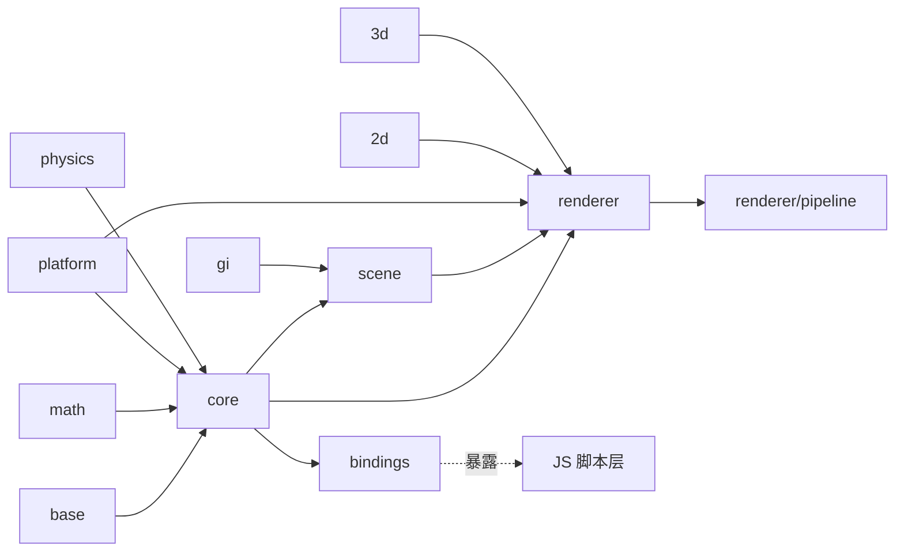

### 11.2 关键依赖关系总结

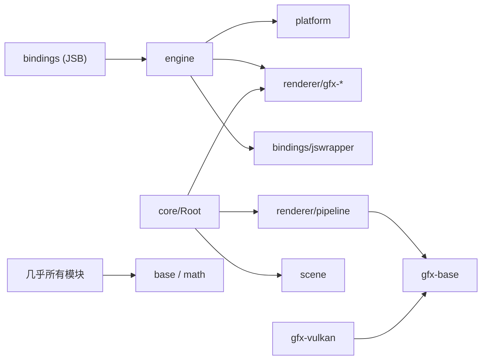

**依赖原则**：上层依赖下层抽象；`gfx-base` 是渲染层稳定接口边界；`base`/`math` 为全局基础设施被普遍依赖；`bindings` 横切各模块以暴露 JS API。

- **谁都依赖**：`base`、`math`。
- **枢纽**：`core`（Root/Node/Asset）串起场景、渲染、脚本。
- **隔离层**：`platform`（系统差异）、`bindings`（语言边界）、`renderer/gfx-base`（后端差异）。

---

## 12. 修改代码前的检查清单

1. 该对象是 `RefCounted` 吗？用 `IntrusivePtr` 还是裸指针（看 `// weak reference` 注释）。
2. 用的是 `ccstd::` 容器而非 `std::`。
3. 跨 DLL 的公开类/函数是否需要 `CC_DLL`。
4. 是否被某个 `CC_USE_XXX` 宏包裹（平台/特性相关）。
5. 涉及渲染资源创建，是否应走 `gfx::Device::createXXX` 抽象而非直接调后端。
6. 若改动会暴露给脚本，是否需要同步 `bindings/`。

---

> 本指南基于当前源码梳理，随引擎迭代请以源码为准。各模块细节见同目录下对应 `.md`（`renderer.md` 含 GFX/管线深度，[application.md](./application.md) 含启动时序）。
