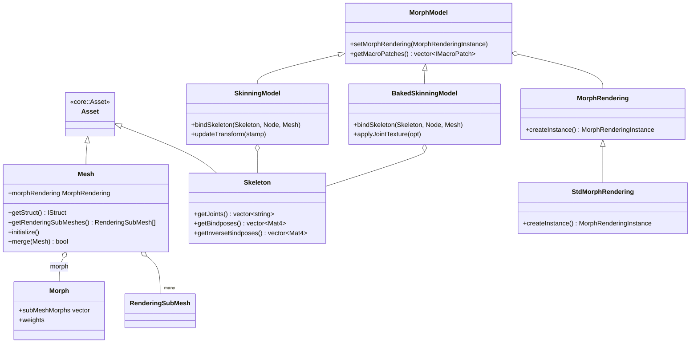

# 3d 模块详解

> 根目录：`native/cocos/3d/` · 规模：~22 文件 · 语言：C++17
> 关联文档：[00-overview](./00-overview.md) · [scene](./scene.md) · [core](./core.md) · [renderer](./renderer.md) · [primitive](./primitive.md)

## 1. 模块职责与定位

`3d` 模块提供 **3D 网格资源** 与 **蒙皮/形变可渲染模型** 的原生实现，是 3D 渲染内容的「数据源」：

- **网格资源（assets/）**：`Mesh` 描述顶点块（`IVertexBundle`）、子网格（`ISubMesh`）、包围盒与形变数据；`Skeleton` 描述骨骼层级与绑定姿势；`Morph`/`MorphRendering` 描述 BlendShape 形变。
- **可渲染模型（models/）**：把 `Mesh` + `Skeleton` 组合成可在 `scene` 中渲染的模型——`SkinningModel`（实时蒙皮）、`BakedSkinningModel`（烘焙蒙皮，骨骼动画预存纹理）、`MorphModel`（形变模型）。
- **辅助（misc/、skeletal-animation/）**：`CreateMesh` 从数据构建网格，`Buffer`/`BufferBlob` 管理二进制缓冲，`SkeletalAnimationUtils` 提供关节纹理等工具。

它与 [scene](./scene.md) 的关系：`3d` 的模型类继承 `scene::Model`/`scene::MorphModel`（位于 `3d/models/`），最终以 `scene::Model` 的身份被 `RenderScene` 持有并参与管线绘制。

## 2. 目录树与子目录说明

```
3d/
├── assets/                 # 3D 资源定义
│   ├── Mesh.h/.cpp         # 网格资源（顶点/索引/子网格/包围盒）
│   ├── Skeleton.h/.cpp     # 骨骼资源（关节路径 + 绑定姿势）
│   ├── Morph.h             # 形变数据结构（MorphTarget/SubMeshMorph/Morph）
│   ├── MorphRendering.h/.cpp # 形变渲染抽象（含 StdMorphRendering）
│   └── Types.h             # 3D 公共类型（MeshWeightsType/IBArray）
├── models/                 # 可渲染模型（继承 scene::Model）
│   ├── SkinningModel.h/.cpp     # 实时蒙皮模型
│   ├── BakedSkinningModel.h/.cpp# 烘焙蒙皮模型（骨骼动画→纹理）
│   └── MorphModel.h/.cpp        # 形变模型基类
├── misc/                   # 网格构建与缓冲
│   ├── CreateMesh.h/.cpp   # 从数据构建 Mesh
│   ├── Buffer.h/.cpp       # 通用缓冲
│   └── BufferBlob.h/.cpp   # 二进制数据块
└── skeletal-animation/
    └── SkeletalAnimationUtils.h/.cpp # 骨骼动画工具（关节纹理句柄等）
```

> 注：`scene/Skin.h` 提供蒙皮基础结构，真正皮肤矩阵计算在本模块的 `SkinningModel` 中完成。

## 3. 关键类 / 结构体

| 类 / 结构体 | 关键成员（真实签名摘要） | 职责 |
| --- | --- | --- |
| `Mesh` | `getStruct()`（`IStruct`）、`getRenderingSubMeshes()`、`initialize()`、`merge()`、`readAttribute()`、`morphRendering` | 网格资源：顶点块 + 子网格 + 包围盒；`onLoaded()` 时 `initialize()` 生成 `RenderingSubMesh` |
| `Skeleton` | `getJoints()`、`getBindposes()`、`getInverseBindposes()`、`getHash()` | 骨骼资源：关节路径数组 + 绑定姿势矩阵（与 `bindposes` 等长） |
| `Morph` | `subMeshMorphs`、`weights`、`targetNames` | 形变小结构：每个子网格的形变目标与权重 |
| `MorphRendering` / `MorphRenderingInstance` | `createInstance()`、`setWeights()`、`adaptPipelineState()`、`requiredPatches()` | 形变渲染抽象：GPU/CPU 混合，子目标数 < `UBOMorph.MAX_MORPH_TARGET_COUNT` 时走 GPU |
| `StdMorphRendering` | `createInstance()` | 标准形变渲染实现（持有各子网格 `SubMeshMorphRendering`） |
| `SkinningModel` | `bindSkeleton(Skeleton, Node, Mesh)`、`updateTransform()`、`uploadJointData()`、`initRealTimeJointTexture()` | 实时蒙皮：每帧计算骨骼矩阵写入关节缓冲/实时关节纹理 |
| `BakedSkinningModel` | `bindSkeleton()`、`applyJointTexture()`、`updateModelBounds()` | 烘焙蒙皮：采样预烘焙的关节纹理，省去运行时骨骼计算 |
| `MorphModel` | `setMorphRendering()`、`getMacroPatches()` | 形变模型基类（继承 `scene::Model`） |
| `CreateMesh` | 从 `IStruct` + 二进制数据构建 `Mesh` | 网格反序列化/构建工具 |
| `Buffer` / `BufferBlob` | 顶点/索引二进制缓冲与块封装 | 网格二进制数据的承载与读写 |
| `SkeletalAnimationUtils` | 关节纹理句柄 `IJointTextureHandle`、`IAnimInfo` | 骨骼动画底层工具（被蒙皮模型复用） |
| `RenderingSubMesh` | （定义于 `core/assets/`）`Mesh::getRenderingSubMeshes()` 返回 | 单个可渲染子网格：供 `scene::SubModel` 直接持有 |

`Mesh::IStruct` 关键子结构：`IVertexBundle{ view, attributes }`、`ISubMesh{ vertexBundelIndices, primitiveMode, indexView, jointMapIndex, cluster }`、`IMeshCluster{ clusterView, triangleView, vertexView, coneView }`（用于网格着色/集群剔除）。

`Morph`/`SubMeshMorph` 的数据组织：`SubMeshMorph::attributes` 列出参与形变的顶点属性（如 `a_position`/`a_normal`），`targets` 为各形变目标（每个 `MorphTarget` 含若干 `IMeshBufferView` 位移数据），`weights` 为初始权重（`MeshWeightsType` = `vector<float>`）；`Morph::targetNames` 仅在每子网格目标数相同时有意义。运行时每个 `MorphRenderingInstance::setWeights(subMeshIndex, weights)` 设置权重，`requiredPatches()` 返回需要注入 Shader 的宏补丁（驱动 `Pass::getShaderVariant()` 生成形变变体）。形变与蒙皮可叠加：`SkinningModel`/`BakedSkinningModel` 均继承 `MorphModel`，同时支持骨骼变换与 BlendShape。

## 4. 关键枚举 / 常量

本模块以**数据结构**为主，类型别名与判别类型如下（无独立 `enum class`）：

```cpp
// Types.h
using MeshWeightsType = ccstd::vector<float>;          // 形变目标权重
using IBArray = ccstd::variant<ccstd::monostate,
                               Uint8Array, Uint16Array, Uint32Array>; // 索引缓冲视图

// Mesh.h —— 动态网格信息
struct IDynamicInfo  { uint32_t maxSubMeshes, maxSubMeshVertices, maxSubMeshIndices; };
struct IDynamicStruct { IDynamicInfo info; ccstd::vector<geometry::AABB> bounds; };

// Morph.h
struct IMeshBufferView { uint32_t offset, length, count, stride; };
struct MorphTarget     { ccstd::vector<IMeshBufferView> displacements; };
struct SubMeshMorph    { ccstd::vector<ccstd::string> attributes;
                         ccstd::vector<MorphTarget> targets;
                         ccstd::optional<MeshWeightsType> weights; };

// 网格图元类型来自 renderer/gfx-base
gfx::PrimitiveMode primitiveMode;   // 如 TRIANGLE_LIST（见 ISubMesh）
```

关节相关：`SkinningModel` 内部 `JointInfo{ bound, target, bindpose, transform, buffers, indices }`；`BakedSkinningModel` 内部 `BakedJointInfo{ buffer, jointTextureInfo, texture, animInfo, boundsInfo }`。

`Mesh::IStruct` 还有 `jointMaps`（`vector<vector<index_t>>`）与每个 `ISubMesh` 的 `jointMapIndex`：当子网格 VB 内关节索引不直接对应 `Skeleton` 数据时，通过 `jointMapIndex` 指向 `jointMaps` 中的映射表，实现子网格级关节重映射（用于合批/裁剪后仅保留用到的关节）。`IMeshCluster{ clusterView, triangleView, vertexView, coneView }` 为网格着色（Mesh Shader）与集群裁剪（cluster culling）预留的几何聚类数据，可选。`IDynamicInfo`/`IDynamicStruct` 描述动态网格的预分配容量（最大子网格数/顶点数/索引数）与每子网格包围盒，供运行时 `Mesh::updateSubMesh()` 增量更新。

## 5. 类关系图



## 6. 与上下层交互

- **上游（core / primitive）**：`Mesh` 继承 `core::Asset`，经 `onLoaded()` 解析二进制数据生成 `core::assets::RenderingSubMesh`；基础几何体可由 [primitive](./primitive.md) 的 `IGeometry`/`createGeometry()` 生成后再封装为 `Mesh`。`Skeleton` 的关节路径指向 `core::Node`。
- **下游（scene / renderer）**：`SkinningModel`/`BakedSkinningModel`/`MorphModel` 均继承 `scene::Model`/`scene::MorphModel`，以 `scene::Model` 身份进入 `RenderScene`；蒙皮结果写入局部 UBO 或关节纹理，`MorphModel::getMacroPatches()` 向管线提供形变宏补丁，由 `scene::SubModel` 的 `Pass::getShaderVariant()` 生成对应 Shader 变体。
- **动画系统**：`skeletal-animation/SkeletalAnimationUtils` 提供关节纹理句柄，被蒙皮模型在 `bindSkeleton()`/`updateTransform()` 中调用；动画驱动来自 `core/animation`（不在本模块）。
- **渲染资源**：顶点/索引 GPU 缓冲由 `Mesh::createVertexBuffers()` 通过 `gfx::Device` 创建（见 [03-gfx-deep-dive](./renderer.md)）。

**典型数据流**：`Mesh`（资源，含 `IStruct` + 二进制）→ `onLoaded()`/`initialize()` 解析为 `RenderingSubMesh` 列表 → `SkinningModel::bindSkeleton()` 绑定 `Skeleton` → 每帧 `updateTransform()` 计算骨骼矩阵（写入局部 UBO 或 `RealTimeJointTexture`）→ 以 `scene::Model` 进入 `RenderScene` 参与剔除与绘制。`Morph` 数据经 `createMorphRendering()` 创建 `StdMorphRendering`，每个子网格持有独立 `MorphRenderingInstance` 控制权重与混合策略。

## 7. 修改 / 扩展要点

1. **新增网格属性/布局**：修改 `Mesh::IStruct` / `IVertexBundle` / `ISubMesh`，并同步 `Mesh::tryConvertVertexData()` 与 `createVertexBuffers()`；注意 `readAttribute()`/`copyAttribute()` 的访问器逻辑。
2. **新增蒙皮模型类型**：继承 `scene::Model` 或 `MorphModel`，实现 `initSubModel()/updateTransform()/updateUBOs()/updateLocalDescriptors()`；若需 JS 实现，注意 `scene::Model::isModelImplementedInJS()` 的判定范围。
3. **形变（Morph）扩展**：新增形变目标需在 `Morph` 结构与 `StdMorphRendering` 中支持；目标数超过 `pipeline::UBOMorph::MAX_MORPH_TARGET_COUNT` 会自动回退到 CPU 混合，扩展前应确认该上限。
4. **烘焙蒙皮**：`BakedSkinningModel` 依赖预烘焙的关节纹理（`IJointTextureHandle`），扩展动画格式时需同步 `BakedJointInfo` 与 `syncDataForJS()`。
5. **内存与生命周期**：`Mesh`/`Skeleton` 为 `RefCounted`，`destroy()` 会释放 GPU 资源（`destroyRenderingMesh()`）；`JointInfo::transform` 等为 `IntrusivePtr`，避免循环引用。
6. **性能敏感路径**：`SkinningModel::updateTransform()` 每帧执行，注意 `ensureEnoughBuffers()` 的容量增长与 `RealTimeJointTexture` 的更新频率；大量同类角色优先用 `BakedSkinningModel`。
7. **资源释放顺序**：`Mesh::destroy()` 会先 `destroyRenderingMesh()` 再释放 `Asset` 基类；`Skeleton` 的 `bindposes` 与 `joints` 必须等长（见 `Skeleton::validate()`），新增骨骼资源导入逻辑时需保证两者一致。
8. **合并网格**：`Mesh::merge()` 要求两个网格顶点块数目/布局一致且子网格布局一致（图元类型、引用的顶点块索引、是否索引绘制），校验逻辑在 `validateMergingMesh()` 中；合并常用于静态合批优化。
