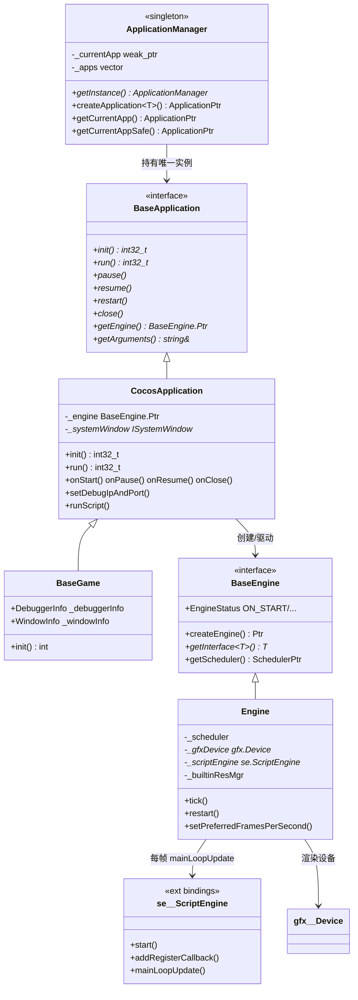
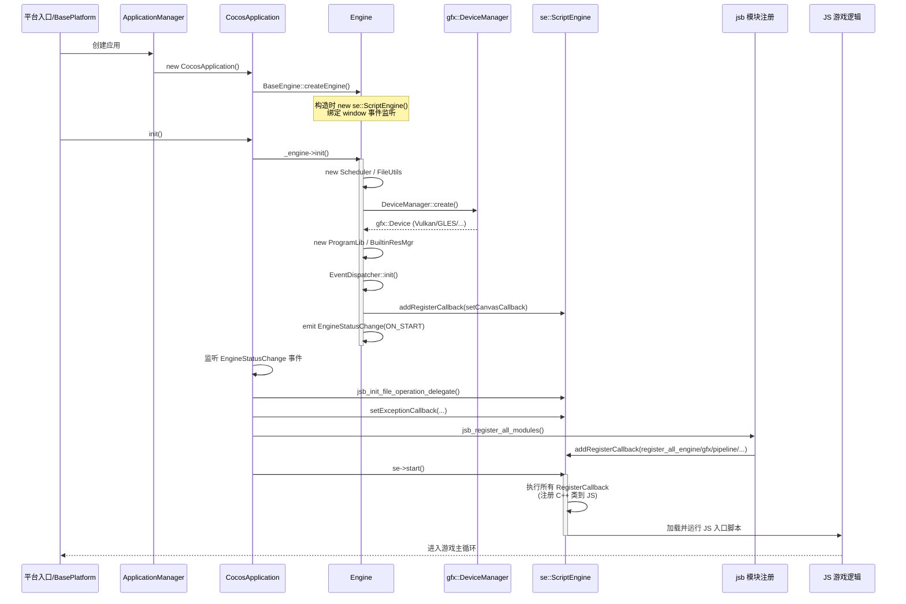
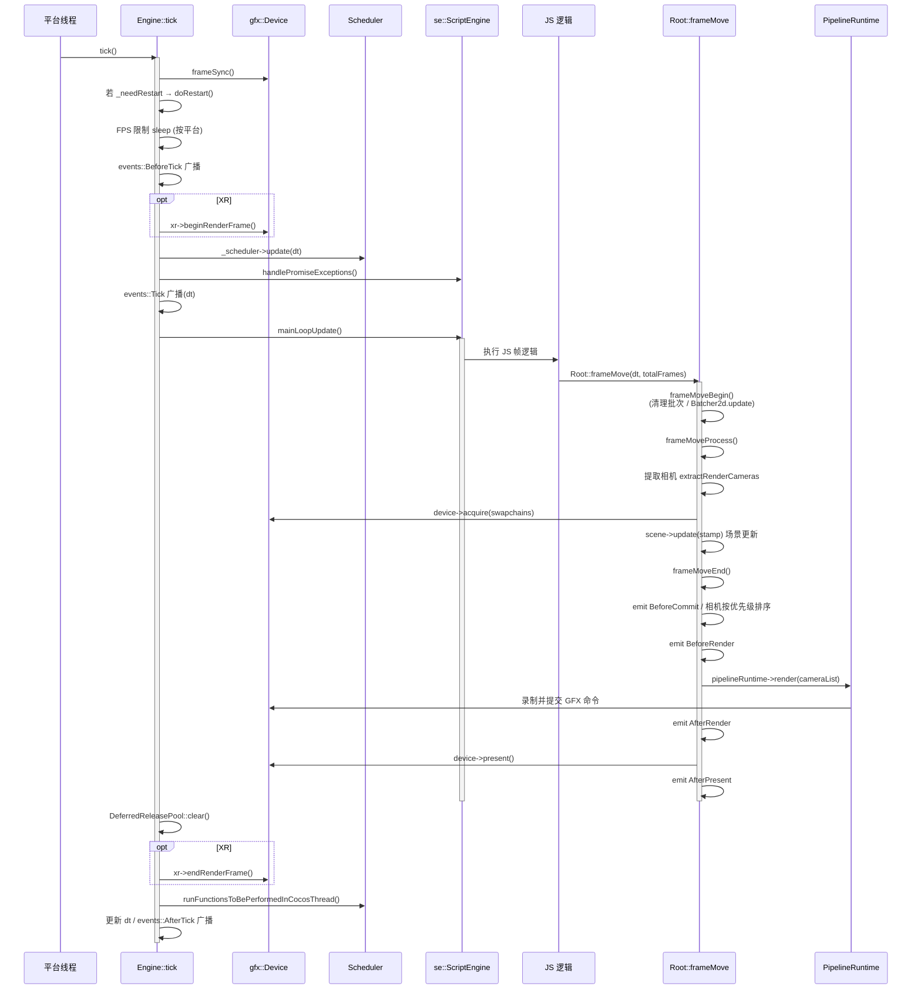
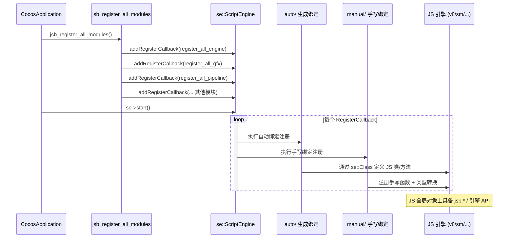
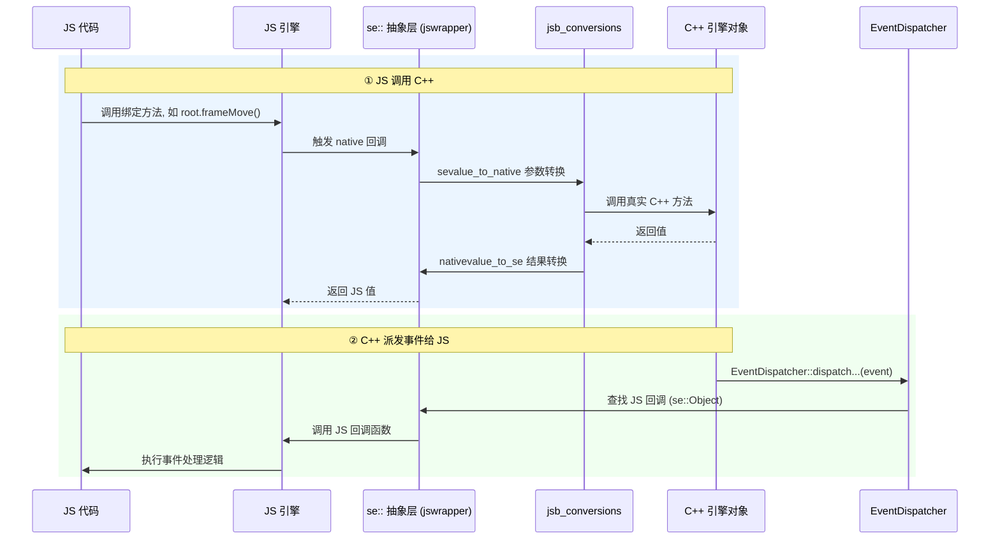
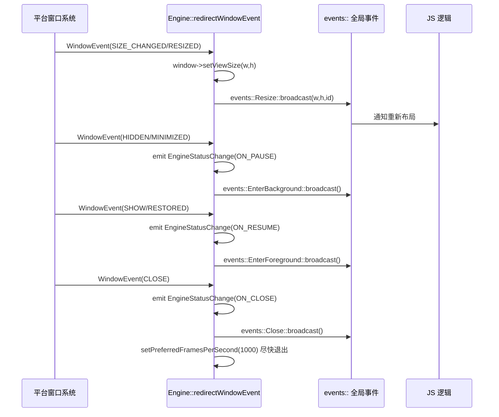
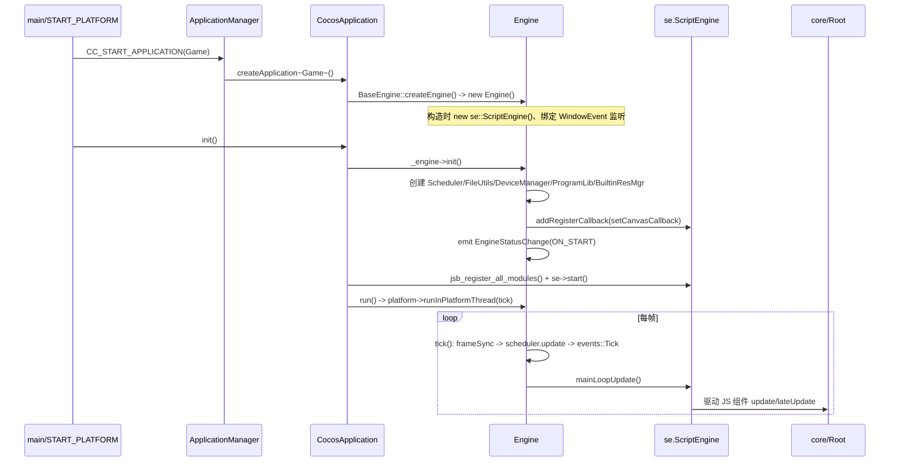

# application 模块详解

> 根目录：`native/cocos/application/`(8 文件) · `native/cocos/engine/`(5 文件) · `native/cocos/main/`(1 文件) · 规模：~14 文件 · 语言：C++17
> 关联文档：[00-overview](./00-overview.md) · [01-architecture](./00-overview.md) · [core](./core.md) · [bindings](./bindings.md) · [platform](./platform.md)

`application/`、`engine/`、`main/` 三者共同构成 Cocos Native 的**入口装配层与引擎生命周期**，相互耦合，故合并讲解。它们负责把操作系统入口、平台抽象层、脚本引擎（JSB）与渲染核心（`core/Root`、`renderer`）串成一条可运行的启动链。

> 启动、每帧 tick、脚本绑定与窗口事件的**完整时序图**见下文 [`## 时序图`](#时序图)；其中每帧渲染在 `Root::frameMove` 内部的细分流程（Begin / Process / End）另有专章，见 [core](./core.md) 的「每帧流程 (Root::frameMove)」。

## 1. 模块职责与定位

- **`main/`**：操作系统级 `main()` 占位。真正的平台入口由各 `platform/<os>/` 提供，这里仅调用 `START_PLATFORM` 宏把控制权交给平台层（`main/EmptyMain.cpp`）。
- **`application/`**：应用装配层。持有全局唯一的 `BaseApplication` 实例（`ApplicationManager` 单例），负责创建 `Engine`、初始化脚本引擎、注册 JSB 模块、驱动主循环。
- **`engine/`**：引擎生命周期与**每帧主循环（tick）**。在 `Engine::init` 中创建调度器、文件系统、GFX 设备、内置资源管理器，并在 `Engine::tick` 中完成输入轮询、逻辑帧、脚本更新与渲染提交。

三者与上下层关系：`main` → `platform::BasePlatform::getPlatform()` → `ApplicationManager` → `CocosApplication` → `Engine` → `se::ScriptEngine` + `core/Root`。

## 2. 目录树与子目录说明

```
native/cocos/
├── main/
│   └── EmptyMain.cpp            # 平台入口占位，调用 START_PLATFORM
├── application/
│   ├── ApplicationManager.h/.cpp # 全局单例，持有/创建当前 Application
│   ├── BaseApplication.h         # 应用接口（纯虚生命周期方法）
│   ├── CocosApplication.h/.cpp   # 标准应用实现：装配引擎与脚本
│   ├── BaseGame.h/.cpp           # 用户可继承的游戏基类（窗口/调试器配置）
│   └── BaseApplication.h         # (同上接口定义)
└── engine/
    ├── BaseEngine.h/.cpp         # 引擎接口 + 生命周期事件
    ├── Engine.h/.cpp             # 引擎实现：tick 主循环、重启、资源销毁
    └── EngineEvents.h            # 引擎事件定义（窗口/输入/帧事件总线）
```

> 注：`application/` 实际 8 个文件（`ApplicationManager`、`BaseApplication`、`CocosApplication`、`BaseGame` 各含 `.h/.cpp`）。

各文件职责速查：

| 文件 | 职责 |
| --- | --- |
| `application/ApplicationManager.h/.cpp` | 全局单例，创建/持有/释放 `BaseApplication`；定义 `CC_*` 访问宏 |
| `application/BaseApplication.h` | 应用接口（纯虚生命周期 + `getArguments`） |
| `application/CocosApplication.h/.cpp` | 标准应用：构造建 `Engine`、装配脚本引擎、驱动主循环 |
| `application/BaseGame.h/.cpp` | 用户游戏基类，封装窗口/调试器配置 |
| `engine/BaseEngine.h/.cpp` | 引擎接口 + `createEngine()` + 生命周期事件 |
| `engine/Engine.h/.cpp` | 引擎实现：`tick` 主循环、资源创建/销毁、窗口事件翻译 |
| `engine/EngineEvents.h` | 窗口/输入/帧事件结构与事件总线定义 |
| `main/EmptyMain.cpp` | 平台入口占位，`START_PLATFORM` 交权给平台层 |

## 3. 关键类 / 结构体

### ApplicationManager（`application/ApplicationManager.h`）
全局单例（`getInstance()` 返回静态局部变量）。核心成员：
- `createApplication<T>(argc, argv)`：模板方法，用 `std::make_shared<T>()` 创建应用、记录命令行参数、设为当前应用。约束 `T` 必须继承 `BaseApplication`。
- `getCurrentApp()` / `getCurrentAppSafe()`：返回 `std::weak_ptr<BaseApplication>` 锁出的 `ApplicationPtr`（后者在失效时 `CC_ASSERT`）。
- `releaseAllApplications()`：清空所有应用（由平台层 `cocos_destroy()` 调用）。

辅助宏（`ApplicationManager.h` 末尾）贯穿全引擎：
- `CC_CURRENT_ENGINE()` → `CC_CURRENT_APPLICATION_SAFE()->getEngine()`
- `CC_GET_PLATFORM_INTERFACE(intf)` → `CC_CURRENT_ENGINE()->getInterface<intf>()`
- `CC_GET_MAIN_SYSTEM_WINDOW()` → 取 `ISystemWindow::mainWindowId` 对应的窗口
- `CC_START_APPLICATION(className)` / `CC_REGISTER_APPLICATION(className)`：用户 `main` 的标准写法。

### BaseApplication（`application/BaseApplication.h`）
纯接口类，`ApplicationManager` 的友元。定义生命周期纯虚函数：`init()`、`run()`、`pause()`、`resume()`、`restart()`、`close()`、`getEngine()`、`getArguments()`；以及受保护的内部方法 `setArgumentsInternal()`。

### CocosApplication（`application/CocosApplication.h`）
`BaseApplication` 的标准实现，也是大多数游戏的基类（`BaseGame` 再继承它）。关键成员：
- 构造时调用 `BaseEngine::createEngine()` 得到 `_engine`（`BaseEngine::Ptr`）。
- 覆写 `init()`：先 `_engine->init()`，再监听 `EngineStatusChange` 事件（映射到 `onStart/onPause/onResume/onClose`），随后初始化脚本引擎——`jsb_init_file_operation_delegate()`、`se->setExceptionCallback(...)`、`jsb_register_all_modules()`、`se->start()`，最后触发 iOS 下的 `events::Resize::broadcast`。
- `run()` 直接转发给 `_engine->run()`；`close()` 调用 `_systemWindow->closeWindow()`。
- 虚回调钩子：`onStart()`、`onPause()`、`onResume()`、`onClose()`，以及 `setDebugIpAndPort()`（→ `jsb_enable_debugger`）、`runScript()`（→ `jsb_run_script`）、`handleException()`（打印到日志）、`setXXTeaKey()`。
- 桌面平台额外提供 `createWindow(title, ...)` 重载，转发到 `ISystemWindow`。

> **启动 / 生命周期链路（与 [`## 时序图`](#时序图) 对应）**：`CocosApplication` 构造即经 `BaseEngine::createEngine()` 创建 `Engine`（内部 `new se::ScriptEngine()` 并绑定窗口事件回调 `redirectWindowEvent`）；`init()` 装配全部原生子系统后 `emit(ON_START)`，再注册并启动 JSB；`run()` 把 `tick` 提交到平台主循环。JSB 注册回调有严格的顺序依赖：`global → engine → cocos_manual → platform → gfx → network → extension → dop → assets → pipeline → geometry`。

### BaseGame（`application/BaseGame.h`）
用户项目通常继承它。内嵌两个配置结构体：
- `DebuggerInfo{ enabled, port=6086, address="0.0.0.0", pauseOnStart }`
- `WindowInfo{ title, x, y, width, height, flags }`
覆写 `int init()`，持有 `_xxteaKey`、`_debuggerInfo`、`_windowInfo`、`std::once_flag _windowCreateFlag`。

### BaseEngine / Engine（`engine/`）
- `BaseEngine`（`BaseEngine.h`）：接口类，继承 `enable_shared_from_this`，通过 `IMPL_EVENT_TARGET` 暴露 `EngineStatusChange(EngineStatus)` 事件；`EngineStatus` 枚举：`ON_START / ON_PAUSE / ON_RESUME / ON_CLOSE / UNKNOWN`。提供模板 `getInterface<T>()`（委托给 `BasePlatform::getPlatform()->getInterface<T>()`）、`static createEngine()`、`SchedulerPtr getScheduler()`。
- `Engine`（`Engine.h`）：`BaseEngine` 的具体实现。持有全局对象 `_scheduler`、`_fs`(FileUtils)、`_gfxDevice`(gfx::Device)、`_builtinResMgr`、`_programLib`、`_scriptEngine`(se::ScriptEngine)、`_debugRenderer`、`_profiler`、`_xr`(IXRInterface)。定义常量 `NANOSECONDS_60FPS = 16666667L` 用于帧率控制；`isValid()` 静态判断引擎与脚本引擎均就绪。
- `Engine` 覆写的关键方法：`init()`（建全局子系统）、`run()`（经 `BasePlatform::runInPlatformThread(tick)` 进入主循环）、`pause()/resume()`（当前为 TODO 占位）、`restart()`（置 `_needRestart`）、`close()`、`setPreferredFramesPerSecond(fps)`（换算 `_preferredNanosecondsPerFrame` 并 `platform->setFps`）、`getTotalFrames()`、`getScheduler()`、`isInited()`。
- `Engine::tick()` 每帧顺序：`gfxDevice->frameSync()` → 处理 `_needRestart`（`doRestart`）→ 平台相关帧率 sleep → `events::BeforeTick::broadcast()` → 计算 `dt` → `if(_xr) _xr->beginRenderFrame()` → `_scheduler->update(dt)` → `se->handlePromiseExceptions()` → `events::Tick::broadcast(dt)` → `se->mainLoopUpdate()`（驱动 JS 逻辑帧）→ `DeferredReleasePool::clear()` → `if(_xr) _xr->endRenderFrame()` → `runFunctionsToBePerformedInCocosThread()` → `events::AfterTick::broadcast()`。每帧在 `Root::frameMove` 内部的细分流程见 [core](./core.md) 的「每帧流程 (Root::frameMove)」。
- `Engine::redirectWindowEvent(const WindowEvent&)` 把平台窗口事件翻译成引擎事件：如 `SHOW/RESTORED`→`emit ON_RESUME` + `EnterForeground`，`HIDDEN/MINIMIZED`→`ON_PAUSE` + `EnterBackground`，`CLOSE`→`ON_CLOSE` + `Close`（并把帧率提到 1000 加速退出），`SIZE_CHANGED/RESIZED`→`events::Resize::broadcast(w,h,windowId)`。

### EngineEvents.h（`engine/EngineEvents.h`）中的事件体系
- `OSEventType`：`KEYBOARD_OSEVENT / TOUCH_OSEVENT / MOUSE_OSEVENT / CUSTOM_OSEVENT / DEVICE_OSEVENT / WINDOW_OSEVENT / APP_OSEVENT / CONTROLLER_OSEVENT / UNKNOWN_OSEVENT`。
- `WindowEvent::Type`：`QUIT / SHOW / RESTORED / SIZE_CHANGED / RESIZED / HIDDEN / MINIMIZED / CLOSE / ENTER / LEAVE / UNKNOWN`（含 `width/height/windowId`）。
- `TouchEvent::Type`：`BEGAN / MOVED / ENDED / CANCELLED`；`MouseEvent::Type`：`DOWN / UP / MOVE / WHEEL`；`KeyboardEvent::Action`：`PRESS / RELEASE / REPEAT`。
- `KeyCode` 大枚举：`MOBILE_BACK / ENTER / ESCAPE / ARROW_LEFT/UP/RIGHT/DOWN / SHIFT_LEFT / CONTROL_LEFT / NUMPAD_0..9 / DPAD_*` 等。
- 事件总线（`namespace events`，基于 `DECLARE_EVENT_BUS(Engine)`）：`EnterForeground / EnterBackground / WindowEnter / WindowLeave / WindowRecreated / WindowDestroy / WindowEvent / WindowChanged / LowMemory / Touch / Mouse / Keyboard / Controller / ControllerChange / Tick / BeforeTick / AfterTick / Resize / Orientation / PointerLock / RestartVM / Close / SceneLoad / ScriptEngine`（`ScriptEngineEvent`：`BEFORE_INIT/AFTER_INIT/BEFORE_CLEANUP/AFTER_CLEANUP`）。

## 4. 关键枚举 / 常量

- `BaseEngine::EngineStatus`：`ON_START, ON_PAUSE, ON_RESUME, ON_CLOSE, UNKNOWN`（`engine/BaseEngine.h`）。
- `Engine` 帧率常量：`NANOSECONDS_PER_SECOND = 1000000000`、`NANOSECONDS_60FPS = 16666667L`（`engine/Engine.h`）。
- 启动宏：`CC_APPLICATION_MANAGER()`、`CC_CURRENT_ENGINE()`、`CC_GET_MAIN_SYSTEM_WINDOW()`、`CC_START_APPLICATION()`、`CC_REGISTER_APPLICATION()`（`application/ApplicationManager.h`）。
- 平台入口宏：`START_PLATFORM(argc, argv)`（`platform/BasePlatform.h`），由 `main/EmptyMain.cpp` 调用。
- `ISystemWindow::mainWindowId = 1`（`platform/interfaces/modules/ISystemWindow.h`），`CC_GET_MAIN_SYSTEM_WINDOW` 依赖它取主窗口。

## 5. 类关系图（Mermaid classDiagram）



### 关键方法调用清单（启动阶段）

| 调用方 | 方法 | 作用 |
| --- | --- | --- |
| `main/EmptyMain.cpp` | `START_PLATFORM(argc, argv)` | 进入平台层 |
| `BasePlatform` | `getPlatform()->init()` / `run()` | 初始化并驱动平台 |
| `ApplicationManager` | `createApplication<Game>()` | 创建应用实例 |
| `CocosApplication` 构造 | `BaseEngine::createEngine()` | `new Engine()`（内含 `new se::ScriptEngine()`） |
| `CocosApplication::init` | `_engine->init()` | 建全局子系统、广播 `ON_START` |
| `CocosApplication::init` | `jsb_register_all_modules()` + `se->start()` | 注册并启动 JSB |
| `CocosApplication::run` | `_engine->run()` | 进入主循环 `tick` |
| `Engine::tick` | `se->mainLoopUpdate()` | 驱动 JS 逻辑帧 |

## 6. 时序图

> 以下四张时序图对应引擎运行的关键链路：**启动初始化**、**每帧渲染 tick**、**脚本绑定与双向调用**、**窗口事件重定向**。
> 参考文件：`engine/Engine.cpp`、`application/CocosApplication.cpp`、`core/Root.cpp`、`bindings/manual/jsb_module_register.cpp`。
> 其中每帧渲染在 `Root::frameMove` 内部的 Begin/Process/End 细分流程，见 [core](./core.md) 的「每帧流程 (Root::frameMove)」。

### 6.1 应用启动初始化

从平台入口到 JS 脚本运行的完整链路。核心在 `CocosApplication::init` 与 `Engine::init`。



**要点：**
- `Engine` 构造即创建 `se::ScriptEngine` 并绑定窗口事件回调 `redirectWindowEvent`。
- `Engine::init()` 装配全部原生子系统，最后 `emit(ON_START)` 通知应用层。
- JS 引擎的 `start()` 会依次执行此前 `addRegisterCallback` 注册的所有绑定回调，将 C++ 类型注入 JS 运行时，然后加载 JS 脚本。
- 注册回调有顺序依赖：`global → engine → cocos_manual → platform → gfx → network → extension → dop → assets → pipeline → geometry`。

### 6.2 每帧渲染 Tick

主循环由 `Engine::run()` 提交到平台线程，反复调用 `Engine::tick`。JS 的每帧逻辑（含调用 `Root::frameMove`）通过 `se::ScriptEngine::mainLoopUpdate()` 驱动。



**要点：**
- 一帧顺序：`frameSync` → 调度器更新 → JS 帧逻辑（触发 `Root::frameMove`）→ 延迟释放 → 跨线程任务 → dt 统计。
- `Root::frameMove` 分三段：
  - **frameMoveBegin**：移除上帧批次，`Batcher2d` 更新，清空相机列表。
  - **frameMoveProcess**：从各窗口提取相机 → `device->acquire()` 获取交换链 → `scene->update()` 更新场景数据。
  - **frameMoveEnd**：相机按 `priority` 排序 → `BeforeRender` → `pipeline->render(cameras)` 录制/提交命令 → `device->present()` 呈现。
- 多线程渲染由 `DeviceAgent`（若启用线程分离）承载，`frameSync`/`acquire`/`present` 是主线程与渲染线程的同步点。
- 事件钩子 `BeforeCommit / BeforeRender / AfterRender / AfterPresent` 由 `Root` 派发，供上层插入自定义渲染逻辑。

### 6.3 脚本绑定与双向调用（JSB）

JSB 双向调用：**注册阶段**（C++ 类型暴露给 JS）与**运行阶段**（JS 调 C++ / C++ 派发事件给 JS）。

#### 6.3.1 注册阶段



#### 6.3.2 运行阶段（双向调用）



**要点：**
- `jswrapper`（`se::` 抽象层）屏蔽底层 JS 引擎差异，可编译期切换 v8 / SpiderMonkey / napi / jsvm。
- **类型转换**集中在 `manual/jsb_conversions*`：`sevalue_to_native`（JS→C++）与 `nativevalue_to_se`（C++→JS）。
- **C++ → JS 事件**主要经 `EventDispatcher`（窗口、输入、resize 等），如 `Engine::redirectWindowEvent` 中的 `events::Resize::broadcast`。
- JS 侧异常经 `CocosApplication::handleException` 统一处理；`Engine::tick` 中 `handlePromiseExceptions()` 处理 Promise 异常。

### 6.4 窗口事件重定向

窗口大小变化、前后台切换等由平台事件经 `Engine::redirectWindowEvent` 转为引擎事件与状态。



## 7. 与上下层交互

**启动链（main → Engine → ScriptEngine + Root）**



- **下行（装配）**：`CocosApplication::init` 调用 `Engine::init` 建立全局子系统，再 `jsb_register_all_modules()` 注册所有 JSB 模块，最后 `se->start()` 进入脚本世界。
- **上行（事件）**：`Engine::tick` 通过 `events::Tick / BeforeTick / AfterTick / Resize` 等事件总线，以及 `redirectWindowEvent` 把 `WindowEvent` 翻译成 `EngineStatusChange`（`engine/EngineEvents.h` 定义 `EnterForeground`、`EnterBackground`、`Close`、`RestartVM` 等总线事件），供应用层 `onStart/onPause/...` 响应。
- **跨模块**：通过 `CC_GET_PLATFORM_INTERFACE(...)` 与 `CC_GET_MAIN_SYSTEM_WINDOW()` 访问 `platform/` 的 `ISystemWindow`/`IScreen`/`IXRInterface` 等能力（详见 [platform](./platform.md)）；通过 `jsb_*` 注册函数把 C++ 暴露给 JS（详见 [bindings](./bindings.md)）。每帧在 `Root::frameMove` 内部的 Begin/Process/End 细分流程见 [core](./core.md) 的「每帧流程 (Root::frameMove)」；完整启动/渲染/绑定时序见上文 [`## 时序图`](#时序图)。

## 8. 修改 / 扩展要点

- **新增平台入口**：在 `main/` 或 `platform/<os>/` 中实现 `main()`，调用 `START_PLATFORM(argc, argv)`；应用类用 `CC_REGISTER_APPLICATION(GameClass)` 或 `CC_START_APPLICATION` 注册。
- **自定义游戏入口**：继承 `BaseGame`，覆写 `init()` 设置 `WindowInfo`/`DebuggerInfo`，并可覆写 `CocosApplication` 的 `onStart/onPause/onResume/onClose` 钩子。
- **新增引擎级全局对象**：在 `Engine::init` 中创建、在 `Engine::destroy` 中按依赖顺序释放（注意 `ScriptEngine` 必须在 `RenderPipeline`/`DebugRenderer` 之后清理，且 JSVM 后端还需 `closeEngine()`）。
- **新增每帧工作**：把逻辑挂到 `Scheduler` 或监听 `events::Tick`（参数为 `float dt`）；避免在 `tick` 中直接阻塞主线程。
- **重启流程**：`Engine::restart()` 仅置 `_needRestart`，真正 `doRestart()` 在 `tick` 末尾 `broadcast(RestartVM)` → `destroy()` → `CC_CURRENT_APPLICATION()->init()`，保证线程安全。
- **避免改动**：`ApplicationManager` 的单例与 `CC_*` 宏是全引擎访问入口，改动会牵动所有模块；`BaseApplication`/`BaseEngine` 接口变更需同步 `CocosApplication`/`Engine` 实现。

### 最小游戏入口示例

```cpp
// 用户工程 main.cpp（参考 CC_REGISTER_APPLICATION / CC_START_APPLICATION）
#include "application/ApplicationManager.h"
#include "application/BaseGame.h"

class MyGame : public cc::BaseGame {
public:
    int init() override {
        // 配置 WindowInfo / DebuggerInfo 后调用基类
        return cc::BaseGame::init();
    }
    void onStart() override { /* 启动后逻辑 */ }
};

// CC_REGISTER_APPLICATION 展开为：
//   int cocos_main(int argc, const char** argv) {
//       CC_START_APPLICATION(MyGame);
//   }
CC_REGISTER_APPLICATION(MyGame)
```

该宏经 `ApplicationManager::createApplication<MyGame>()` 创建实例并 `init()`，再由 `run()` 进入 `Engine` 主循环；`MyGame` 的 `onStart/onPause/onResume/onClose` 钩子通过 `EngineStatusChange` 事件自动触发。
