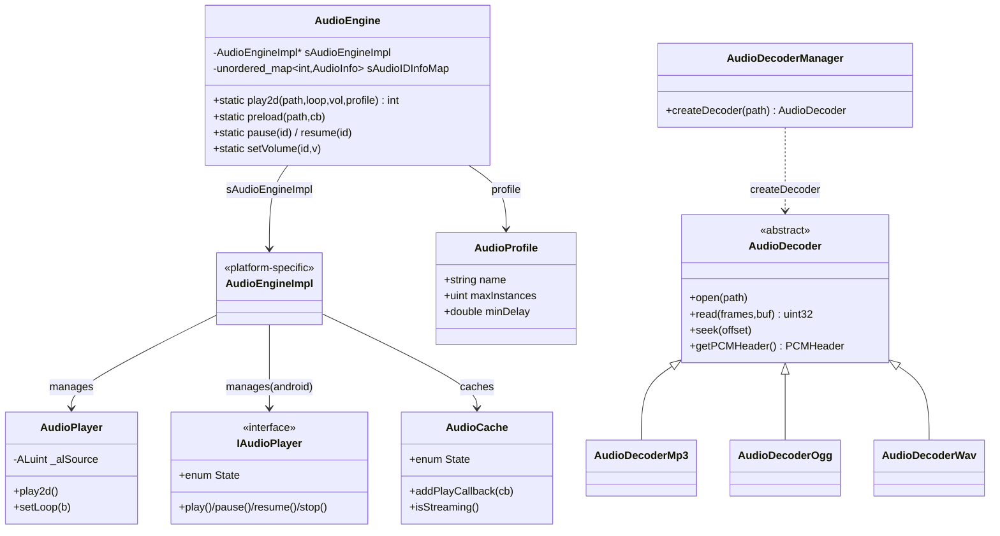

# Audio 音频模块详解

> 根目录：`native/cocos/audio/` · 规模：~101 文件 · 语言：C++17
> 关联文档：[00-overview](./00-overview.md) · [01-architecture](./00-overview.md) · [application](./application.md) · [platform](./platform.md) · [base](./base.md)

Cocos Native 的音频系统采用 **「引擎门面（AudioEngine）→ 平台实现（AudioEngineImpl / AudioPlayer）→ 解码器（AudioDecoder）」** 三层结构，并对不同平台提供多套后端：Android 使用 OpenSL ES（SLES）/ AAudio 与 PCM 混音，iOS/macOS 使用 AudioUnit + OpenAL，桌面（Windows/Linux）使用 OpenAL Soft，OpenHarmony 使用自有播放服务。解码器层（common/decoder）与平台无关，负责把 mp3/ogg/wav 等压缩格式解码为 PCM。

## 1. 模块职责与定位

- **职责**
  - 提供跨平台的音频播放 API：播放/暂停/恢复/停止/循环/音量/进度/预加载。
  - 通过 `AudioEngineImpl` 把播放请求分派到具体平台后端。
  - 通过 `AudioDecoder` / `AudioDecoderManager` 统一解码压缩音频为 PCM（`PCMHeader`）。
  - 维护 `AudioProfile`（并发实例上限、最小间隔）与音频缓存（`AudioCache`）。
- **定位**：引擎音频组件（TS 侧 `AudioSource`/`AudioEngine`）在 native 端的落地实现；依赖 `platform` 模块的线程/文件钩子与 `base` 的容器类型，并通过 `engine/EngineEvents.h` 的 `EnterBackground`/`EnterForeground` 事件自动暂停/恢复。

## 2. 目录树与子目录说明

```
audio/
├── include/
│   ├── AudioEngine.h            # 公开门面：AudioEngine / AudioProfile / AudioState
│   ├── AudioDef.h               # AudioDataFormat 枚举、PCMHeader 结构体
│   ├── AudioMacros.h            # 平台宏
│   └── Export.h
├── common/
│   ├── decoder/                 # 与平台无关的解码器
│   │   ├── AudioDecoder.h       # 抽象解码器接口
│   │   ├── AudioDecoderManager.h# 解码器工厂（按扩展名创建）
│   │   ├── AudioDecoderMp3.h / AudioDecoderOgg.h / AudioDecoderWav.h
│   └── utils/
├── android/                     # Android 后端（OpenSL ES / AAudio + PCM 混音）
│   ├── AudioEngine-inl.h        # Android 版 AudioEngineImpl
│   ├── IAudioPlayer.h           # 播放器接口（State 枚举）
│   ├── PcmAudioPlayer.h / PcmAudioService.h / UrlAudioPlayer.h
│   ├── AudioDecoder*.h / AudioDecoderProvider.h
│   ├── AudioMixer.h / AudioMixerController.h / AudioMixerOps.h
│   ├── AudioResampler*.h        # 采样率重采样
│   ├── OpenSLHelper.h / Track.h / PcmData.h / PcmBufferProvider.h
│   ├── cutils/ utils/           # Android 兼容工具（bitops/log/Errors）
├── apple/                       # iOS / macOS 后端（AudioUnit + OpenAL）
│   ├── AudioEngine-inl.h        # Apple 版 AudioEngineImpl
│   ├── AudioCache.h / AudioPlayer.h / AudioMacros.h / AudioDecoder.h
├── oalsoft/                     # 桌面后端（OpenAL Soft）
│   ├── AudioEngine-soft.h       # 基于 OpenAL 的 AudioEngineImpl
│   ├── AudioCache.h / AudioPlayer.h
├── ohos/ openharmony/           # OpenHarmony 后端
│   ├── AudioDecoderWav.h / FsCallback.h
│   ├── PcmAudioService.h / UrlAudioPlayer.h
```

- **include/**：稳定公开 API，引擎仅依赖它。
- **common/decoder/**：纯解码逻辑，不碰任何平台音频 API，便于单测与复用。
- **android/apple/oalsoft/ohos/openharmony**：平台专用实现，`AudioEngine-inl.h` 在各自目录提供，由编译系统按目标平台选用。

## 3. 关键类 / 结构体

### 3.1 引擎门面（include）

| 类 / 枚举 | 文件 | 说明 |
|---|---|---|
| `AudioEngine` | `include/AudioEngine.h` | 静态门面，`play2d/preload/setVolume/pause/resume/stop/setCurrentTime/...`；内部持有 `AudioEngineImpl *sAudioEngineImpl`、`sThreadPool`（线程池）、`sAudioIDInfoMap`（audioID→AudioInfo） |
| `AudioEngine::AudioState` | `include/AudioEngine.h` | `enum class { ERROR=-1, INITIALIZING, PLAYING, PAUSED }` |
| `AudioProfile` | `include/AudioEngine.h` | 含 `name`、`maxInstances`、`minDelay` |
| `AudioEngine::AudioInfo` | `include/AudioEngine.h` | 每条播放记录：`filePath`、`profileHelper`、`volume`、`loop`、`duration`、`state` |
| `PCMHeader` | `include/AudioDef.h` | `totalFrames/bytesPerFrame/sampleRate/channelCount/dataFormat` |
| `AudioDataFormat` | `include/AudioDef.h` | `UNKNOWN/SIGNED_8/UNSIGNED_8/SIGNED_16/.../FLOAT_32/FLOAT_64` |

`AudioEngine` 关键方法：`static int play2d(path, loop, volume, profile)`、`preload(path, cb)`、`setVolume(id,v)`、`pause(id)`/`pauseAll()`、`resume(id)`/`resumeAll()`、`stop(id)`/`stopAll()`、`setCurrentTime(id,t)`、`getCurrentTime(id)`、`getDuration(id)`、`setFinishCallback(id, cb)`、`uncache(path)`/`uncacheAll()`、`getPCMHeader(url)`、`getOriginalPCMBuffer(url, channelID)`、`setEnabled(bool)`。

### 3.2 解码器（common/decoder）

| 类 | 文件 | 说明 |
|---|---|---|
| `AudioDecoder` | `common/decoder/AudioDecoder.h` | 抽象基类：`open(path)`、`read(frames,pcmBuf)`、`readFixedFrames(...)`、`seek(offset)`、`tell()`、`getTotalFrames()/getBytesPerFrame()/getSampleRate()/getChannelCount()/getDataFormat()/getPCMHeader()`；含 `INVALID_FRAME_INDEX = UINT32_MAX` |
| `AudioDecoderManager` | `common/decoder/AudioDecoderManager.h` | `init()/destroy()`、`createDecoder(path)`（按扩展名选择 Mp3/Ogg/Wav）、`destroyDecoder(decoder)` |
| `AudioDecoderMp3` / `AudioDecoderOgg` / `AudioDecoderWav` | 同目录 | 各格式具体解码实现 |

### 3.3 播放器（平台专用）

| 类 | 文件 | 说明 |
|---|---|---|
| `IAudioPlayer` | `android/IAudioPlayer.h` | Android 播放器接口：`enum class State { INVALID, INITIALIZED, PLAYING, PAUSED, STOPPED, OVER }`、`play/pause/resume/stop/rewind/setVolume/setLoop/setPosition` 与 `PlayEventCallback` |
| `PcmAudioPlayer` / `PcmAudioService` / `UrlAudioPlayer` | `android/` | Android SLES 播放器与 PCM 服务 |
| `AudioPlayer` | `apple/AudioPlayer.h` / `oalsoft/AudioPlayer.h` | 基于 OpenAL 源（`ALuint _alSource`）的播放器，含 `rotateBufferThread` 循环缓冲播放 |
| `AudioCache` | `apple/AudioCache.h` / `oalsoft/AudioCache.h` | 解码后的 PCM 缓存；`enum class State { INITIAL, LOADING, READY, FAILED }`、`addPlayCallback`、`addLoadCallback`、`isStreaming()` |
| `AudioEngineImpl` | 各平台 `AudioEngine-inl.h` | 平台具体引擎实现，被 `AudioEngine::sAudioEngineImpl` 持有 |

### 3.4 Android 混音/重采样（android/）

`AudioMixer`/`AudioMixerController`/`AudioMixerOps` 负责多路 PCM 混音；`AudioResampler`/`AudioResamplerCubic` 做采样率转换；`OpenSLHelper` 封装 SLES 接口；`Track`/`PcmData`/`PcmBufferProvider` 组织音频轨数据。

## 4. 关键枚举 / 常量

`include/AudioEngine.h`：

```cpp
enum class AudioState { ERROR = -1, INITIALIZING, PLAYING, PAUSED };
static const int INVALID_AUDIO_ID;       // 非法音频 ID
static const float TIME_UNKNOWN;         // 未知时长
```

`include/AudioDef.h`：

```cpp
enum class AudioDataFormat {
    UNKNOWN = 0, SIGNED_8, UNSIGNED_8, SIGNED_16, UNSIGNED_16,
    SIGNED_32, UNSIGNED_32, FLOAT_32, FLOAT_64
};
struct PCMHeader {
    uint32_t totalFrames{0}, bytesPerFrame{0}, sampleRate{0}, channelCount{0};
    AudioDataFormat dataFormat{AudioDataFormat::UNKNOWN};
};
```

`android/IAudioPlayer.h`：

```cpp
enum class State { INVALID = 0, INITIALIZED, PLAYING, PAUSED, STOPPED, OVER };
```

`apple/AudioCache.h`：

```cpp
enum class State { INITIAL, LOADING, READY, FAILED };
```

`common/decoder/AudioDecoder.h`：`static const uint32_t INVALID_FRAME_INDEX = UINT32_MAX;`

## 5. 类关系图



## 6. 与上下层交互

- **上层（引擎/绑定）**：TS 侧 `AudioEngine`/`AudioSource` 调用 `AudioEngine::play2d(...)`/`preload(...)` 等静态方法；返回 `audioID` 作为后续控制的句柄。
- **引擎事件**：`AudioEngine` 在构造时注册 `events::EnterBackground`/`EnterForeground` 监听器（`onEnterBackground`/`onEnterForeground`），应用切后台自动暂停、回前台自动恢复。
- **线程模型**：`AudioEngine` 持有 `AudioEngineThreadPool *sThreadPool`，把解码/加载放到工作线程，避免阻塞主线程；播放状态变更通过回调回到主线程（`setFinishCallback`）。
- **解码流程**：`AudioEngineImpl` 播放前通过 `AudioDecoderManager::createDecoder(path)` 创建对应解码器，解码得到 `PCMHeader` 与 PCM 缓冲，再交给 `AudioCache` 缓存与 `AudioPlayer` 播放。
- **平台后端**：编译期由 `platform` 模块决定选用 `android/AudioEngine-inl.h`、`apple/AudioEngine-inl.h`、`oalsoft/AudioEngine-soft.h` 或 `openharmony` 实现；Android 额外走 `AudioMixer`/`AudioResampler` 做混音与重采样。

## 7. 修改 / 扩展要点

1. **新增音频格式**：在 `common/decoder/` 增加 `AudioDecoderXxx.h/.cpp`，继承 `AudioDecoder` 实现 `open/read/seek/getPCMHeader`；在 `AudioDecoderManager::createDecoder` 中按扩展名注册（注意 `common/decoder/AudioDecoder.h` 在 Windows/Linux/OHOS 下含 vorbis 头，wav/mp3 走自有实现）。
2. **新平台后端**：复制某平台 `AudioEngine-inl.h` 模板，实现 `AudioEngineImpl`（`play2d`/`pause`/`resume`/`stop`/`preload` 等），并适配 `AudioPlayer` 或 `IAudioPlayer` 接口；确保 `AudioEngine::sAudioEngineImpl` 指向你的实现。
3. **修改播放行为**：优先改 `AudioEngineImpl` 与 `AudioPlayer`，不要破坏 `AudioEngine` 静态门面的签名（引擎绑定依赖它）。
4. **混音/音效质量**：Android 的 `AudioMixer`/`AudioResampler` 是性能热点，调优时关注 `AudioMixerOps` 与 `AudioResamplerCubic`；`AudioCache::isStreaming()` 决定长音频走流式而非整段缓存。
5. **资源管理**：`uncache`/`uncacheAll` 会先停掉相关音频；退出前必须调用 `AudioEngine::end()` 释放 `AudioEngineImpl` 与线程池，否则可能崩溃（头文件注释已强调）。
6. **注意点**：`AudioDataFormat` 仅支持 1 或 2 声道（`getChannelCount` 注释明确）；PCM 缓冲以 `vector<uint8_t>` 返回，字节长度参考 `PCMHeader.bytesPerFrame * totalFrames`。
