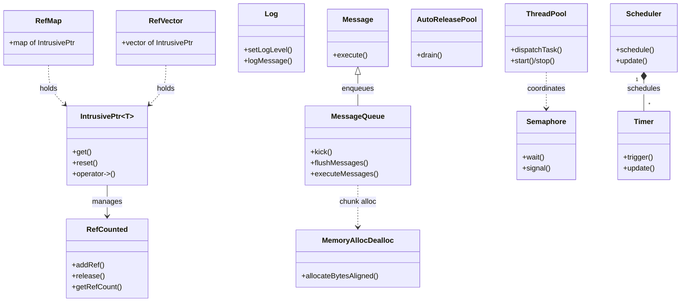
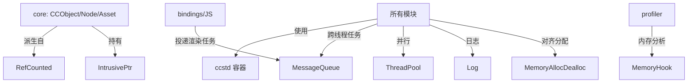

# base 模块详解

> 根目录：`native/cocos/base/` · 规模：~109 文件 · 语言：C++17
> 关联文档：[00-overview](./00-overview.md) · [core](./core.md) · [math](./math.md) · [platform](./platform.md) · [application](./application.md)

## 1. 模块职责与定位

`base` 是 Cocos Native 的**基础设施层**，被 `core`、`math`、渲染、物理、平台等几乎所有模块依赖。它提供：

- **对象生命周期**：`RefCounted` 引用计数基类与 `IntrusivePtr<T>` 智能指针，是引擎内对象（如 `Node`、`Asset`）内存管理的基石（见 [core](./core.md)）。
- **STL 抽象 `ccstd`**：`base/std/` 下对 `vector`/`map`/`string`/哈希等的标准库再封装，全引擎统一使用 `ccstd::` 命名空间。
- **内存**：`memory/` 对齐分配与内存钩子；`memop` 相关的压缩/解压（etc1/astc/etc2/Compressed）。
- **线程与并发**：`threading/`（消息队列 `MessageQueue`、自动释放池 `AutoReleasePool`、信号量 `Semaphore`、线程池 `ThreadPool`、条件变量、读写锁、线程安全计数/分配器）。
- **宏与日志**：`Macros.h`（导出符号、断言、回调绑定、字节序）、`Log.h`（分级日志）。
- **通用工具**：`Value`（万能值类型）、`Data`（字节缓冲）、`Scheduler`/`Timer`（定时器）、`BinaryArchive`（二进制序列化）、字符串/编码/Base64/Zip/RNG 等。

它**不依赖** `core`/`math`，是依赖图的叶子；但 [core](./core.md) 的 `CCObject`、`RefMap`、`RefVector` 均建立在其之上。

## 2. 目录树与子目录说明

```
base/
├── RefCounted.h/.cpp       # 引用计数基类
├── Ptr.h                   # IntrusivePtr<T> 智能指针 + hash 特化
├── Object.h                # 极简 Object 基类
├── RefMap.h RefVector.h    # 持有 IntrusivePtr 的容器
├── Macros.h                # 宏：导出/断言/回调/字节序/CC_ENUM_BITWISE_OPERATORS
├── Log.h/.cpp LogRemote.cpp# 分级日志与远程日志
├── Agent.h                 # 代理/弱持有辅助
├── Assertf.h               # 断言格式化
├── Config.h                # 编译期配置开关
├── TypeDef.h               # 基础类型别名
├── TemplateUtils.h HasMemberFunction.h IndexHandle.h Locked.h
├── Scheduler.h/.cpp Timer.h/.cpp        # 定时器调度
├── Value.h/.cpp Data.h/.cpp             # 万能值 / 字节缓冲
├── BinaryArchive.h/.cpp               # 二进制序列化
├── StringUtil.h UTF8.h StringHandle.h StringPool.h
├── Random.h Utils.h/.cpp base64.h/.cpp ZipUtils.h/.cpp
├── memory/                 # 对齐内存分配、内存钩子、调用栈
├── threading/              # 并发原语（见 §3.4）
├── std/                    # ccstd STL 抽象（container/ hash/ any/ optional/ variant）
├── job-system/             # 任务调度后端抽象（taskflow / tbb / dummy）
└── astc/ etc1/ etc2/ Compressed/ csscolorparser/  # 资源压缩与颜色解析
```

| 子目录 | 关键产物 | 说明 |
| --- | --- | --- |
| 根目录 | `RefCounted`、`Ptr`、`Macros`、`Log`、`Value`、`Scheduler` | 生命周期/宏/日志/工具核心 |
| `memory` | `MemoryAllocDealloc`、`MemoryHook`、`CallStack` | 对齐分配、泄漏钩子 |
| `threading` | `MessageQueue`/`AutoReleasePool`/`Semaphore`/`ThreadPool`/… | 跨线程通信与并发同步 |
| `std` | `ccstd` 容器与哈希、any/optional/variant | 全引擎统一 STL 抽象 |
| `job-system` | `JobSystem.h` + 后端 | 并行任务调度（可按平台切换） |

## 3. 关键类 / 结构体

### 3.1 引用计数 `RefCounted`（`RefCounted.h`）
```cpp
class RefCounted {
public:
    RefCounted();
    virtual ~RefCounted();
    void addRef();            // 引用 +1
    void release();           // 引用 -1，归零则 delete this
    unsigned int getRefCount() const;
    static void printLeaks(); // 调试期泄漏检测
};
```
派生类（如 `CCObject`、`SceneGlobals`、几何 `ShapeBase`）通过 `addRef/release` 管理生命；配合 `IntrusivePtr` 实现自动引用管理。注释显示也支持 CRTP 形式 `class MyFoo : public RefCounted<MyFoo>` 以获得更精确的类型。

### 3.2 智能指针 `IntrusivePtr<T>`（`Ptr.h`）
```cpp
template <typename T>
class IntrusivePtr {
    T *get() const;
    T *operator->() const;
    T &operator*() const;
    void reset() noexcept;
    void reset(T *p);
    IntrusivePtr& operator=(T* / IntrusivePtr / &&);
    bool operator==(std::nullptr_t / T*) const;
};
// 支持在哈希容器中使用：hash<cc::IntrusivePtr<T>>
```
`IntrusivePtr<T>` 在构造/赋值时自动 `addRef`，析构时自动 `release`。引擎中 `Node`、`Asset` 的子节点/资源成员均以 `IntrusivePtr` 持有（如 `ccstd::vector<IntrusivePtr<Node>>`）。它的哈希特化使其可直接放入 `ccstd::unordered_map<IntrusivePtr<T>, ...>`。

### 3.3 引用容器与值类型
- **`RefMap`（`RefMap.h`）/ `RefVector`（`RefVector.h`）**：内部以 `IntrusivePtr` 持有元素的 `map`/`vector`，插入即 `addRef`，移除即 `release`，避免裸指针悬垂。
- **`Value`（`Value.h`）**：万能值包装，`enum class Type { NONE, BYTE, INTEGER, FLOAT, DOUBLE, BOOLEAN, STRING, VECTOR, MAP, ... }`，提供 `getType()`、`isNull()` 等，用于配置与脚本桥接。
- **`Data`（`Data.h`）**：简单字节缓冲（`getBytes()/getSize()`），常用于文件/资源原始数据。
- **`Object`（`Object.h`）**：极简 `class Object { virtual ~Object(); }`，作为非引用计数对象的轻量基类。
- **`BinaryArchive`（`BinaryArchive.h`）**：二进制读写序列化。

### 3.4 线程与并发（`threading/`）
- **`MessageQueue`（`MessageQueue.h`）**：跨线程消息队列。基类 `Message { virtual void execute(); }`；`MemoryAllocator`（单例）以 16×4096 字节 `MEMORY_CHUNK_SIZE` 块做零拷贝分配（`allocateAndCopy`），`kick()`/`kickAndWait()`/`flushMessages()`/`finishWriting()` 驱动生产者-消费者；`runConsumerThread`/`consumerThreadLoop` 在消费者线程执行 `execute()`。这是 JS 主线程向渲染/后台线程投递任务的核心机制（见 [application](./application.md)）。
- **`AutoReleasePool`（`AutoReleasePool.h`）**：`drain()` 释放池内对象；在 Apple 平台通过 `_nsReleasePool` 桥接 `NSAutoreleasePool`。
- **`Semaphore`（`Semaphore.h`）**：`wait()`、`signal(int count=1)`、`signalAll()`（占位禁止），用于线程间阻塞同步。
- **`ThreadPool`（`ThreadPool.h`）**：`dispatchTask(Function&&, Args&&) -> std::future<...>`、`start()`/`stop()`/`addThread()`；常量 `CPU_CORE_COUNT`、`MAX_THREAD_COUNT`，按 CPU 核数自动扩容，适合并行计算任务。
- **`ConditionVariable`（`ConditionVariable.h`）**：`wait()`/`wait(predicate)`，配合锁使用。
- **`ReadWriteLock`（`ReadWriteLock.h`）**：`lockRead(fn)`/`lockWrite(fn)`，基于 `std::shared_mutex`，适合读多写少。
- 辅助：`ThreadSafeCounter`、`ThreadSafeLinearAllocator`、`threading/Event.h`。

### 3.5 内存（`memory/`）
- **`MemoryAllocDealloc`（`Memory.h`）**：`allocateBytesAligned(align, count)`/`deallocateBytesAligned(ptr)`（Windows 走 `_aligned_malloc/_aligned_free`）。宏：`CC_MALLOC`、`CC_REALLOC`、`CC_FREE`、`CC_MALLOC_ALIGN`、`CC_FREE_ALIGN`。
- **`MemoryHook` / `CallStack`**：内存分配钩子与调用栈采集，用于内存分析（`profiler` 见 [profiler](./profiler.md)）。

### 3.6 宏与日志
- **`Macros.h`**：`CC_DLL`（导出/导入符号）、`CC_DEGREES_TO_RADIANS`/`CC_RADIANS_TO_DEGREES`、`CC_SWAP16/32`、`CC_SWAP_INT32_LITTLE_TO_HOST`、`CC_CALLBACK_0..3`（std::bind 辅助）、`CC_BREAK_IF`、`CC_DEPRECATED_ATTRIBUTE`，以及 `CC_ENUM_BITWISE_OPERATORS`（使 `Layers::LayerList` 等位枚举支持 `| & ~`）。
- **`Log`（`Log.h`）**：
  ```cpp
  enum class LogType { KERNEL, ... };
  enum class LogLevel { FATAL, ERR, WARN, INFO, LEVEL_DEBUG }; // DEBUG 在 Win 为宏，故用 LEVEL_DEBUG
  class Log {
      static LogLevel slogLevel;
      static void setLogLevel(LogLevel); static FILE* getLogFile();
      static void setLogFile(const ccstd::string&); static void close();
      static void logMessage(LogType, LogLevel, const char*, ...);
      static void logRemote(const char*);
  };
  // 宏：CC_LOG_DEBUG / CC_LOG_INFO / CC_LOG_WARN / CC_LOG_ERROR / CC_LOG_FATAL
  ```
  日志级别低于 `slogLevel` 的将被过滤。

### 3.7 STL 抽象 `ccstd`（`std/`）
`base/std/` 将标准库容器/算法聚合成 `ccstd` 命名空间：`container/`（array/deque/list/map/queue/set/string/unordered_map/unordered_set/vector）、`hash/`（hash.h）、以及 `any.h`/`optional.h`/`variant.h`。引擎代码一律使用 `ccstd::vector` 等，便于统一替换/移植后端。

### 3.8 任务系统（`job-system/`）
`JobSystem.h` 提供后端抽象，目录下有 `job-system-dummy`/`job-system-taskflow`/`job-system-tbb` 三套实现，按平台/编译选项选择，供需要细粒度并行的模块使用。

### 3.9 其它工具
`Scheduler`/`Timer`（定时器调度，见 §4）、`StringUtil`/`UTF8`/`StringHandle`/`StringPool`（字符串处理）、`Random`（随机数）、`base64`/`ZipUtils`（编解码与压缩）、`astc/etct/etc2/Compressed`（纹理格式解压）、`csscolorparser`（CSS 颜色解析）、`DeferredReleasePool`、`Agent`。

## 4. 关键枚举 / 常量

### 4.1 `LogType` / `LogLevel`（`Log.h`）
`LogType { KERNEL, ... }`；`LogLevel { FATAL, ERR, WARN, INFO, LEVEL_DEBUG }`——`LEVEL_DEBUG` 因 Windows 下 `DEBUG` 已是宏而改用此名。

### 4.2 `Value::Type`（`Value.h`）
`enum class Type { NONE, BYTE, INTEGER, FLOAT, DOUBLE, BOOLEAN, STRING, VECTOR, MAP, ... }`——标识 `Value` 当前包装的具体类型。

### 4.3 宏常量（`Macros.h`）
`MEMORY_CHUNK_SIZE = 4096*16`（`MessageQueue` 内存块）、`CC_DLL`、`CC_CALLBACK_*` 等。

## 5. 类关系图



## 6. 与上下层交互



- **向上支撑 `core`/`math`**：`CCObject`（`core/data/Object.h`）继承 `RefCounted`；`Node`/`Asset` 以 `IntrusivePtr` 互相持有（见 [core](./core.md)）。`math` 的类型虽为轻量 POD，但其容器类型来自 `ccstd`。
- **与 `application`/`bindings`**：`MessageQueue` 是 JS 主线程向渲染线程/工作线程投递 `Message` 的通道；`application`（[application](./application.md)）据此驱动主循环与多线程。
- **与 `profiler`**：`MemoryHook`/`CallStack` 为性能与内存分析（[profiler](./profiler.md)）提供数据。
- **与平台层**：`Macros.h`/`Config.h`/`threading` 的底层实现在不同平台（`platform`，见 [platform](./platform.md)）有差异，但对外接口统一。

## 7. 修改 / 扩展要点

- **新增引用计数对象**：继承 `RefCounted`（或 `RefCounted<T>` CRTP），在析构中释放自身资源；凡需共享持有的成员用 `IntrusivePtr<T>` 而**不要**用裸指针或 `std::shared_ptr`，以保持引擎统一的内存模型。
- **持有集合**：优先用 `RefMap`/`RefVector` 而非裸 `std::map/vector<T*>`，避免遗漏 `addRef/release` 导致泄漏或悬垂。
- **跨线程通信**：不要直接在不同线程操作引擎对象；通过 `MessageQueue` 投递 `Message` 子类（实现 `execute()`），用 `kickAndWait` 等确保同步；生产者侧用 `MemoryAllocator` 的 `allocateAndCopy` 做零拷贝以避免数据竞争。
- **并发同步**：互斥用 `Semaphore`/`ConditionVariable`；读多写少用 `ReadWriteLock`；并行计算交给 `ThreadPool::dispatchTask`（返回 `std::future`）。
- **内存分配**：统一走 `CC_MALLOC/CC_FREE` 与 `CC_MALLOC_ALIGN/CC_FREE_ALIGN`，不要混用裸 `new`/平台 API，便于 `MemoryHook` 统计与定位泄漏（`RefCounted::printLeaks` 辅助）。
- **日志规范**：使用 `CC_LOG_*` 宏并按级别输出，避免 `printf`；远程日志走 `Log::logRemote`。
- **STL 抽象**：新增容器/算法使用 `ccstd::` 命名空间（来自 `base/std/`），保持跨平台一致性；不要引入对特定编译器 STL 实现细节的依赖。
