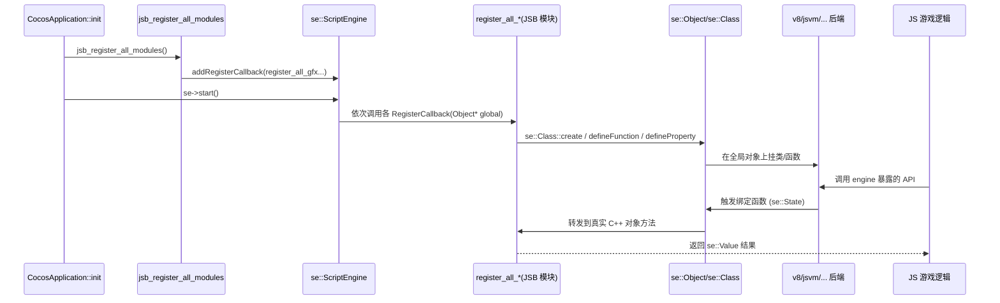

# bindings 模块详解

> 根目录：`native/cocos/bindings/` · 规模：~180 文件 · 语言：C++17
> 关联文档：[00-overview](./00-overview.md) · [01-architecture](./00-overview.md) · [02-sequence-diagrams](./application.md) · [application](./application.md) · [platform](./platform.md)

`bindings/` 是 Cocos Native 的 **JSB（JavaScript Binding）层**，负责把 C++ 引擎暴露给 JavaScript/TypeScript 游戏逻辑。它建立在脚本引擎抽象 `se::`（Script Engine）之上，通过多后端（`v8`/`jsvm`/`napi`/`sm`/…）屏蔽底层 VM 差异，再以「自动生成（`auto/`）＋手工绑定（`manual/`）＋ 现代模板（`sebind/`）」三种方式完成 C++ → JS 的类型与函数注册。

## 1. 模块职责与定位

- **脚本引擎抽象（`jswrapper/`）**：提供与具体 VM 无关的 `se::` 命名空间（`ScriptEngine`、`Object`、`Class`、`Value`、`AutoHandleScope`、`State` 等），并通过 `config.h` 的 `SCRIPT_ENGINE_TYPE` 在编译期选择后端（V8 / JSVM / NAPI / SpiderMonkey / JSC / ChakraCore）。
- **模块注册（`manual/jsb_module_register.cpp`）**：引擎启动时由 `CocosApplication` 调用 `jsb_register_all_modules()`，按依赖顺序把各子系统的 `register_all_*` 回调注册进 `se::ScriptEngine`，最终在 `se->start()` 时统一执行。
- **暴露 C++ 给 JS**：`auto/` 由工具自动生成的绑定（如 `jsb_gfx_auto`、`jsb_scene_auto`）；`manual/` 是需手写逻辑的高级绑定（如 `jsb_gfx_manual`、`jsb_websocket`）；`sebind/` 是基于模板的现代绑定语法糖。
- **桥接能力**：`JavaScriptJavaBridge` / `JavaScriptObjCBridge` / `JavaScriptArkTsBridge` 用于 JS ↔ 原生（Android/iOS/OpenHarmony）互调；`event/`、`utils/`、`dop/` 提供事件分发、工具与数据对象协议辅助。

## 2. 目录树与子目录说明

```
native/cocos/bindings/
├── jswrapper/                # ★ 脚本引擎抽象 se:: + 各 VM 后端
│   ├── SeApi.h               # 按 SCRIPT_ENGINE_TYPE 转发到具体后端 SeApi.h
│   ├── config.h              # SCRIPT_ENGINE_TYPE 定义 / 后端开关
│   ├── Object.h  Value.h  State.h  HandleObject.h  PrivateObject.h
│   ├── MappingUtils.h/.cpp   # JS 对象 ↔ C++ 对象映射
│   ├── ValueArrayPool.h/.cpp # 参数数组池
│   ├── v8/                   # V8 后端（Class/ScriptEngine/Object/HelperMacros…）
│   ├── jsvm/                 # JSVM 后端
│   ├── jsvm-v8-backend/      # JSVM 基于 V8 后端的实现
│   ├── napi/                 # NAPI（OpenHarmony）后端
│   └── sm/                   # SpiderMonkey 后端
├── manual/                   # ★ 手工绑定
│   ├── jsb_module_register.h/.cpp  # 总注册入口 jsb_register_all_modules()
│   ├── jsb_global.h/.cpp  jsb_global_init.*  # 全局对象/初始化
│   ├── jsb_conversions*.h/.cpp        # C++ ↔ JS 值转换
│   ├── jsb_classtype.h/.cpp          # C++ 类型注册表 JSBClassType
│   ├── jsb_helper.h/.cpp             # 绑定辅助宏/函数
│   ├── jsb_gfx_manual / jsb_scene_manual / jsb_pipeline_manual / jsb_assets_manual …
│   ├── jsb_websocket / jsb_socketio / jsb_xmlhttprequest / jsb_network_manual …
│   ├── jsb_platform*.cpp             # 各平台平台绑定
│   ├── JavaScriptJavaBridge / JavaScriptObjCBridge / JavaScriptArkTsBridge
│   └── (auto/ 由工具生成：jsb_gfx_auto、jsb_scene_auto、jsb_2d_auto …)
├── sebind/                  # ★ 现代模板绑定
│   ├── sebind.h  class_v8.h/.cpp  class.inl
│   └── intl/ common.h/.cpp
├── event/                   # JS 事件分发封装（EventDispatcher 等）
├── utils/                   # 绑定工具
└── dop/                     # 数据对象协议（jsb_dop.h）→ register_all_dop_bindings
```

> `auto/` 为构建期由绑定生成工具产出的代码（`jsb_module_register.cpp` 通过 `#include "cocos/bindings/auto/jsb_*.h"` 引用），本仓库通常不会手改。

### 后端选择机制
`jswrapper/SeApi.h` 在编译期依据 `config.h` 的 `SCRIPT_ENGINE_TYPE` 宏，分别 `#include` 对应后端的 `SeApi.h`（如 `v8/SeApi.h`、`jsvm/SeApi.h`、`napi/SeApi.h`、`sm/SeApi.h`）；各后端再统一包含 `HandleObject.h`/`Object.h`/`State.h`/`Value.h`，使上层 `se::` 代码无需感知具体 VM。支持的后端宏：`SCRIPT_ENGINE_V8 / SCRIPT_ENGINE_JSVM / SCRIPT_ENGINE_NAPI / SCRIPT_ENGINE_SM / SCRIPT_ENGINE_JSC / SCRIPT_ENGINE_CHAKRACORE`。`SE_ENABLE_INSPECTOR` 宏控制是否引入 V8 Inspector（`node::Environment`）。

## 3. 关键类 / 结构体

### se::ScriptEngine（`jswrapper/<backend>/ScriptEngine.h`）
脚本引擎单例（`static getInstance()`），代表一个 JS VM 上下文。关键成员/方法：
- 生命周期：`init()` / `start()` / `start(isolate)` / `cleanup()` / `isValid()` / `isInCleanup()`。
- **注册回调**：`using RegisterCallback = bool (*)(Object*)`；`addRegisterCallback(cb)` / `addPermanentRegisterCallback(cb)`——仅入队，在 `start()` 时按注册顺序执行（见 `callRegisteredCallback`）。
- 执行脚本：`evalString(script, len, ret, fileName)` / `runScript(path, ret)` / `saveByteCodeToFile()` / `runByteCodeFile()`。
- 主循环：`mainLoopUpdate()`（每帧由 `Engine::tick` 调用）、`handlePromiseExceptions()`、`garbageCollect()`、`callFunction()`。
- 回调与钩子：`setExceptionCallback(ExceptionCallback)`、`setJSExceptionCallback`、`enableDebugger(addr, port, wait)`、`addBeforeInitHook/AfterInitHook/BeforeCleanupHook/AfterCleanupHook`、`setFileOperationDelegate(FileOperationDelegate)`。
- `FileOperationDelegate`：含 `onGetDataFromFile`/`onGetStringFromFile`/`onCheckFileExist`/`onGetFullPath` 四个 `std::function`，由 `CocosApplication` 通过 `jsb_init_file_operation_delegate()` 注入。

### se:: 基础类型（`jswrapper/`）
- `se::Object`：JS 对象包装，提供属性/函数定义与调用（经 `getGlobalObject()` 取全局对象）。
- `se::Value`：JS 值通用容器（布尔/数/字符串/对象/…）。
- `se::State`：绑定函数调用的状态（参数 `args` 与返回值 `rval`）。
- `se::AutoHandleScope`：栈分配的作用域，管理局部句柄（V8 后端实现，其他后端为空实现）。
- `se::Class`：描述一个 C++ 类如何映射到 JS 类（构造函数、方法、属性、父类链）。
- `MappingUtils` / `JSBClassType`：维护 C++ 对象 ↔ JS 对象的映射与类型元数据。

### jsb_module_register（`manual/jsb_module_register.cpp`）
总注册函数 `jsb_register_all_modules()`，先 `addBeforeCleanupHook`（GC + `DeferredReleasePool::clear`），再按依赖顺序 `addRegisterCallback`：
`jsb_register_global_variables` → `register_all_engine` → `register_all_cocos_manual` → `register_platform_bindings` → `register_all_gfx`(+manual) → `register_all_network`(+manual) → `register_all_xmlhttprequest` → `register_all_extension` → `register_all_dop_bindings` → `register_all_assets`(+manual) → `register_all_pipeline`(+manual) → `register_all_geometry`(+manual) → `register_all_scene`(+manual) → `register_all_gi` → `register_all_render` → `register_all_native2d` … 之后按宏条件追加 `audio`/`xr`/`box2d`/`spine`/`dragonbones`/`physics`/`webview`/`video`/`websocket`/`billing` 等模块，最后 `addAfterCleanupHook` 清理 `JSBClassType`。

### sebind（`sebind/`）
现代模板绑定（`sebind.h` → `class_v8.h`），以声明式方式定义类/方法/属性的 JS 绑定，降低手写 `se::Class` 样板代码；`intl/common` 提供内部公共辅助。

### se::ScriptEngine 关键方法速查（来自 `jswrapper/<backend>/ScriptEngine.h`）

| 方法 | 说明 |
| --- | --- |
| `getInstance()` | 取得脚本引擎单例 |
| `init()` / `start()` / `start(isolate)` / `cleanup()` | 创建上下文、执行注册回调、清理 VM |
| `addRegisterCallback(cb)` / `addPermanentRegisterCallback(cb)` | 注册模块（`RegisterCallback = bool(*)(Object*)`），`start` 时按序执行 |
| `getGlobalObject()` | 取得 JS 全局对象（注册挂载点） |
| `evalString()` / `runScript()` / `saveByteCodeToFile()` | 执行脚本 / 字节码 |
| `mainLoopUpdate()` / `handlePromiseExceptions()` | 每帧由 `Engine::tick` 调用 |
| `garbageCollect()` | 触发 JS GC |
| `setExceptionCallback(cb)` / `setJSExceptionCallback(cb)` | `ExceptionCallback(location,message,stack)` |
| `enableDebugger(addr,port,wait)` | 启用 V8 Inspector 调试 |
| `setFileOperationDelegate(FileOperationDelegate)` | 注入文件读取委托（含 `onGetDataFromFile` 等四个 `std::function`） |

## 4. 关键枚举 / 常量

- `SCRIPT_ENGINE_TYPE`：编译期后端开关，取值 `SCRIPT_ENGINE_V8 / SCRIPT_ENGINE_JSVM / SCRIPT_ENGINE_NAPI / SCRIPT_ENGINE_SM / SCRIPT_ENGINE_JSC / SCRIPT_ENGINE_CHAKRACORE`（`jswrapper/config.h`）。`SeApi.h` 据此 `#include` 对应后端头。
- `se::ScriptEngine::RegisterCallback = bool (*)(Object*)`：模块注册函数签名。
- `se::ScriptEngine::ExceptionCallback = std::function<void(const char*, const char*, const char*)>`（location, message, stack）。
- `SE_ENABLE_INSPECTOR`：是否启用 V8 Inspector 调试（影响 `node::Environment` 等成员）。
- 平台/功能宏控制注册范围：`CC_USE_AUDIO` / `CC_USE_XR` / `CC_USE_SOCKET` / `CC_USE_MIDDLEWARE` / `CC_USE_PHYSICS_PHYSX` / `CC_USE_WEBVIEW` / `CC_USE_VIDEO` / `CC_USE_BOX2D_JSB` 等（见 `jsb_module_register.cpp` 的条件编译）。

## 5. 类关系图（Mermaid flowchart）

```mermaid
flowchart TB
    subgraph APP["应用装配"]
        CA["CocosApplication::init"]
    end
    subgraph REG["注册中心"]
        MODREG["jsb_register_all_modules()"]
        SE["se::ScriptEngine (单例)"]
    end
    subgraph BIND["绑定来源"]
        AUTO["auto/ jsb_*_auto (工具生成)"]
        MANUAL["manual/ jsb_*_manual / jsb_*"]
        SEBIND["sebind/ 模板绑定"]
    end
    subgraph WRAP["脚本引擎抽象 se::"]
        OBJ["se::Object / se::Class"]
        VAL["se::Value / se::State"]
        AUTO2["AutoHandleScope / MappingUtils"]
    end
    subgraph VM["VM 后端 (jswrapper/)"]
        V8["v8/"] JSVM["jsvm/"] NAPI["napi/"] SM["sm/"]
    end
    subgraph JS["JS / TS 游戏逻辑"]
        GAME["game.js / 组件"]
    end

    CA -->|jsb_register_all_modules| MODREG
    MODREG -->|addRegisterCallback| SE
    SE -->|start 时执行| AUTO
    SE -->|start 时执行| MANUAL
    SE -->|start 时执行| SEBIND
    AUTO --> WRAP
    MANUAL --> WRAP
    SEBIND --> WRAP
    WRAP --> VM
    GAME -->|调用暴露的 API| OBJ
    OBJ -->|回调 C++| MANUAL
```

### 模块注册依赖顺序（节选自 `jsb_module_register.cpp`）

```
global → engine → cocos_manual → platform → gfx(+manual)
→ network(+manual) → xmlhttprequest → extension → dop
→ assets(+manual) → pipeline(+manual) → geometry(+manual)
→ scene(+manual) → gi → render → native2d
[+ audio / xr / box2d / spine / dragonbones / physics / webview / video
   / websocket / billing / ar  按 CC_USE_* 宏条件追加]
```

- **auto vs manual**：`auto/`（`jsb_2d_auto`、`jsb_gfx_auto`、`jsb_scene_auto`、`jsb_assets_auto`、`jsb_pipeline_auto`、`jsb_geometry_auto`、`jsb_gi_auto`、`jsb_render_auto`、`jsb_network_auto`、`jsb_cocos_auto`、`jsb_extension_auto`…）由绑定生成工具产出，仅做机械字段/方法映射；`manual/`（`jsb_gfx_manual`、`jsb_scene_manual`、`jsb_pipeline_manual`、`jsb_assets_manual`、`jsb_websocket`、`jsb_xmlhttprequest`…）补充需手写逻辑的部分。两者共享同一 `register_all_*` 命名约定。
- **dop / event / utils**：`dop/` 提供数据对象协议（`register_all_dop_bindings`）；`event/` 封装 JS 事件分发；`utils/` 提供绑定工具函数。

### auto 与 manual 的生成/维护边界
- **`auto/`（生成）**：由 `bindings` 生成工具基于引擎接口定义（IDL/注解）批量产出 `jsb_*_auto.cpp/.h`，覆盖绝大多数「字段+方法」的机械映射，**不应手改**，重新生成即覆盖。
- **`manual/` （手写）**：当自动映射不足以表达语义时（如回调、Promise、生命周期、错误码转换、平台桥接）由开发者维护 `jsb_*_manual`；其 `register_all_*` 与对应 `auto` 的注册函数并存，共同挂到同一 JS 命名空间。
- **`sebind/`**：面向新代码的声明式模板方案，目标是减少 `se::Class` 手写样板，长期与 `auto/manual` 互补。

## 6. 与上下层交互

**C++ 暴露给 JS 的完整路径**



- **与 application 层**：`CocosApplication::init` 在 `Engine::init` 之后调用 `jsb_register_all_modules()` + `se->start()`（`application/CocosApplication.cpp`）；每帧 `Engine::tick` 调用 `se->mainLoopUpdate()` 与 `se->handlePromiseExceptions()`（`engine/Engine.cpp`）。
- **与 platform 层**：`FileOperationDelegate` 由应用注入，使 `se->runScript/evalString` 能经 `FileUtils`/`ISystemWindow` 读取脚本；平台还通过 `JavaScriptJavaBridge`/`JavaScriptObjCBridge`/`JavaScriptArkTsBridge` 实现 JS↔原生互调。
- **与业务模块**：`renderer`、`scene`、`gfx`、`pipeline`、`assets` 等子系统的 `register_all_*` 把自身 C++ 类挂到 JS 全局（`jsb_gfx_auto` 等），TS 层才能 `import` 并使用。

## 7. 修改 / 扩展要点

- **暴露新的 C++ 类/方法给 JS**：
  - 简单/机械映射优先走**自动生成**（`auto/`）——由绑定工具基于接口定义产出 `jsb_*_auto`，不要手改 `auto/`。
  - 需要自定义逻辑（如回调、生命周期、错误处理）时，在 `manual/` 增加 `jsb_xxx_manual.cpp/.h`，实现 `register_all_xxx(SE::Object*)` 并用 `se::Class`/`se::Object` 注册；再在 `jsb_module_register.cpp` 的 `jsb_register_all_modules()` 中 `addRegisterCallback(register_all_xxx)`，并置于其依赖（如 asset 在 pipeline 之前）之后。
  - 现代写法可用 `sebind/` 模板声明式绑定，减少样板代码。
- **新增 VM 后端**：在 `jswrapper/` 下新增后端目录，实现 `SeApi.h` 所需的 `se::` 类型，并在 `jswrapper/SeApi.h` 与 `config.h` 中按 `SCRIPT_ENGINE_TYPE` 接入（现有 `v8`/`jsvm`/`jsvm-v8-backend`/`napi`/`sm`）。
- **值转换**：跨语言的类型转换集中在 `jsb_conversions*.h`；自定义类型需在此提供 `se::Value` ↔ C++ 的互转函数。
- **平台桥接**：JS↔原生互调（Java/ObjC/ArkTS）在 `JavaScript*Bridge` 中实现，并按 `CC_PLATFORM` 条件在 `jsb_module_register.cpp` 注册 `register_javascript_*_bridge`。
- **清理顺序**：`SE` 的 cleanup/restart 依赖 `addBeforeCleanupHook`（GC + `DeferredReleasePool`）与 `addAfterCleanupHook`（`JSBClassType::cleanup`），新增模块若持有持久句柄需在对应钩子中释放，避免悬空 `BackingStore`（见 `jsb_module_register.cpp` 顶部注释）。
- **注意**：绑定层与 JS 全局对象强耦合，注册函数签名必须为 `bool (*)(se::Object*)`；改 `se::` 抽象接口会波及所有后端与所有 `register_all_*`，需谨慎。

### 手工绑定模块骨架示例（manual/）

```cpp
// manual/jsb_mymodule_manual.cpp
#include "cocos/bindings/jswrapper/SeApi.h"

static bool js_myApi_foo(se::State& state) {
    const auto& args = state.args();        // se::Value 参数数组
    // ... 调用真实 C++ 对象 ...
    state.rval().setInt32(result);          // 通过 se::Value 返回
    return true;
}
SE_BIND_FUNC(js_myApi_foo)                  // 绑定辅助宏（jsb_helper）

bool register_all_mymodule(se::Object* global) {
    auto* ns = se::Object::createPlainObject(); // 命名空间对象
    global->setProperty("MyApi", ns);
    ns->defineFunction("foo", _SE(js_myApi_foo));
    return true;
}
```

要点：注册函数签名为 `bool(se::Object*)`，通过 `se::State` 取参/回值，最终由 `jsb_module_register.cpp` 的 `jsb_register_all_modules()` 以 `addRegisterCallback(register_all_mymodule)` 挂载，并在 `se->start()` 时自动执行。

### se::Class 与对象映射
- `se::Class`：描述一个 C++ 类如何映射为 JS 类（构造函数、成员/静态函数、属性、父类链），由 `sebind/` 与自动生成代码封装使用。
- `MappingUtils` / `JSBClassType`（`jsb_classtype.h`）：维护 C++ 原生对象 ↔ JS 对象句柄的双向映射与类型元数据，是值转换与生命周期管理（`PrivateObject`、引用计数）的基础。
- `sebind/class_v8.*`：在 V8 后端上以模板方式落地上述映射，提供更简洁的声明式 API。

### 值转换与辅助（`manual/jsb_conversions*`、`jsb_helper`）
- `jsb_conversions.h/.cpp` 与 `jsb_conversions_spec.h/.cpp`：提供 `ccstd::string` / 数值 / `Vec2/Vec3` / `Color` / 容器等在 `se::Value` 与 C++ 类型间的互转，自定义类型通常在此扩展。
- `jsb_helper.h/.cpp`：封装常用绑定辅助函数（属性获取、参数校验、异常抛出），降低各 `register_all_*` 的样板代码。
- `jsb_classtype.h/.cpp` 的 `JSBClassType`：在引擎清理（`addAfterCleanupHook`）时统一释放类型注册表，避免跨 VM 残留。

### 调试与排错
- 通过 `CocosApplication::setDebugIpAndPort(addr, port, wait)` → `jsb_enable_debugger` 开启 V8 Inspector（`se::ScriptEngine::enableDebugger`）。
- JS 异常经 `se->setExceptionCallback` 上报到 `CocosApplication::handleException`（打印 `location/msg/stack`）。
- 重启时会 `broadcast(RestartVM)` 并 `ScriptEngine::cleanup()`，需在 `addBefore/AfterCleanupHook` 中释放持久句柄，避免悬空外部内存（见 `jsb_module_register.cpp` 注释）。
