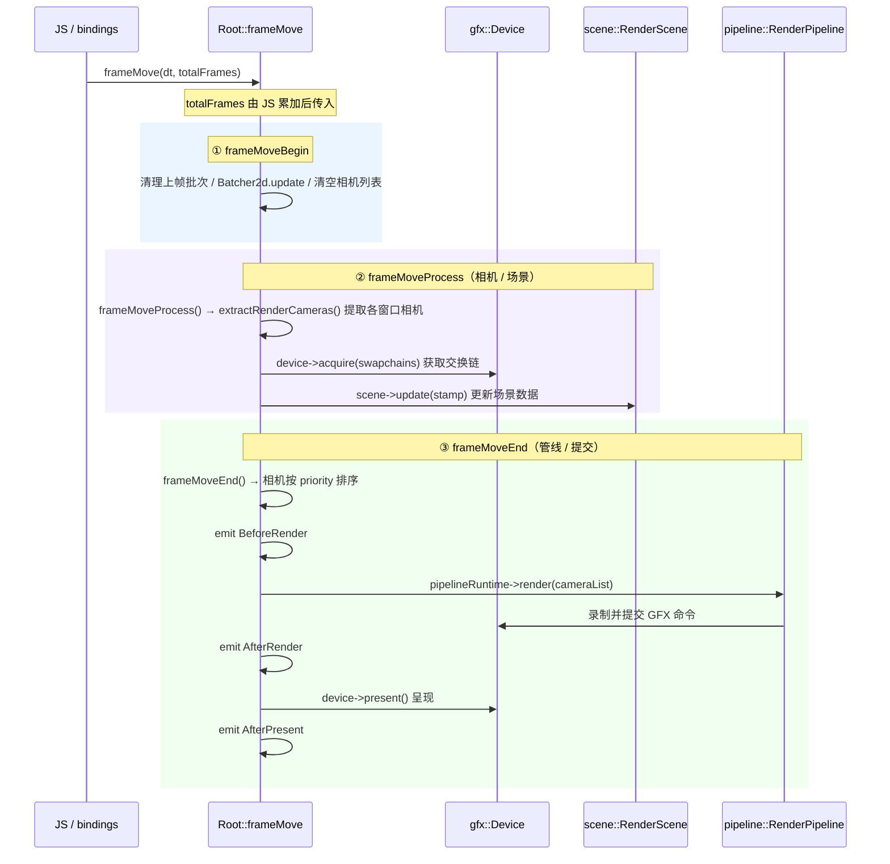
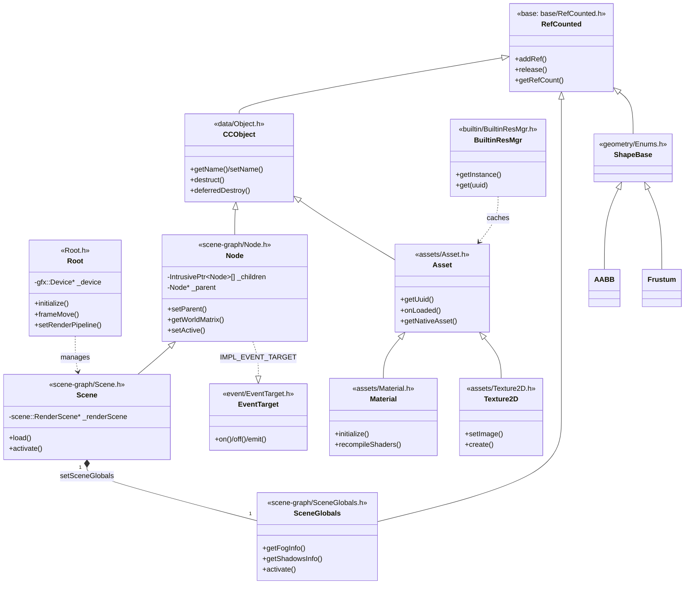
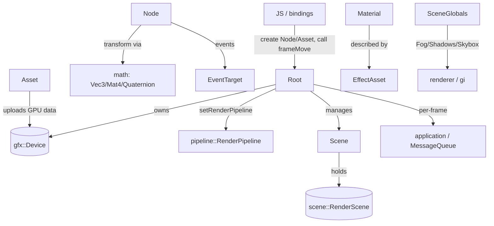

# core 模块详解

> 根目录：`native/cocos/core/` · 规模：~116 文件 · 语言：C++17
> 关联文档：[00-overview](./00-overview.md) · [base](./base.md) · [math](./math.md) · [scene](./scene.md) · [renderer](./renderer.md) · [gi](./gi.md) · [application](./application.md) · [04-pipeline-deep-dive](./renderer.md)

## 1. 模块职责与定位

`core` 是 Cocos Native 引擎的**运行时中枢**，向下持有 `gfx::Device`（见 [03-gfx-deep-dive](./renderer.md)），向上为 JS 层（通过 `bindings`）提供可直接实例化的核心对象。它覆盖了：

- **渲染总控**：`Root` 作为「导演（Director）」的 C++ 等价物，负责每帧 `frameMove`、窗口/场景/模型/灯光生命周期管理，以及把渲染任务交给 `pipeline::RenderPipeline`。
- **场景图（scene-graph）**：`Node` / `Scene` / `Layers` / `SceneGlobals`，构成对象树、变换层级（局部↔世界矩阵）与层级掩码。
- **资源系统（assets）**：`Asset` 抽象基类及其子类（`Material`、`Texture2D`、`EffectAsset` 等），以及内置资源管理器 `BuiltinResMgr`。
- **事件系统（event）**：`EventBus`（编译期总线）与 `EventTarget`（对象级事件分发，被 `Node` 大量使用）。
- **几何与相交（geometry）**：`AABB`、`Frustum`、`Ray`、`OBB`、`Sphere`、`Plane` 等以及 `Intersect` 静态相交工具。
- **支撑设施**：`data/Object`（CCObject）、`platform`（宏配置 `Macro`、调试 `Debug`）、`utils`（ID、`Path`、`Pool`）、`memop`（JS 风格 `TypedArray`/`ArrayBuffer`/`Any`）、`builtin`、`animation`。

> 注意：`Component`、`RenderScene`、`Model`、`Light` 等**并不在本模块**，它们位于 `scene` 模块（见 [scene](./scene.md)）。`core` 的 `Node` 只提供节点树与变换，组件挂载由 `scene`/JS 层完成（见 `core/scene-graph/Node.h` 中已注释掉的 `getComponent`）。

## 2. 目录树与子目录说明

```
core/
├── Root.h / Root.cpp            # 渲染总控 Root（导演）
├── Any.h / Types.h              # 通用 any 容器与全局类型别名
├── ArrayBuffer.* TypedArray.* DataView.*  # JS 风格类型化数组 / 二进制视图
├── animation/                   # 骨骼动画工具（SkeletalAnimationUtils）
├── assets/                      # 资源体系：Asset 基类 + 各资源子类
│   ├── Asset.h                  # 资源抽象基类
│   ├── Material.h EffectAsset.h # 材质 / Effect 描述
│   ├── Texture2D.h TextureBase.h SimpleTexture.h TextureCube.h ImageAsset.h RenderTexture.h
│   ├── Font.h BitmapFont.h FreeTypeFont.h BufferAsset.h SceneAsset.h RenderingSubMesh.h TextAsset.h
│   └── AssetEnum.h AssetsModuleHeader.h
├── builtin/                     # 内置资源与调试信息（BuiltinResMgr, DebugInfos）
├── data/                        # CCObject（RefCounted 派生的引擎对象基类）
├── event/                       # EventBus / EventTarget / Event
├── geometry/                    # AABB/Frustum/Ray/OBB/Sphere/Plane/Line/Triangle/Capsule/Spline/Curve + Intersect
├── memop/                       # 内存操作辅助
├── platform/                    # Macro（全局配置）、Debug（调试输出）
├── scene-graph/                 # Node / Scene / Layers / SceneGlobals / NodeEnum
└── utils/                       # IDGenerator / Path / Pool
```

| 子目录 | 关键产物 | 说明 |
| --- | --- | --- |
| `scene-graph` | `Node`, `Scene`, `Layers`, `SceneGlobals` | 节点树、变换层级、层级掩码、场景级环境信息 |
| `assets` | `Asset` 及子类 | 资源加载、引用计数、GPU 资源上传 |
| `event` | `EventBus`, `EventTarget` | 编译期总线 + 对象级事件 |
| `geometry` | `AABB`…`Intersect` | 数学几何与碰撞/可见性判定（依赖 [math](./math.md)） |
| `platform` | `Macro`, `Debug` | 运行期宏开关与日志/断言 |
| `data` | `CCObject` | 引擎对象基类，桥接 `base/RefCounted.h` |
| `utils` | `IDGenerator`, `Path`, `Pool` | 通用小工具 |
| `builtin` | `BuiltinResMgr` | 默认/内置资源单例 |

## 3. 关键类 / 结构体

### 3.1 渲染总控 `Root`（`Root.h`）
```cpp
class Root final {
    explicit Root(gfx::Device *device);
    void initialize(gfx::Swapchain *swapchain);
    void destroy();
    void resize(uint32_t width, uint32_t height, uint32_t windowId);
    bool setRenderPipeline(pipeline::RenderPipeline *rppl = nullptr); // 见 04-pipeline-deep-dive
    void frameMove(float deltaTime, int32_t totalFrames);   // 每帧推进（totalFrames 由 JS 传入）
    void frameSync();
    void frameMoveBegin(); void frameMoveProcess(bool, int32_t); void frameMoveEnd();
    scene::RenderWindow *createRenderWindowFromSystemWindow(uint32_t windowId);
    static uint32_t createSystemWindow(const cc::ISystemWindowInfo &info);
    void destroyScene(scene::RenderScene *);
    void destroyModel(scene::Model *);
    void destroyLight(scene::Light *);
    uint32_t getFrameCount() const; uint32_t getFps() const;
    void setFixedFPS(uint32_t fps); bool isUsingDeferredPipeline() const;
};
```
`Root` 持有 `gfx::Device *_device`，是连接上层 `application`/JS 与下层 `pipeline` 的调度核心；C++ 侧没有独立的 `Director`，`totalFrames` 由 JS 层累加后传入 `frameMove`。

### 3.2 场景图
- **`Node`（`scene-graph/Node.h`）**：`class Node : public CCObject`，通过 `IMPL_EVENT_TARGET_WITH_PARENT(Node, getParent)` 挂载事件。核心能力：
  - 树操作：`setParent(Node*, bool isKeepWorld=false)`、`addChild`/`removeChild`/`removeAllChildren`、`getChildren()`（`ccstd::vector<IntrusivePtr<Node>>`）、`getParent()`、`walk(pre, post)`。
  - 激活：`setActive(bool)`、`isActive()`、`isActiveInHierarchy()`、`onPostActivated(bool)`。
  - 变换：`setPosition/getPosition`（Vec3）、`getRotation`（Quaternion）、`getScale`、`getWorldPosition/ Rotation/Scale`、`getWorldMatrix()`（Mat4）、`updateWorldTransform()`、`updateWorldTransformRecursive(uint32_t &superDirtyBits)`；脏标记 `TransformBit`（见 4.2）。
  - 层级：`getLayer()/setLayer(uint32_t)`、`Layers`。
  - 事件常量：`TouchStart/Move/End/Cancel`、`MouseDown/Up`、`TransformChanged`、`ChildAdded/Removed`、`ActiveInHierarchyChanged`、`SceneUpdated` 等（见 `DECLARE_TARGET_EVENT_BEGIN`）。
- **`Scene`（`scene-graph/Scene.h`）**：`class Scene final : public Node`，额外持有 `scene::RenderScene *_renderScene`（`getRenderScene()`），以及 `SceneGlobals`（通过 `setSceneGlobals`），提供 `load()`、`activate(bool)`、`onBatchCreated(bool)`。
- **`SceneGlobals`（`scene-graph/SceneGlobals.h`）**：`class SceneGlobals : public RefCounted`，聚合并管理场景级环境信息对象：`getAmbientInfo()`→`AmbientInfo`、`getShadowsInfo()`→`ShadowsInfo`、`getSkyboxInfo()`→`SkyboxInfo`、`getFogInfo()`→`FogInfo`、`getOctreeInfo()`→`OctreeInfo`、`getLightProbeInfo()`→`gi::LightProbeInfo`、`getSkinInfo()`→`SkinInfo`、`getPostSettingsInfo()`→`PostSettingsInfo`；`activate(Scene*)` 绑定到具体场景。
- **`Layers`（`scene-graph/Layers.h`）**：见 4.2。

### 3.3 资源体系（`assets/`）
- **`Asset`（`assets/Asset.h`）**：`class Asset : public CCObject`，资源抽象基类：
  - 标识：`getUuid()/setUuid`、`getNativeUrl()`、`NativeDep getNativeDep()`。
  - 原生资产桥接：`virtual ccstd::any getNativeAsset() const`、`virtual void setNativeAsset(const ccstd::any&)`（JS 端 GFX 句柄通过此处回写）。
  - 引用与生命周期：`addAssetRef()`、`decAssetRef(bool autoRelease=true)`、`getAssetRefCount()`、`destruct()`。
  - 加载钩子：`onLoaded()`、`initDefault(optional<string>)`、`validate()`、`serialize/deserialize`。
- **`Material`（`assets/Material.h`）**：`class Material : public Asset`。关键结构 `IMaterialInfo`（`effectAsset`、`effectName`、`defines`、`states`、`technique`）。方法：`initialize/reset(const IMaterialInfo&)`、`recompileShaders(const MacroRecord&)`、`overridePipelineStates(const PassOverrides&, index_t)`、`resetUniforms(bool)`、`onLoaded()`。其 `Passes` 由 `EffectAsset` 描述。
- **`Texture2D`（`assets/Texture2D.h`）**：`class Texture2D final : public SimpleTexture`。`getMipmaps()/setMipmaps`、`getImage()/setImage(ImageAsset*)`、`create(w,h,format,mipLevel,...)`、`updateMipmaps(firstLevel,count)`、`reset(ITexture2DCreateInfo)`、`initDefault`。
- 其它：`SimpleTexture`/`TextureBase`/`TextureCube`/`ImageAsset`/`RenderTexture`（`RenderTarget` 用途）、`EffectAsset`、`Font`/`BitmapFont`/`FreeTypeFont`、`BufferAsset`、`SceneAsset`、`RenderingSubMesh`、`TextAsset`。

### 3.4 内置资源 `BuiltinResMgr`（`builtin/BuiltinResMgr.h`）
```cpp
class BuiltinResMgr final {
    static BuiltinResMgr *getInstance();
    void addAsset(const ccstd::string &uuid, Asset *asset);
    Asset *getAsset(const ccstd::string &uuid);
    template <typename T> T *get(const ccstd::string &uuid); // 带类型转换
    void initTexture2DWithUuid(...); void initTextureCubeWithUuid(...);
    ccstd::unordered_map<ccstd::string, IntrusivePtr<Asset>> _resources;
};
```
单例，缓存默认贴图/材质等内置资源，供引擎与 JS 层按 uuid 取用。

### 3.5 引擎对象基类 `CCObject`（`data/Object.h`）
`class CCObject : public RefCounted`（见 [base](./base.md) 的 `RefCounted`）。提供 `getName/setName`、`setHideFlags(Flags)`、`destruct()`、`destroyImmediate()`、`static deferredDestroy()`、`setScriptObject(se::Object*)`（绑定 JS 对象）。`Node`、`Asset` 等均继承自它。

### 3.6 事件（`event/`）
- **`EventBus`**：基于 `BusEventListenerDB<EHandler>` 的**编译期总线**。`BusEventBroadcaster` 调用 `broadcast(ARGS...)`；`Listener` 通过 `EHandler::BUS_NAME`/`HANDLE_CLASS` 自注册到 `BusEventListenerContainer`，支持 `enable/disable`。适合跨模块「全局事件」。
- **`EventTarget`**：对象级事件系统，用于 `Node`。通过 `IMPL_EVENT_TARGET_WITH_PARENT` 与 `TARGET_EVENT_ARG0/1(...)` 宏声明事件；提供 `on/off/once/targetOff/emit`，`Event` 携带 `stopPropagation()/preventDefault()`。

### 3.7 几何（`geometry/`，依赖 [math](./math.md)）
- 形状基类 `ShapeBase : public RefCounted`（`Enums.h`），派生 `AABB`、`Frustum`、`Ray`、`OBB`、`Sphere`、`Plane`、`Line`、`Triangle`、`Capsule`。
  - `AABB`：`create(px,py,pz,hw,hh,hl)`、`merge`、`transform(const Mat4&, AABB*)`、`getBoundary(min,max)`、`fromPoints`。
  - `Frustum`：`createPerspective/createOrtho`、`update(const Mat4& m, const Mat4& inv)`、`split(...)`、`planes`（`ccstd::array<Plane*,6>`）。
  - `Ray`：`fromPoints`、`computeHit(Vec3*, float distance)`。
- **`Intersect`**（`Intersect.h`，命名空间 `cc::geometry`）：大量 `static` 相交判定函数，覆盖 `Ray` 与 `AABB`/`OBB`/`Plane`/`Sphere`/`Triangle`/`Frustum`/`Line`/`Capsule` 以及 `Model` 的求交，是相机拣选与拾取的基础。
- `Spline` / `Curve`：曲线/样条工具。

### 3.8 平台与工具
- **`Macro`（`platform/Macro.h`）**：巨型配置结构，包含大量运行期布尔开关（如 tiled map 自动剔除、alpha 通道、光照修正等），在 `game.init` 前可改写。
- **`Debug`（`platform/Debug.h`）**：`enum class DebugMode`；自由函数 `log/warn/error/_assert/debug(...)`，输出到 Creator 控制台或运行期 Web 控制台。
- **`IDGenerator`（`utils/IDGenerator.h`）**：`getNewId()` 按 `category` 前缀生成唯一 id。
- **`Path`（`utils/Path.h`）**：`join`、`extname`、`basename`、`dirname` 等路径处理。
- **`Pool`（`utils/Pool.h`）**：通用对象池模板，`get`/`put`/`getCount()`，回收可重置对象以降低分配。

## 4. 每帧流程 (Root::frameMove)

`Root::frameMove` 是 `core` 模块的**每帧渲染职责核心**：它被 `application` 层经 JS 逻辑（`se::ScriptEngine::mainLoopUpdate` → `root.frameMove(dt, totalFrames)`）驱动，内部再细分为 `frameMoveBegin → frameMoveProcess → frameMoveEnd` 三段。其上层调用链（平台线程 → `Engine::tick` → `se::mainLoopUpdate` → JS → `Root::frameMove`）与启动/脚本绑定/窗口事件时序，统一汇总在 [application](./application.md) 的「时序图」章节。



**要点：**
- **Begin**：移除上帧批次，`Batcher2d` 更新，清空相机列表，为本次渲染做准备。
- **Process**：从各窗口 `extractRenderCameras` 提取相机 → `device->acquire()` 获取交换链 → `scene->update(stamp)` 更新场景数据（变换、动画、可见性等）。
- **End**：相机按 `priority` 排序 → `BeforeRender` → `pipeline->render(cameras)` 录制/提交 GFX 命令 → `device->present()` 呈现；期间 `Root` 派发 `BeforeCommit / BeforeRender / AfterRender / AfterPresent` 事件钩子，供上层插入自定义渲染逻辑。
- 多线程渲染由 `DeviceAgent`（若启用线程分离）承载，`acquire`/`present` 是主线程与渲染线程的同步点；`XR` 路径下由 `Engine::tick` 的 `xr->beginRenderFrame/endRenderFrame` 包裹整段流程（见 [application](./application.md)）。

## 5. 关键枚举 / 常量

### 5.1 `TransformBit`（`scene-graph/Node.h`）
节点变换脏标记位（与 `NodeEnum` 协同），用于局部↔世界矩阵增量更新：
`NONE`、`POSITION`、`ROTATION`、`SCALE`、`RS`（旋转+缩放）、`TRS`、`TRS_MASK` 等（`TransformDirtyBit` 为其别名）。`Node::_transformFlags` 初始为 `TRS | SKEW`。

### 5.2 `Layers::LayerList`（`scene-graph/Layers.h`）
```cpp
enum class LayerList : uint32_t {  // 位掩码，CC_ENUM_BITWISE_OPERATORS
    NONE = 0, LAYER_0..LAYER_31 等（按位 1<<n）
};
```
与 `Node::getLayer/setLayer` 配合，决定节点参与拣选/光照/相机的可见性分组。

### 5.3 `geometry::ShapeEnum`（`geometry/Enums.h`）
`enum class ShapeEnum { ... }` 区分 `AABB`/`OBB`/`SPHERE`/`PLANE`/`RAY`/`LINE`/`FRUSTUM`/`TRIANGLE`/`CAPSULE` 等形状类型。

### 5.4 `DebugMode`（`platform/Debug.h`）
`enum class DebugMode { NONE, INFO, WARN, ERROR, ... }` 控制调试输出级别。

### 5.5 数学常量
`math::PI`、`PI_2`、`PI_DIV2`…（见 [math](./math.md) `Math.h`）。

## 6. 类关系图



## 7. 与上下层交互



- **下层（gfx / pipeline）**：`Root` 持有 `gfx::Device`，通过 `setRenderPipeline` 接入 `pipeline::RenderPipeline` 与 `scene::RenderScene`，把场景数据投递到渲染后端（详见 [04-pipeline-deep-dive](./renderer.md)、[03-gfx-deep-dive](./renderer.md)）。
- **上层（JS / bindings）**：JS 直接实例化 `Node`/`Scene`/`Asset`/`Material` 等，并通过 `bindings` 调用 `Root::frameMove`；原生 GFX 句柄经 `Asset::setNativeAsset`/`getNativeAsset` 在 C++ 与 JS 间传递。每帧 `frameMove` 的 Begin/Process/End 流程见上文 [`## 每帧流程 (Root::frameMove)`](#每帧流程-rootframemove)。
- **横切依赖**：`Node`/`Scene` 变换依赖 [math](./math.md) 的 `Vec3`/`Mat4`/`Quaternion`；`SceneGlobals` 的环境信息（雾、阴影、天空盒、光照探针）驱动 [renderer](./renderer.md) 与 [gi](./gi.md)；几何形状与 `Intersect` 服务于相机拣选与 [physics](./physics.md) 碰撞。
- **基础设施**：`CCObject`/`Asset`/`Node` 的引用计数来自 [base](./base.md) 的 `RefCounted` 与 `IntrusivePtr`。
- **启动与生命周期**：`Root` 由 `application` 层创建并驱动（见 [application](./application.md) 的启动/每帧 tick/脚本绑定时序）；其 `frameMove` 的调用时序由 `Engine::tick` → `se::mainLoopUpdate` 串联。

## 8. 修改 / 扩展要点

- **新增资源类型**：在 `assets/` 下继承 `Asset`，实现 `getNativeAsset/setNativeAsset`、`onLoaded`、`initDefault`、`validate`、`destruct`；如需要统一暴露，加入 `AssetsModuleHeader.h`。注意 GPU 资源上传需显式调用（如 `Texture2D::uploadData`），不会自动同步。
- **新增节点能力**：扩展 `Node` 时优先使用其事件系统（`TARGET_EVENT_ARG0/1`）而非直接耦合；世界矩阵走 `updateWorldTransform` + `TransformBit` 脏标记以保证增量更新正确。
- **扩展事件总线**：新增全局事件需定义带 `BUS_NAME`/`HANDLE_CLASS` 的 `EHandler`，注册到 `EventBus`，避免在主线程外随意 broadcast。
- **修改 `Root` 帧流程**：`frameMove → frameMoveBegin/Process/End → frameSync` 的拆分与 `totalFrames`/`deltaTime` 由 JS 控制，改动须与 `application`（见 [application](./application.md)）及 `bindings` 协同，避免破坏 XR/多窗口路径（`doXRFrameMove`、`createRenderWindowFromSystemWindow`）。
- **几何/相交**：新形状应继承 `ShapeBase` 并在 `geometry::ShapeEnum` 注册；相交算法放到 `Intersect`（静态函数），保持无状态、可单元测试。
- **配置项**：运行期开关统一放在 `platform/Macro.h`，并在 `game.init` 前允许覆盖；新增布尔开关请补充注释说明默认值与影响范围。
- **内存与生命周期**：`core` 对象均依赖 `RefCounted`/`IntrusivePtr`，新增跨模块持有关系时务必使用 `IntrusivePtr` 防止悬垂（详见 [base](./base.md)）。
