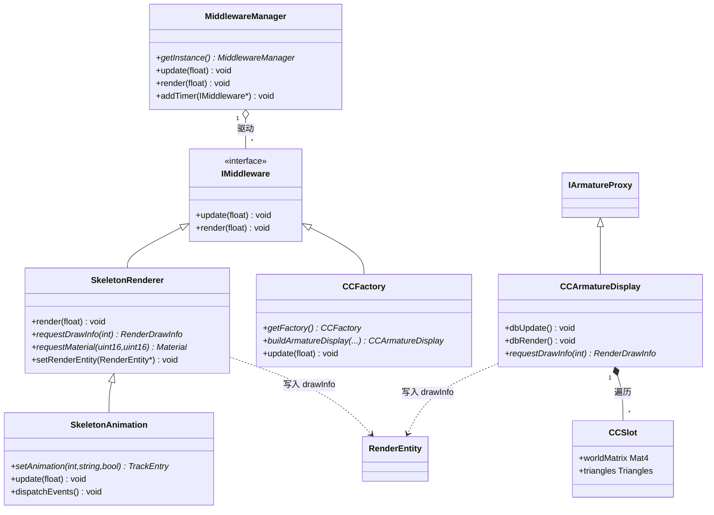
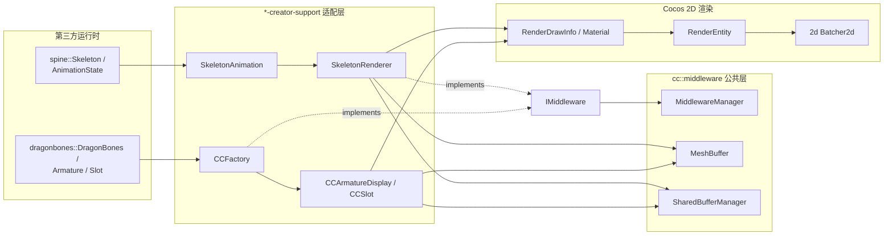

# 骨骼动画运行时（Spine / DragonBones）模块详解

> 根目录：`native/cocos/editor-support/` · 规模：~451 文件 · 语言：C++17
> 关联文档：[00-overview](./00-overview.md) · [2d](./2d.md) · [renderer](./renderer.md) · [scene](./scene.md) · [core](./core.md) · [base](./base.md) · [bindings](./bindings.md)

## 1. 模块职责与定位

`editor-support/` 集成了两大 **2D 骨骼动画运行时**——**Spine**（Esoteric Software）与 **DragonBones**，并提供了它们与 Cocos 渲染/组件系统的适配层。

- **为什么文件这么多**：~451 个文件里绝大多数是第三方运行时的完整源码（`spine/` 内含 3.8 与 4.2 两套，`dragonbones/` 是官方 C++ 运行时）。真正属于引擎「胶水/适配」的代码集中在 `*-creator-support/` 两个子目录。
- **两大职责**：
  1. **运行时计算**：骨骼变换 + 蒙皮，算出每帧网格顶点与贴图坐标（由第三方运行时完成）。
  2. **Cocos 适配**：把运行时产出的顶点/索引转换成 `cc::RenderDrawInfo` 与 `cc::Material`，挂到 `cc::RenderEntity`，最终走 `2d/` 批渲染（`Batcher2d`）上屏。
- **统一的驱动骨架**：两边共享一套 `cc::middleware` 中间件层（`IMiddleware` + `MiddlewareManager`），由引擎主循环统一 `update`/`render`。

> 阅读策略：不要逐文件读第三方运行时；聚焦 `spine-creator-support/` 与 `dragonbones-creator-support/` 的适配层，以及 `cc::middleware` 公共层。

## 2. 目录树与子目录说明

```text
native/cocos/editor-support/
├── middleware-adapter.h/cpp      // 公共适配类型别名（Color4F/V3F_T2F_C4B/Triangles 等）
├── MiddlewareMacro.h             // MIDDLEWARE_BEGIN / MIDDLEWARE_END 命名空间宏
├── MiddlewareManager.h/cpp       // 中间件统一驱动（单例）
├── MeshBuffer.h/cpp              // 按顶点格式复用的网格顶点/索引缓冲
├── SharedBufferManager.h/cpp     // 共享 TypedArray 缓冲（render info / attach info）
├── IOBuffer.h/cpp                // 二进制 IO 缓冲
├── IOTypedArray.h/cpp            // 暴露给 JS 层的 TypedArray 视图
├── TypedArrayPool.h/cpp          // TypedArray 对象池（减少 GC）
│
├── spine/                        // ★第三方 Spine C++ 运行时（3.8 / 4.2 两套）
│   ├── 3.8/spine/  (Skeleton, AnimationState, Atlas, AttachmentLoader ...)
│   ├── 4.2/spine/
│   ├── VERSION.txt
│   └── spine.h                   // 顶层 umbrella 头（按 CC_USE_SPINE_3_8 选择版本）
│
├── spine-creator-support/        // ★Cocos 适配层
│   ├── SkeletonRenderer.h/cpp    // 核心：把 Skeleton 渲染为 RenderDrawInfo
│   ├── SkeletonAnimation.h/cpp   // 在 Renderer 上叠加 AnimationState + 事件回调
│   ├── SkeletonDataMgr.h/cpp     // 骨骼数据 + Atlas 缓存（单例）
│   ├── SkeletonCache.h/cpp
│   ├── SkeletonCacheMgr.h/cpp
│   ├── SkeletonCacheAnimation.h/cpp
│   ├── AttachmentVertices.h/cpp  // 附件顶点（每附件独立顶点缓冲）
│   ├── VertexEffectDelegate.h/cpp// 顶点特效（仅 CC_USE_SPINE_3_8）
│   └── spine-cocos2dx.h/cpp
│
├── spine-wasm/                   // Spine 的 WASM 版本支持（Web 平台）
│
├── dragonbones/                  // ★第三方 DragonBones 官方运行时
│   ├── DragonBonesHeaders.h
│   ├── core/  armature/  animation/  event/  factory/
│   ├── geom/  model/  parser/
│   └── (DragonBones / BaseFactory / Armature / Slot / Animation ...)
│
└── dragonbones-creator-support/  // ★Cocos 适配层
    ├── CCFactory.h/cpp           // 全局工厂（继承 BaseFactory，单例）
    ├── CCArmatureDisplay.h/cpp   // 骨架树根显示对象（继承 IArmatureProxy）
    ├── CCArmatureCacheDisplay.h/cpp
    ├── CCSlot.h/cpp              // 插槽（继承 Slot，保存三角形/世界顶点）
    ├── CCTextureAtlasData.h/cpp
    ├── CCDragonBonesHeaders.h
    ├── ArmatureCache.h/cpp
    └── ArmatureCacheMgr.h/cpp
```

| 子目录 | 角色 | 是否应修改 |
| --- | --- | --- |
| `spine/` `dragonbones/` | 第三方运行时（骨骼/动画/蒙皮/解析） | 仅升级版本时 |
| `spine-creator-support/` `dragonbones-creator-support/` | **引擎适配层（重点关注）** | 对接 2d/渲染时 |
| `spine-wasm/` | Web 端 Spine WASM | Web 专项 |
| `Middleware*` `MeshBuffer*` `SharedBufferManager*` `IO*` `TypedArrayPool*` `middleware-adapter*` | **公共中间件层**（两运行时共用） | 改渲染对接时 |

## 3. 关键类 / 结构体

### 3.1 公共中间件层 `cc::middleware`（`editor-support/MiddlewareManager.h`）

| 类型 | 位置 | 说明 |
| --- | --- | --- |
| `IMiddleware` | `MiddlewareManager.h:39` | 所有中间件基类，纯虚 `update(float dt)` 与 `render(float dt)` |
| `MiddlewareManager` | `MiddlewareManager.h:51` | **单例**；`update(dt)`/`render(dt)` 遍历 `_updateList`；`addTimer`/`removeTimer` 登记中间件（延迟到 `updateOperateCache` 生效）；`getMeshBuffer(format)` 按顶点格式取得 `MeshBuffer`；`getRenderInfoMgr()`/`getAttachInfoMgr()` 返回 `SharedBufferManager` |
| `MeshBuffer` | `MeshBuffer.h` | 按顶点格式复用的 VBO/IBO 缓冲，供适配层写入 |
| `SharedBufferManager` | `SharedBufferManager.h` | 管理共享 `TypedArray`（`getVBTypedArray`/`getIBTypedArray` 等），用于把顶点数据零拷贝交给 JS/渲染层 |
| `IOTypedArray` / `TypedArrayPool` | `IOTypedArray.h` / `TypedArrayPool.h` | 暴露给脚本层的 TypedArray 视图与对象池 |
| `AttachmentVertices` | `spine-creator-support/AttachmentVertices.h` | 每附件的顶点/索引缓冲（Spine 侧） |
| `VertexEffectDelegate` | `spine-creator-support/VertexEffectDelegate.h` | Spine 顶点特效（`CC_USE_SPINE_3_8` 下生效） |

### 3.2 Spine 适配层（`spine-creator-support/`）

| 类型 | 位置 | 说明 |
| --- | --- | --- |
| `SkeletonRenderer` | `spine-creator-support/SkeletonRenderer.h:70` | **继承 `cc::RefCounted` + `cc::middleware::IMiddleware`**；持有 `spine::Skeleton*`、`spine::Atlas*`；`render(dt)` 计算并生成 `RenderDrawInfo`；`requestDrawInfo(idx)`/`requestMaterial(blendSrc,blendDst)`/`setRenderEntity` 与 2d 渲染对接；`setSkin`/`findBone`/`findSlot`/`setAttachment` 等运行时操控；`setSlotsRange` 限定渲染插槽区间；`getDebugData`/`getSharedBufferOffset` 供调试 |
| `SkeletonAnimation` | `spine-creator-support/SkeletonAnimation.h:51` | 继承 `SkeletonRenderer`，叠加 `spine::AnimationState *_state`；`setAnimation`/`addAnimation`/`setMix`/`clearTracks`；`setStartListener`…`setEventListener` 回调；`cacheAnimationEvent`/`dispatchEvents` 把 Spine 事件派发到 JS |
| `SkeletonDataMgr` | `spine-creator-support/SkeletonDataMgr.h:64` | **单例**，缓存 `SkeletonDataInfo`（`Skeleton*`/`Atlas*`/`AttachmentLoader*`/`attachmentVerticesMap`），避免重复解析 |
| `SkeletonCache` / `SkeletonCacheMgr` | `SkeletonCache.h` / `SkeletonCacheMgr.h` | 离线预烘焙动画帧缓存（提升大量同骨格实例性能） |

### 3.3 DragonBones 适配层（`dragonbones-creator-support/`）

| 类型 | 位置 | 说明 |
| --- | --- | --- |
| `CCFactory` | `dragonbones-creator-support/CCFactory.h:47` | **继承 `BaseFactory` + `IMiddleware`**；全局单例 `getFactory()`；持有 `DragonBones *_dragonBonesInstance`（以 `CCArmatureDisplay` 作事件管理器）；`update(dt)` 调 `_dragonBonesInstance->advanceTime(dt)`，`render(dt)` 调 `render()`；`loadDragonBonesData`/`loadTextureAtlasData`/`buildArmatureDisplay`；`add/remove(Armature)` 经 `WorldClock` 驱动 |
| `CCArmatureDisplay` | `dragonbones-creator-support/CCArmatureDisplay.h:55` | **继承 `cc::RefCounted` + `IArmatureProxy`**；骨架树根，`dbInit/dbUpdate/dbRender/dispose` 由运行时回调；`traverseArmature` 遍历计算渲染数据；`requestDrawInfo`/`requestMaterial`/`setRenderEntity` 与 2d 对接；`addDBEventListener`/`dispatchDBEvent` 转发运行时事件 |
| `CCSlot` | `dragonbones-creator-support/CCSlot.h:46` | 继承 `Slot`；保存 `worldMatrix`(Mat4)、`triangles`(middleware::Triangles)、`worldVerts`、`Color4B color`——即真正持有顶点/颜色的地方 |
| `CCArmatureCacheDisplay` / `ArmatureCache` / `ArmatureCacheMgr` | 对应 .h | 与 Spine 的 Cache 类似，预烘焙骨架动画 |

### 3.4 第三方运行时（仅列举关键入口类）

- **Spine**（`spine/`，经 `spine/spine.h` 引入）：`spine::Skeleton`、`spine::SkeletonData`、`spine::AnimationState`、`spine::Atlas`、`spine::AttachmentLoader`、`spine::SkeletonClipping`。版本由宏 `CC_USE_SPINE_3_8`（否则 4.2）选择。
- **DragonBones**（`dragonbones/`，经 `DragonBonesHeaders.h` 引入）：`dragonbones::DragonBones`、`BaseFactory`、`Armature`、`Slot`、`Animation`、`WorldClock`、`EventObject`。命名空间由 `DRAGONBONES_NAMESPACE_BEGIN/END` 包裹，`DRAGONBONES_DISALLOW_COPY_AND_ASSIGN` 禁用拷贝。

## 4. 关键枚举 / 常量

本模块无集中式枚举头；控制以**编译宏 + 命名空间宏**为主：

```cpp
// 版本/能力选择（spine-creator-support）
CC_USE_SPINE_3_8          // 选择 spine 3.8 运行时，否则使用 4.2；影响 VertexEffectDelegate 等

// 命名空间宏
MIDDLEWARE_BEGIN / MIDDLEWARE_END          // cc::middleware 命名空间（MiddlewareMacro.h）
DRAGONBONES_NAMESPACE_BEGIN / END          // dragonbones 命名空间
DRAGONBONES_DISALLOW_COPY_AND_ASSIGN(C)    // 禁用拷贝/移动
BIND_CLASS_TYPE_A(CCSlot)                  // 运行时反射类型绑定

// 共享数据格式（注释约定，非枚举）
// getSharedBufferOffset(): Uint32Array = |renderInfoOffset|attachInfoOffset|
// getDebugData(): Float32Array = |debugBonesLength|[beginX|beginY|toX|toY|...]
```

Spine 侧事件类型来自运行时本身（`spine::EventType`，在 `SkeletonAnimation` 中通过 `CacheEventInfo::type` 使用：`EventType_Start` 等）；DragonBones 侧为 `dragonbones::EventObject` 派发的字符串类型事件。

## 5. 类关系图





## 6. 与上下层交互

- **驱动入口（主循环 / `MiddlewareManager`）**：引擎启动时把 `SkeletonRenderer`、`CCFactory` 等 `IMiddleware` 通过 `MiddlewareManager::addTimer` 登记；每帧 `MiddlewareManager::update(dt)/render(dt)` 统一推进各运行时（`advanceTime`、骨骼世界变换、生成顶点）。
- **对接 2D 渲染（`2d/` + `renderer/`）**：适配层不直接调 GFX，而是：
  1. `setRenderEntity(cc::RenderEntity*)` 绑定到所属节点的渲染实体；
  2. `requestDrawInfo(idx)` 取得/复用 `cc::RenderDrawInfo`，`requestMaterial(blendSrc, blendDst)` 取得按混合模式缓存的 `cc::Material`（见 `SkeletonRenderer.h:166`、`CCArmatureDisplay.h:170`）；
  3. 写好的 `RenderDrawInfo` 随 `RenderEntity` 进入 `2d/` 的 `Batcher2d` 合批，最终进 `renderer` 管线绘制。
- **对接资源（`core/assets/Texture2D`）**：`setSlotTexture(slotName, Texture2D*, createAttachment)`、`CCTextureAtlasData` 把图集贴图映射为 `cc::Texture2D`，用于生成顶点 UV 与材质。
- **对接脚本层（`bindings/`）**：`getSharedBufferOffset`/`getDebugData` 返回 `IOTypedArray`（由 `SharedBufferManager` 管理），JS 层零拷贝读取；Spine 事件经 `SkeletonAnimation::dispatchEvents`、DragonBones 事件经 `CCArmatureDisplay::dispatchDBEvent` 派发到脚本回调。
- **共享缓冲与对象池**：`SharedBufferManager` + `TypedArrayPool` 避免每帧分配 TypedArray，是大量骨骼实例下性能的关键。

## 7. 修改 / 扩展要点

- **绝大多数情况不要改第三方运行时**（`spine/`、`dragonbones/`）。需要升级 Spine/DragonBones 版本时才动，且要同步 `CC_USE_SPINE_3_8` 宏与 `spine/VERSION.txt`。
- **扩展渲染表现**：在 `*-creator-support/` 适配层修改。例如新增混合模式 → 调整 `requestMaterial` 的 `blendSrc/blendDst` 缓存键；新增顶点特效 → 扩展 `VertexEffectDelegate`（Spine 3.8）。
- **新增一种骨骼数据源**：仿照 DragonBones 的 `CCFactory`/`CCArmatureDisplay`/`CCSlot` 三件套，实现 `IArmatureProxy` 与 `Slot` 派生，并挂入 `MiddlewareManager` 即可复用同一套 `MeshBuffer`/`SharedBufferManager`/2D 渲染链路。
- **性能调优**：大量同骨格实例优先用 `SkeletonCache`/`ArmatureCache`（`SkeletonCacheMgr`/`ArmatureCacheMgr`）预烘焙；注意 `setSlotsRange` 可裁剪只渲染部分插槽。
- **事件链路**：脚本层要接收动画事件，走 `SkeletonAnimation` 的 `setXxxListener` / `dispatchEvents`，或 `CCArmatureDisplay::addDBEventListener` / `dispatchDBEvent`——务必保证事件对象生命周期与回调线程一致。
- **线程/生命周期**：`SkeletonDataMgr`、`SkeletonCacheMgr`、`ArmatureCacheMgr`、`CCFactory` 均为单例，注意 `destroyInstance` 与脚本引擎清理（`stopSchedule` 移除 `MiddlewareManager` 计时器）的配合，避免析构顺序问题。
