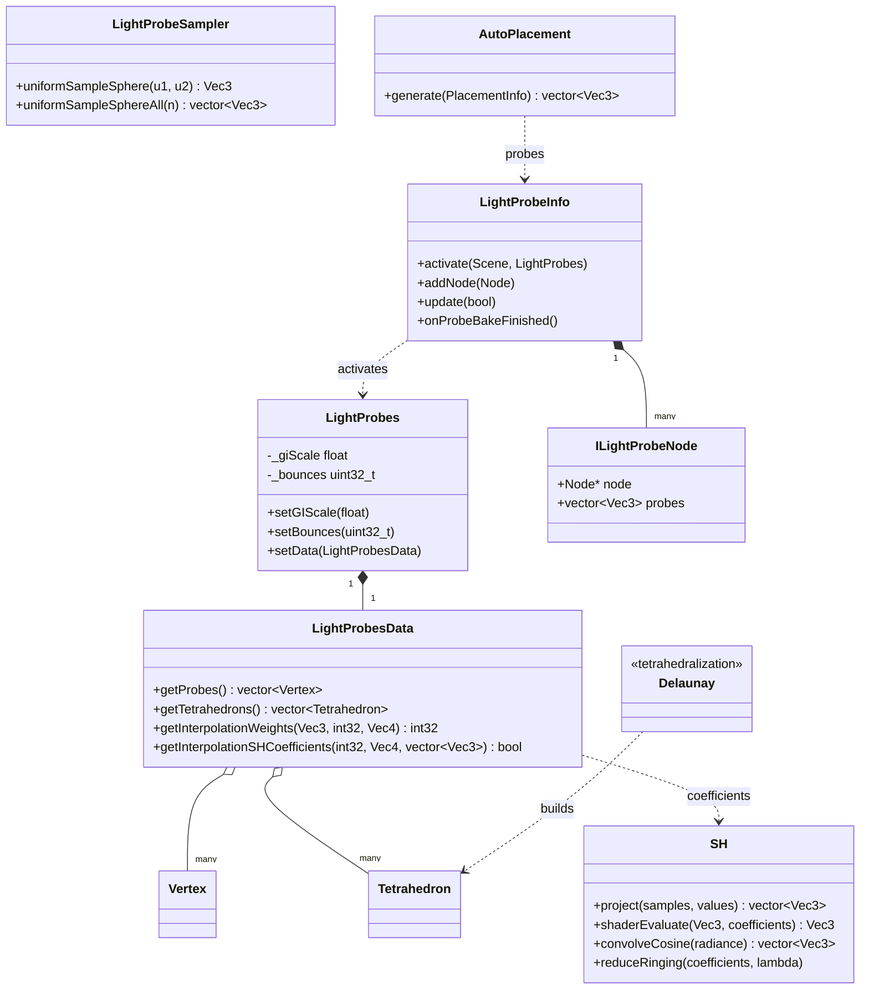

# gi 模块详解

> 根目录：`native/cocos/gi/` · 规模：~13 文件 · 语言：C++17
> 关联文档：[00-overview](./00-overview.md) · [scene](./scene.md) · [core](./core.md) · [math](./math.md)

## 1. 模块职责与定位

`gi` 模块提供 **全局光照（Global Illumination）** 的原生支持，当前核心是 **光照探针（Light Probe）** 系统：

- 在场景中采样间接光照，用 **球谐函数（Spherical Harmonics, SH）** 编码为少量系数；
- 用 **Delaunay 四面体剖分** 把离散探针连成可插值的四面体网格；
- 运行时根据动态物体世界坐标定位所在四面体，做重心插值得到柔和环境光，写入 `scene::Model` 的 SH UBO。

与 [scene](./scene.md) 的耦合：`scene::Model` 通过 `setUseLightProbe()` / `setTetrahedronIndex()` / `updateSHUBOs()` 消费本模块数据；探针数据本身由烘焙工具离线生成后随场景加载。

## 2. 目录树与子目录说明

```
gi/
└── light-probe/
    ├── LightProbe.h/.cpp   # 光照探针系统入口（LightProbes / LightProbesData / LightProbeInfo）
    ├── SH.h/.cpp           # 球谐函数工具（编码/重建/卷积）
    ├── Delaunay.h/.cpp     # Delaunay 四面体剖分（含 Vertex / Tetrahedron 定义）
    ├── tetgen.h/.cpp       # 四面体网格生成库（几何计算）
    ├── AutoPlacement.h/.cpp# 探针自动布点（UNIFORM / ADAPTIVE）
    ├── PolynomialSolver.h/.cpp # 多项式方程求解（几何/插值辅助）
    ├── predicates.cpp      # 几何谓词（浮点鲁棒性）
    └── SH.cpp / LightProbe.cpp / ...
```

> 说明：`AutoPlacement` 用于离线/编辑器阶段自动布置探针；运行时主要依赖 `LightProbesData` + `SH` 做插值查询。

几何计算库分工：`Delaunay.cpp` 实现 Delaunay 四面体剖分（把离散探针点连成互不重叠的四面体，供重心插值）；`tetgen.cpp` 是引入的四面体网格生成库（更通用的网格生成）；`predicates.cpp` 提供浮点鲁棒的几何谓词（点在面内/外接球测试等），保证剖分在退化坐标下稳定；`PolynomialSolver.cpp` 提供多项式方程求解，服务于几何/插值的辅助计算。这些文件均为离线/加载期使用，运行时热路径（插值查询）不依赖它们，性能开销集中在 `LightProbesData` 的查表与加权。

## 3. 关键类 / 结构体

| 类 / 结构体 | 关键成员（真实签名摘要） | 职责 |
| --- | --- | --- |
| `LightProbes` | `setGIScale()`/`getGIScale()`、`setGISamples()`、`setBounces()`、`setReduceRinging()`、`setData(LightProbesData*)` | 探针运行时参数容器（GI 强度/采样数/反弹次数/去振铃） |
| `LightProbesData` | `getProbes()`（`vector<Vertex>`）、`getTetrahedrons()`（向量）、`getInterpolationWeights()`、`getInterpolationSHCoefficients()` | 探针数据：探针点 + 四面体网格 + 插值查询 |
| `LightProbeInfo` | `activate(Scene, LightProbes)`、`addNode()`/`removeNode()`、`syncData()`、`update()`、`onProbeBakeFinished()` | 探针信息（编辑器/序列化侧），管理 `ILightProbeNode` 列表与数据更新 |
| `ILightProbeNode` | `Node* node`、`ccstd::vector<Vec3> probes` | 单个探针节点：挂接的 Node 与局部探针点 |
| `LightProbeSampler` | `uniformSampleSphere()`、`uniformSampleSphereAll()`、`uniformSpherePdf()` | 球面均匀采样（烘焙 SH 系数用） |
| `SH` | `updateUBOData()`、`shaderEvaluate()`、`project()`、`convolveCosine()`、`reduceRinging()`、`SH_BASIS_COUNT=9` | 球谐工具：SH 基函数 LMAX=2（9 个系数），含 AC 去振铃 |
| `AutoPlacement` | `generate(PlacementInfo)`、`PlaceMethod method`、`doGenerateUniform/Adaptive` | 探针自动布点 |
| `Vertex` / `Tetrahedron` | （定义于 `Delaunay.h`）`Vertex{ coefficients, position... }`、`Tetrahedron{ 4 探针索引, 邻接 }` | 剖分基本单元：顶点含 SH 系数，四面体用于插值 |

`LightProbesData` 的插值核心：`getInterpolationWeights(position, tetIndex, weights)` 返回四面体重心坐标 `Vec4`，`getInterpolationSHCoefficients(tetIndex, weights, coefficients)` 用 4 个探针的 SH 系数加权得到目标点环境光。

`LightProbeInfo` 维护 `ccstd::vector<ILightProbeNode> _nodes`，每个节点挂接一个 `core::Node` 并携带局部探针点；`addNode()`/`removeNode()`/`syncData()` 在编辑器与运行时之间同步；`update(updateTet)` 触发四面体网格重建（`updateTetrahedrons()`），`onProbeBakeFinished()`/`clearSHCoefficients()` 处理烘焙完成与清理。运行时可视化由 `_showProbe/_showWireframe/_showConvex` 控制。

## 4. 关键枚举 / 常量

```cpp
// AutoPlacement.h
enum class PlaceMethod { UNIFORM=0, ADAPTIVE=1 };
struct PlacementInfo {
    PlaceMethod method = PlaceMethod::UNIFORM;
    uint32_t nProbesX{3U}, nProbesY{3U}, nProbesZ{3U};
    Vec3 minPos{-10, -10, -10}, maxPos{10, 10, 10};
};

// SH.h
#define SH_BASIS_COUNT 9          // LMAX=2 的 9 个 SH 基
static constexpr int32_t LMAX = 2;
// SH::reduceRinging(): lambda * level^2 * (level+1)^2 衰减高频振铃

// LightProbes 默认参数
float _giScale{1.0F}; uint32_t _giSamples{1024U};
uint32_t _bounces{2U}; float _reduceRinging{0.0F};
```

`SH` 的 `basisFunctions`/`basisOverPI` 为静态表；`LightProbeSampler::uniformSpherePdf()` 返回 `1/(4π)`。

SH 基函数采用 LMAX=2 的 9 个实球谐基（`SH_BASIS_COUNT=9`），索引由 `toIndex(l,m)=l*l+l+m` 计算。`SH::convolveCosine()` 直接由辐射度系数卷积得到辐照度（irradiance）系数，省去运行时积分；`SH::shaderEvaluate()` 与着色器内 `SHEvaluate` 保持一致，便于在 Native 侧复算验证。`reduceRinging()` 按 `scale = 1/(1+λ·l²·(l+1)²)` 对高频（大 `l`）系数做衰减，抑制 SH 投影常见的振铃伪影（`λ` 即 `LightProbes::_reduceRinging`）。`LightProbeSampler` 提供球面均匀采样（`uniformSampleSphere(u1,u2)` 单点、`uniformSampleSphereAll(n)` 批量）供烘焙阶段投影使用。

## 5. 类关系图



## 6. 与上下层交互

- **上游（core / scene）**：`LightProbeInfo::activate(Scene, LightProbes)` 接入 `core::Scene`；探针烘焙结果（SH 系数）随场景资源加载，存入 `LightProbesData`。
- **下游（scene / renderer）**：运行时 `scene::Model` 设置 `setUseLightProbe(true)` 与 `setTetrahedronIndex()`，在 `Model::updateSHUBOs()` 中根据 `LightProbesData` 插值得到 SH 系数，写入局部 SH UBO（`_localSHBuffer`/`_localSHData`），供材质 Shader 读取环境光。
- **依赖 math**：全部几何计算基于 `math::Vec3`/`Vec4`/`Mat4`；`SH::evaluate` 等使用 `math::PI` 与向量运算（见 [math](./math.md)）。
- **烘焙链路（外部）**：`LightProbeSampler` + `SH::project` 由离线烘焙工具调用生成系数；`Delaunay`/`tetgen` 生成四面体网格。运行时仅做插值，不涉及重烘焙。

**典型数据流（烘焙）**：`AutoPlacement::generate()` 或手动布点 → 对每个探针用 `LightProbeSampler::uniformSampleSphereAll()` 采样方向 → `SH::project()` 把辐射度投影为 9 个 SH 系数写入 `Vertex::coefficients` → `Delaunay`/`tetgen` 把探针点剖分为 `Tetrahedron` 网格 → 结果存入 `LightProbesData` 随场景加载。
**典型数据流（运行时）**：`scene::Model` 设 `setUseLightProbe(true)` + `setTetrahedronIndex()` → 每帧根据其世界坐标在 `LightProbesData` 中定位四面体并 `getInterpolationWeights()` 得重心坐标 → `getInterpolationSHCoefficients()` 插值得到 SH → `Model::updateSHUBOs()` 写入 `_localSHBuffer`/`_localSHData` → 材质 Shader 读取环境光。

## 7. 修改 / 扩展要点

1. **扩展 SH 阶数**：当前 `SH::LMAX=2`（`SH_BASIS_COUNT=9`）。提升阶数需同步 `UBOMorph`/光照 UBO 布局、Shader 中 SH 系数数量，以及 `LightProbesData::Vertex::coefficients` 长度——属跨模块改动，需对齐 [03-gfx-deep-dive](./renderer.md) 的 UBO 定义。
2. **新增布点策略**：在 `AutoPlacement::PlaceMethod` 增加枚举，实现 `doGenerateXxx()`；结果作为 `Vec3` 点集回传给 `LightProbeInfo::syncData()`。
3. **插值/剖分调整**：`LightProbesData::getInterpolationWeights()` 处理普通四面体与「外单元（outer cell）」边界情况；修改重心坐标算法需保证 `weights` 四分量和为 1。
4. **去振铃（Reduce Ringing）**：`SH::reduceRinging()` 按 `level` 高频衰减；`LightProbes::_reduceRinging` 由 `LightProbeInfo` 透传，注意 0 表示关闭。
5. **性能与内存**：探针以 SH 系数（9×Vec3）存储，远小于立方图；运行时插值仅查表 + 矩阵乘，属轻量路径。调试可视化由 `LightProbeInfo` 的 `_showProbe/_showWireframe/_showConvex` 控制（编辑器侧）。
6. **四面体网格边界**：`getInterpolationWeights()` 区分普通四面体与「外单元（outer cell）」（`getOuterCellBarycentricCoord`），物体落在凸包外时用外单元策略外推；修改剖分或插值算法后需验证边界稳定性，避免 NaNs 污染 SH UBO。
7. **数据合法性**：`LightProbesData::empty()` 要求 `probes` 与 `tetrahedrons` 均非空；`hasCoefficients()` 要求首个探针含系数。运行时查询前应检查 `LightProbes::empty()`，缺失数据下 `Model` 应回退到环境光（`Ambient`/`Skybox`）而非报错。
