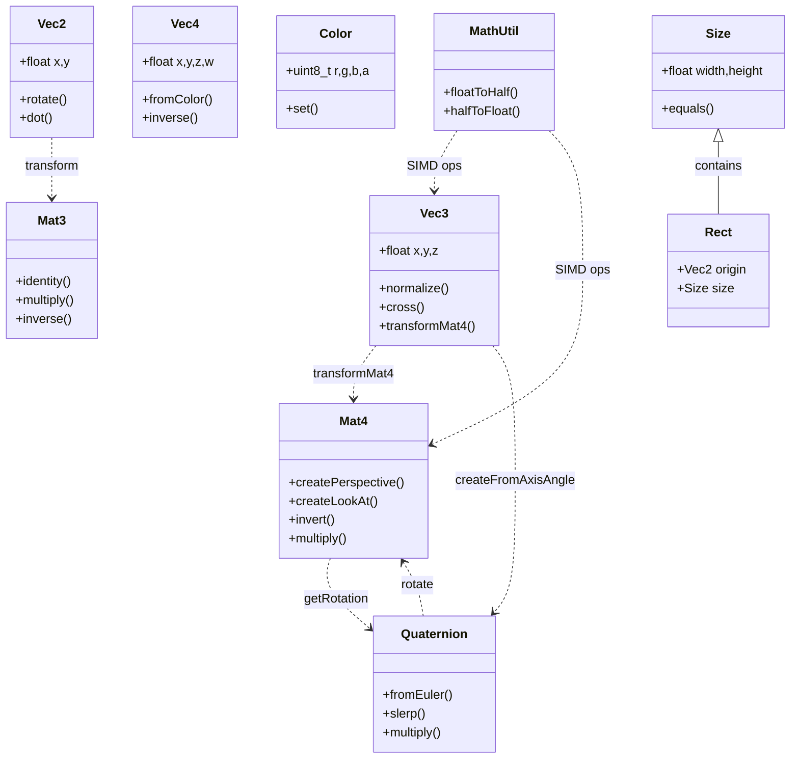
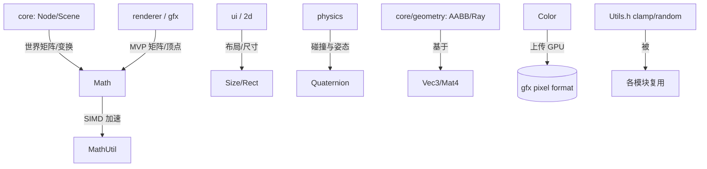

# math 模块详解

> 根目录：`native/cocos/math/` · 规模：~23 文件 · 语言：C++17
> 关联文档：[00-overview](./00-overview.md) · [base](./base.md) · [core](./core.md) · [scene](./scene.md) · [renderer](./renderer.md)

## 1. 模块职责与定位

`math` 是引擎的**基础数学库**，为图形、物理、动画、UI（[ui](./ui.md)）、[2d](./2d.md)/[3d](./3d.md) 等几乎所有模块提供高性能数值类型与运算。它仅依赖 [base](./base.md)（主要是 `ccstd` 与基础宏），不反向依赖 `core`。核心包含：

- **向量**：`Vec2` / `Vec3` / `Vec4`（点、方向、齐次坐标）。
- **矩阵**：`Mat3`（2D 变换）/ `Mat4`（3D 变换与投影）。
- **旋转**：`Quaternion`（避免万向锁的球面插值）。
- **颜色**：`Color`（RGBA 8 位）。
- **几何辅助**：`Geometry.h` 中的 `Size` / `Rect`（2D 尺寸与矩形）。
- **常量与工具**：`Math.h`/`MathBase.h`（π 相关常量、角度弧度转换）、`MathUtil.h`（带 SIMD 优化的底层运算、半精度浮点）、`Utils.h`（clamp/random 等模板工具）。

多数类型提供 `.inl` 内联实现（`Vec3.inl`、`Mat4.inl`、`Quaternion.inl`、`MathUtil.inl`）以及 SIMD 后端（`MathUtilSSE.inl` / `MathUtilNeon.inl` / `MathUtilNeon64.inl`），在支持的平台上自动启用以加速批量运算。

## 2. 目录树与子目录说明

```
math/
├── Vec2.h Vec2.inl          # 二维向量
├── Vec3.h Vec3.inl          # 三维向量（最常用）
├── Vec4.h Vec4.inl          # 四维向量（齐次/颜色）
├── Mat3.h                   # 3x3 矩阵（2D 仿射变换）
├── Mat4.h Mat4.inl          # 4x4 矩阵（变换 + 投影）
├── Quaternion.h Quaternion.inl  # 四元数
├── Color.h                  # RGBA 颜色
├── Geometry.h               # Size / Rect（2D 几何辅助）
├── Math.h                   # 常量（PI 族）与角度/弧度转换
├── MathBase.h               # 底层数学宏与常量定义
├── MathUtil.h MathUtil.inl  # SIMD 优化运算、半精度浮点
├── MathUtilSSE.inl / MathUtilNeon.inl / MathUtilNeon64.inl  # 平台 SIMD 后端
└── Utils.h                  # clamp / random 等模板工具
```

| 文件 | 关键类型 / 内容 |
| --- | --- |
| `Vec2/3/4` | 2/3/4 维向量（分量运算、点积、归一化、插值） |
| `Mat3/4` | 3×3 / 4×4 矩阵（乘法、求逆、平移/旋转/缩放、透视/正交投影） |
| `Quaternion` | 四元数（欧拉↔四元数、轴角、slerp、乘法） |
| `Color` | 8 位 RGBA，构造/取分量 |
| `Geometry.h` | `Size`、`Rect` |
| `Math/Base/Util` | 常量、转换、SIMD 工具、clamp/random |

## 3. 关键类 / 结构体

### 3.1 向量 `Vec2` / `Vec3` / `Vec4`
统一风格（以 `Vec3` 为例，`Vec2`/`Vec4` 同名方法）：
```cpp
class Vec3 {
    float x, y, z;
    static Vec3 fromColor(unsigned int color);
    static float angle(const Vec3 &v1, const Vec3 &v2);
    void add(const Vec3 &v);            static void add(v1,v2,dst);
    void subtract(const Vec3&);         static void subtract(...);
    void scale(float scalar);
    void multiply(const Vec3 &v);       // 逐分量乘
    void negate();
    void normalize();                   // 原地归一
    static float dot(const Vec3&, const Vec3&);
    void cross(const Vec3 &v);          static void cross(v1,v2,dst);
    void clamp(const Vec3 &min, const Vec3 &max);
    void transformMat4(const Mat4 &m); // 用 Mat4 变换（齐次）
    void transformMat3(const Vec3 &v, const Mat3 &m);
    static void transformInverseRTS(const Vec3 &v, const Quaternion &r,
                                    const Vec3 &t, const Vec3 &s, Vec3 *out);
    float length() const;  float distance(const Vec3&) const;
    static void lerp(const Vec3 &a, const Vec3 &b, float t, Vec3 *dst);
};
```
- `Vec2`：额外有 `rotate(const Vec2 &point, float angle)`、`getAngle()`。
- `Vec4`：`fromColor(unsigned int)`、`inverse(...)`、`dot/normalize`，常用于齐次坐标与 `Color` 转换。

### 3.2 矩阵 `Mat3` / `Mat4`
```cpp
class Mat4 {
    float m[16];
    static void createLookAt(const Vec3 &eye, const Vec3 &target, const Vec3 &up, Mat4 *dst);
    static void createPerspective(float fov, float aspect, float zNear, float zFar, Mat4 *dst);
    static void createOrthographic(float l,float r,float b,float t,float zn,float zf, Mat4 *dst);
    static void createBillboard(...);
    void translate(const Vec3&); void rotate(const Quaternion&); void scale(float,float,float);
    void multiply(const Mat4 &m);                 // 后置乘
    static void multiply(const Mat4 &a, const Mat4 &b, Mat4 *dst);
    bool invert();  static void invert(const Mat4&, Mat4*);
    void transpose(); static void transpose(const Mat4&, Mat4*);
    void transformVector(const Vec3 &src, Vec3 *dst) const;
    void getRotation(Quaternion *dst) const; void getScale(Vec3*) const; void getTranslation(Vec3*) const;
};
```
约定：缩放/旋转/平移方法均为矩阵**后置乘**（如先旋转后平移写作 `RT`）。`Mat3` 提供 `identity`、`transpose`、`inverse`、`adjoint`、`multiply`、`translate/rotate/scale`（作用于 2D `Vec2`）。

### 3.3 四元数 `Quaternion`
```cpp
class Quaternion {
    float x, y, z, w;
    static const Quaternion &identity();  static const Quaternion &zero();
    static void fromEuler(float x, float y, float z, Quaternion *dst);
    static void toEuler(const Quaternion &q, bool outerZ, Vec3 *out);
    static void createFromRotationMatrix(const Mat4 &m, Quaternion *dst);
    static void createFromAxisAngle(const Vec3 &axis, float angle, Quaternion *dst);
    static void createFromAngleZ(float z, Quaternion *dst);
    void conjugate();  void inverse();  void normalize();
    void multiply(const Quaternion &q);  static void multiply(q1,q2,dst);
    static void slerp(const Quaternion &q1, const Quaternion &q2, float t, Quaternion *dst);
    void set(float,float,float,float);  void set(const Mat4 &m);
};
```
提供 `lerp`/`slerp`（球面线性插值）/ `squad` 三种插值；注意类本身不自动归一化，必要时显式 `normalize()`。

### 3.4 颜色 `Color`
```cpp
class Color {
    uint8_t r, g, b, a;   // [0,255]
    Color();
    Color(uint8_t r, uint8_t g, uint8_t b, uint8_t a);
    explicit Color(uint32_t val);          // 0xAABBGGRR 打包
    explicit Color(const uint8_t *src);
    void set(uint8_t r, uint8_t g, uint8_t b, uint8_t a);
    // 与 Vec4/float 互转、lerp、toRGBA 等
};
```
轻量 POD，**非** `RefCounted`，按值传递为主；8 位分量与 GPU 像素格式对齐。

### 3.5 几何辅助 `Size` / `Rect`（`Geometry.h`）
```cpp
class Size {
    float width, height;
    Size(); Size(float w, float h); explicit Size(const Vec2&);
    void setSize(float w, float h);
    bool equals(const Size &target) const;
    static const Size ZERO;
    // + - * / 运算符、operator=(Vec2)
};
class Rect { /* origin(Vec2) + size(Size)，2D 矩形区域 */ };
```
`Size` 可由 `Vec2` 隐式转换，服务于 [ui](./ui.md)/[2d](./2d.md) 布局。

### 3.6 常量与工具
- **`Math.h`**：`namespace cc::math` 下常量 `PI`、`PI_2`、`PI_DIV2`、`PI_DIV3`、`PI_DIV4`、`PI_DIV5`、`PI_DIV6`、`PI_DIV8`、`PI_SQR`、`PI_INV`；角度↔弧度转换工具。
- **`MathBase.h`**：底层宏 `MATH_PIOVER2` 等常量与平台相关的数学宏。
- **`MathUtil.h`**：`class MathUtil`（友元 `Mat4`/`Vec3`），封装 SIMD 加速的底层运算（`Vec3Transform*`、`Mat4Invert`、`Vec3Multiply` 等，标记 `CC_FORCE_INLINE`）；提供 `floatToHalf`/`halfToFloat` 半精度浮点转换，供纹理/压缩数据使用。平台后端由 `MathUtilSSE.inl` / `MathUtilNeon.inl` / `MathUtilNeon64.inl` 提供。
- **`Utils.h`**：模板工具 `clamp(val,min,max)`、`clamp01(val)`、`random()`、`randomRange(min,max)`、`randomRangeInt(min,max)` 等，与 `base/Random.h` 配合。

## 4. 关键枚举 / 常量

- `math::PI` 族（`Math.h`）：`PI`、`PI_2`、`PI_DIV2`…`PI_INV`，用于角度/弧度及周期性运算。
- `Color` 分量范围常量：各通道为 `uint8_t`（0–255），无独立枚举。
- `MathBase.h` 宏：`MATH_PIOVER2` 等（底层常量，通常不直接使用）。

> 说明：与 `core/geometry` 的 `ShapeEnum`、各种形状类（AABB/Frustum/Ray 等）不同，`math` 模块只提供**纯数值类型与运算**，不含碰撞/可见性判定逻辑（后者见 [core](./core.md) 的 `geometry`）。

## 5. 类关系图



## 6. 与上下层交互



- **`core` 场景图**：`Node` 的 `setPosition(Vec3)`、`getWorldMatrix()(Mat4)`、`getWorldRotation()(Quaternion)` 直接映射到本模块类型（见 [core](./core.md)）。
- **`renderer` / `gfx`**：`Mat4::createPerspective/Orthographic/LookAt` 生成 MVP/视图矩阵；`Color` 与 GPU 像素格式（见 [03-gfx-deep-dive](./renderer.md)）对接；`MathUtil::floatToHalf/halfToFloat` 用于纹理压缩数据转换。
- **`ui` / `2d` / `3d`**：`Size`/`Rect` 支撑布局；`Vec2`/`Vec3` 支撑坐标与变换（见 [ui](./ui.md)、[2d](./2d.md)、[3d](./3d.md)）。
- **`physics` / `gi`**：`Quaternion`/`Vec3` 表达刚体姿态与向量场（见 [physics](./physics.md)、[gi](./gi.md)）。
- **`core/geometry`**：`AABB`/`Frustum`/`Ray` 等形状以 `Vec3`/`Mat4`/`Quaternion` 作为存储与变换基底，但不属于本模块。

## 7. 修改 / 扩展要点

- **保持纯数值、无状态**：新增类型应为轻量 POD（如 `Color`），避免继承 `RefCounted`，按值传递以减少开销；需要引用语义时再考虑 [base](./base.md) 的智能指针。
- **静态方法优先**：向量/矩阵运算普遍采用 `static void op(a, b, dst)` 形式，便于链式调用且不修改源操作数；同时提供实例方法（原地）版本。
- **SIMD 同步**：若修改 `MathUtil` 的底层运算，必须同步更新 `MathUtilSSE.inl`/`MathUtilNeon.inl`/`MathUtilNeon64.inl` 三个后端与 `MathUtil.inl`，确保各平台结果一致；性能敏感路径使用 `CC_FORCE_INLINE`。
- **半精度浮点**：`floatToHalf/halfToFloat` 用于纹理与压缩数据，修改需保证位级正确，并与 `gfx` 像素格式约定一致。
- **常量管理**：新增数学常量放入 `Math.h`（`cc::math` 命名空间）或 `MathBase.h`，不要散落于各文件；角度/弧度转换统一走 `Math.h` 的工具函数。
- **跨模块一致性**：本模块被全引擎依赖，API 变更影响面极广，新增/修改方法前确认 [core](./core.md)、[renderer](./renderer.md)、[scene](./scene.md) 的使用情况，避免破坏二进制兼容。
