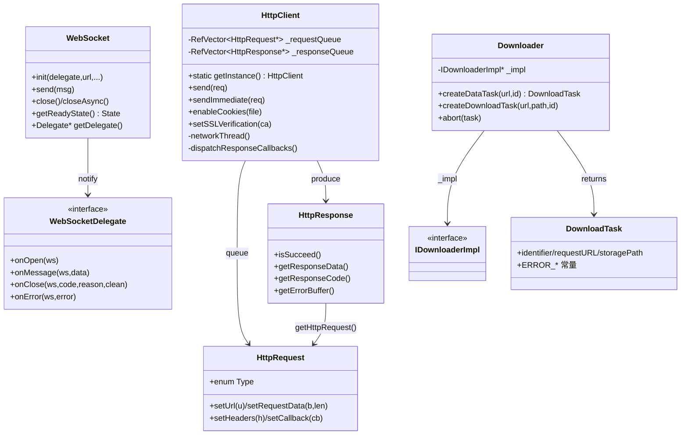

# Network 网络模块详解

> 根目录：`native/cocos/network/` · 规模：~28 文件 · 语言：C++17
> 关联文档：[00-overview](./00-overview.md) · [01-architecture](./00-overview.md) · [base](./base.md) · [application](./application.md) · [platform](./platform.md)

Cocos Native 的网络模块提供三类能力：**HTTP 客户端**（`HttpClient` + `HttpRequest`/`HttpResponse`）、**WebSocket**（`WebSocket` + `Delegate`）、**文件下载器**（`Downloader` + `DownloadTask`）。HTTP 与下载在桌面/服务端用 libcurl 实现，在 Android 走 Java（`Downloader-java`/`HttpClient-java`），在 Apple 平台走系统 API（`DownloaderImpl-apple`/`HttpAsynConnection-apple`）；WebSocket 用 libwebsockets（桌面/通用）或 OkHttp（Android，`WebSocket-okhttp`）。所有回调默认在主线程派发。

## 1. 模块职责与定位

- **职责**
  - 异步 HTTP 请求（GET/POST/PUT/DELETE/HEAD/PATCH），含请求队列、Cookie、SSL 证书校验。
  - 全双工 WebSocket 通信（文本/二进制、连接/消息/关闭/错误事件）。
  - 断点/分块文件下载，支持数据任务与文件任务、进度回调、并发上限与超时。
- **定位**：引擎网络组件（TS 侧 `HttpRequest`/`WebSocket`/`assetManager` 下载）在 native 的落地实现；基于 `base` 的引用计数（`RefCounted`/`RefVector`）、容器与线程原语，并利用 `Scheduler`（来自 `application`/`core`）在主线程派发回调。

## 2. 目录树与子目录说明

```
network/
├── HttpClient.h / HttpClient.cpp            # HTTP 客户端单例（线程 + 请求/响应队列）
├── HttpClient-java.cpp                      # Android(Java) HTTP 桥接
├── HttpRequest.h                            # 请求对象（Type 枚举、url、data、headers、callback）
├── HttpResponse.h                           # 响应对象（succeed、responseData、code、errorBuffer）
├── HttpCookie.h / HttpCookie.cpp            # Cookie 管理
├── HttpAsynConnection-apple.h               # Apple 平台异步连接封装
├── WebSocket.h                              # WebSocket 封装（Delegate、State、ErrorCode、Data）
├── WebSocket-libwebsockets.cpp              # libwebsockets 后端实现
├── WebSocket-okhttp.cpp                     # Android OkHttp 后端实现
├── WebSocketServer.h / WebSocketServer.cpp  # 可选 WS 服务端
├── SocketIO.h / SocketIO.cpp                # Socket.IO 封装
├── Uri.h / Uri.cpp                          # URL 解析工具
├── Downloader.h / Downloader.cpp            # 下载器门面（DownloadTask、回调、DownloaderHints）
├── DownloaderImpl.h                         # 后端接口 IDownloaderImpl / IDownloadTask
├── Downloader-curl.cpp / .h                 # libcurl 后端
├── Downloader-java.cpp / .h                 # Android(Java) 后端
└── DownloaderImpl-apple.h                   # Apple 平台后端
```

- **HTTP**：`HttpClient` 是单例，内部有网络线程 `networkThread()` 与响应队列，主线程通过 `dispatchResponseCallbacks()` 派发。平台差异由 `* -java` / `HttpAsynConnection-apple` 承载。
- **WebSocket**：`WebSocket` 持有 `WebSocketImpl`（OBJC_CLASS），后端是 `libwebsockets` 或 `okhttp`，所有公开方法须在主线程（Cocos Thread）调用。
- **Downloader**：门面持 `std::unique_ptr<IDownloaderImpl> _impl`，后端为 `curl`/`java`/`apple`。

## 3. 关键类 / 结构体

### 3.1 HTTP

| 类 / 枚举 | 文件 | 说明 |
|---|---|---|
| `HttpClient` | `HttpClient.h` | 单例（`getInstance()`/`destroyInstance()`）；`send(req)` 入队、`sendImmediate(req)` 立即发送；`enableCookies(file)`、`setSSLVerification(caFile)`、`getCookie()`；私有 `networkThread()`、`dispatchResponseCallbacks()`、`processResponse()`；常量 `RESPONSE_BUFFER_SIZE = 256` |
| `HttpRequest` | `HttpRequest.h` | 继承 `RefCounted`；`enum class Type { GET, POST, PUT, DELETE, HEAD, PATCH, UNKNOWN }`；`setRequestType/setUrl/setRequestData/setHeaders/setCallback`；`using ccHttpRequestCallback = std::function<void(HttpClient*, HttpResponse*)>` |
| `HttpResponse` | `HttpResponse.h` | 继承 `RefCounted`；`isSucceed()`、`getResponseData()`（vector<char>）、`getResponseHeader()`、`getResponseCode()`（long）、`getErrorBuffer()`、`getHttpRequest()` |
| `HttpCookie` | `HttpCookie.h` | Cookie 存取 |

`HttpClient` 关键字段：`_requestQueue`（`RefVector<HttpRequest*>`）、`_responseQueue`（`RefVector<HttpResponse*>`）、`_timeoutForConnect`/`_timeoutForRead`、`_threadCount`、`std::weak_ptr<Scheduler> _scheduler`、`HttpCookie *_cookie`、`char _responseMessage[256]`。

### 3.2 WebSocket

| 类 / 枚举 | 文件 | 说明 |
|---|---|---|
| `WebSocket` | `WebSocket.h` | 继承 `RefCounted`；`init(delegate, url, protocols, caFile)`、`send(string)`/`send(binary,len)`、`close()`/`closeAsync()`、`getReadyState()`、`closeAllConnections()` |
| `WebSocket::Delegate` | `WebSocket.h` | 纯虚回调：`onOpen(ws)`、`onMessage(ws,data)`、`onClose(ws,code,reason,wasClean)`、`onError(ws,error)` |
| `WebSocket::State` | `WebSocket.h` | `CONNECTING/OPEN/CLOSING/CLOSED` |
| `WebSocket::ErrorCode` | `WebSocket.h` | `TIME_OUT/CONNECTION_FAILURE/UNKNOWN` |
| `WebSocket::Data` | `WebSocket.h` | `bytes/len/issued/isBinary/ext`，方法 `getRemain()` |
| `WebSocketServer` | `WebSocketServer.h` | 可选 WS 服务端 |
| `SocketIO` | `SocketIO.h` | 基于 WebSocket 的 Socket.IO 封装 |

### 3.3 Downloader

| 类 / 结构体 | 文件 | 说明 |
|---|---|---|
| `Downloader` | `Downloader.h` | final 门面；回调 `onDataTaskSuccess`/`onFileTaskSuccess`/`onTaskProgress`/`onTaskError`；`createDataTask(url,id)`、`createDownloadTask(url,path,header,id)`、`abort(task)`；持有 `std::unique_ptr<IDownloaderImpl> _impl` |
| `DownloadTask` | `Downloader.h` | final；`identifier/requestURL/storagePath/header`；错误码 `ERROR_NO_ERROR=0 / INVALID_PARAMS=-1 / FILE_OP_FAILED=-2 / IMPL_INTERNAL=-3 / ABORT=-4`；私有 `std::unique_ptr<IDownloadTask> _coTask` |
| `DownloaderHints` | `Downloader.h` | `countOfMaxProcessingTasks{6}`、`timeoutInSeconds{45}`、`tempFileNameSuffix{".tmp"}` |
| `IDownloaderImpl` | `DownloaderImpl.h` | 后端接口；`Downloader-curl`/`Downloader-java`/`DownloaderImpl-apple` 实现 |
| `IDownloadTask` | `DownloaderImpl.h` | 后端任务句柄 |

## 4. 关键枚举 / 常量

`HttpRequest.h`：

```cpp
enum class Type { GET, POST, PUT, DELETE, HEAD, PATCH, UNKNOWN };
```

`WebSocket.h`：

```cpp
enum class ErrorCode { TIME_OUT, CONNECTION_FAILURE, UNKNOWN };
enum class State { CONNECTING, OPEN, CLOSING, CLOSED };
```

`Downloader.h`（`DownloadTask` 错误码）：

```cpp
static const int ERROR_NO_ERROR      = 0;
static const int ERROR_INVALID_PARAMS= -1;
static const int ERROR_FILE_OP_FAILED= -2;
static const int ERROR_IMPL_INTERNAL = -3;
static const int ERROR_ABORT         = -4;
```

`HttpClient.h`：`static const int RESPONSE_BUFFER_SIZE = 256;`

## 5. 类关系图



## 6. 与上下层交互

- **上层（引擎/绑定）**：TS 侧 `HttpRequest`/`WebSocket`/`assetManager` 调用本模块 C++ 类；`HttpClient::send` 接受 `HttpRequest*`（含 `ccHttpRequestCallback`）；`WebSocket` 通过 `Delegate` 把事件回传脚本层。
- **线程与调度**：`HttpClient` 起独立网络线程 `networkThread()` 执行请求，完成后放入 `_responseQueue`，由主线程 `dispatchResponseCallbacks()` 经 `Scheduler` 派发回调，避免在子线程回调 JS。`WebSocket` 明确要求所有公开方法在 Cocos Thread 调用。
- **平台桥接**：Android 的 HTTP 与下载通过 `HttpClient-java`/`Downloader-java` 调到 Java 层；Apple 用 `HttpAsynConnection-apple`/`DownloaderImpl-apple`；其余平台用 `Downloader-curl`（libcurl）。WebSocket 后端：`WebSocket-libwebsockets`（通用）与 `WebSocket-okhttp`（Android）。
- **安全**：`HttpClient::setSSLVerification(caFile)` 设置根证书路径，为空则关闭 SSL 校验；`enableCookies` 可开启持久 Cookie。
- **URI 解析**：`Uri`（Uri.h/cpp）为 HTTP/WS 内部提供 URL 解析支撑。

## 7. 修改 / 扩展要点

1. **新增 HTTP 后端**：参考 `HttpClient-java`/`HttpAsynConnection-apple` 模式，把请求转交平台 API，最终仍构造 `HttpResponse` 并回主线程派发；保持 `HttpRequest`/`HttpResponse` 的接口不变。
2. **新增下载后端**：实现 `IDownloaderImpl`/`IDownloadTask`（参考 `Downloader-curl`），让 `Downloader` 的 `_impl` 指向它；回调（`onDataTaskSuccess`/`onTaskProgress`/`onTaskError`）签名已在 `Downloader.h` 固定，勿改。
3. **新增 WebSocket 后端**：实现 `WebSocketImpl`（参考 `WebSocket-libwebsockets`），保证 `Delegate` 的四个回调语义一致；注意 `closeAsync(code,reason)` 与 `close()` 的差异。
4. **线程安全**：所有最终回调必须回到主线程（Cocos Thread），不要在网络/下载子线程直接调用 JS 回调，否则触发崩溃。
5. **超时与并发**：`HttpClient` 的 `_timeoutForConnect`/`_timeoutForRead` 与 `DownloaderHints` 的 `countOfMaxProcessingTasks`/`timeoutInSeconds` 是常用调优点；下载临时文件后缀默认为 `.tmp`（`tempFileNameSuffix`）。
6. **注意点**：`HttpRequest` 因跨线程使用，**禁止使用** `autorelease()`，需手动 `retain/release`（`HttpRequest` 头注释明确）；`HttpResponse` 由 `HttpClient` 内部创建与释放，用户不应手动析构。
