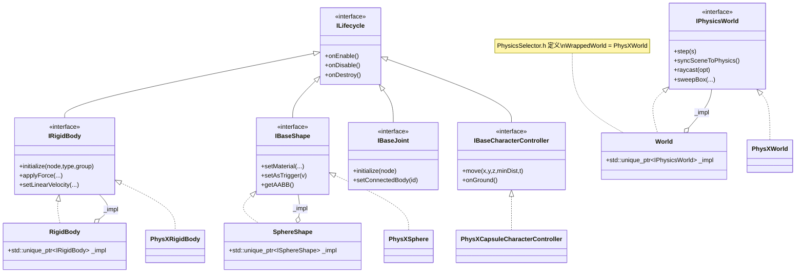

# Physics 物理模块详解

> 根目录：`native/cocos/physics/` · 规模：~66 文件 · 语言：C++17
> 关联文档：[00-overview](./00-overview.md) · [01-architecture](./00-overview.md) · [core](./core.md) · [application](./application.md) · [scene](./scene.md)

Cocos Native 的物理系统采用 **「接口抽象层（spec）→ 共享包装层（sdk）→ 后端实现层（physx）」** 三层架构。上层引擎（TypeScript 侧的 `PhysicsSystem`、`RigidBody`、`Collider`、`PhysicsMaterial` 等组件）通过 JSB 绑定到本模块的 C++ 类；本模块本身不直接耦合任何具体物理引擎，而是通过 `PhysicsSelector.h` 在编译期选择后端（当前内置 PhysX）。

## 1. 模块职责与定位

- **职责**
  - 提供与具体物理引擎解耦的抽象接口（spec 层），定义世界（World）、刚体（Body）、碰撞体（Shape）、关节（Joint）、角色控制器（CharacterController）及生命周期（Lifecycle）行为。
  - 提供共享的 final 包装类（sdk 层），以 `std::unique_ptr<Interface> _impl` 委托给后端，作为引擎绑定的稳定 API 表面。
  - 提供 PhysX 后端（physx 层），实现所有抽象接口，并完成与 PhysX SDK 的对象创建、步进、事件分发与射线/扫掠查询。
  - 维护碰撞矩阵、触发/接触事件、`Raycast`/`sweep` 查询、调试绘制标志等通用能力。
- **定位**：位于引擎框架与第三方物理 SDK 之间，是渲染循环（`application`/`core`）与物理模拟的桥接点。物理世界随主循环 `step` 推进，并把模拟结果 `syncSceneToPhysics` / `syncSceneWithCheck` 同步回场景图节点（`scene`/`core` 的 `Node`）。

## 2. 目录树与子目录说明

```
physics/
├── PhysicsSelector.h              # 编译期后端选择宏（WrappedWorld 等）
├── PhysicsSDK.h                  # 聚合导出 sdk 层头文件
├── spec/                         # 抽象接口层（与后端无关，纯虚接口 + 事件结构体 + 枚举）
│   ├── ILifecycle.h              # onEnable/onDisable/onDestroy 生命周期接口
│   ├── IWorld.h                  # IPhysicsWorld + 事件/查询结构体与枚举
│   ├── IBody.h                   # IRigidBody + ERigidBodyType
│   ├── IShape.h                  # IBaseShape 及各形状子接口 + EAxisDirection/EShapeFilterFlag
│   ├── IJoint.h                  # IBaseJoint 及各关节子接口
│   └── ICharacterController.h    # IBaseCharacterController 及胶囊/盒形控制器子接口
├── sdk/                          # 共享包装层（final 类，持有 _impl 委托给后端）
│   ├── World.h / World.cpp
│   ├── RigidBody.h / RigidBody.cpp
│   ├── Shape.h / Shape.cpp       # CC_PHYSICS_SHAPE_CLASS 宏生成各形状 final 类
│   ├── Joint.h / Joint.cpp
│   └── CharacterController.h / CharacterController.cpp
└── physx/                        # PhysX 后端实现层
    ├── PhysX.h / PhysXInc.h      # 后端入口与 PhysX SDK 头聚合
    ├── PhysXWorld.h              # IPhysicsWorld 实现
    ├── PhysXRigidBody.h          # IRigidBody 实现
    ├── PhysXSharedBody.h         # Node 与 PhysX 体之间的共享桥接
    ├── PhysXEventManager.h       # 触发/接触/CCT 事件收集
    ├── PhysXUtils.h / PhysXFilterShader.h
    ├── shapes/                  # PhysXSphere/Box/Capsule/Plane/Trimesh/Terrain/Cone/Cylinder
    ├── joints/                  # PhysXRevolute/Fixed/Spherical/GenericJoint
    └── character-controllers/   # PhysXCapsule/BoxCharacterController
```

- **spec/ 与 physx/ 是一对多关系**：每个 `spec` 接口在 `physx` 中都有对应实现；若未来接入其他物理引擎（如 Bullet），只需新增 `physics/bullet/` 并实现这些接口，无需改动 `spec/` 与 `sdk/`。
- **sdk/ 是「薄包装」**：它不包含物理算法，仅把调用转发给 `_impl`。引擎绑定只认 `sdk::World` / `sdk::RigidBody` / `sdk::SphereShape` 等，从而与后端彻底解耦。

## 3. 关键类 / 结构体

### 3.1 抽象接口层（spec）

| 类 / 结构体 | 文件 | 作用 |
|---|---|---|
| `IPhysicsWorld` | `spec/IWorld.h` | 物理世界接口：重力、步进、事件发射、场景同步、碰撞矩阵、射线/扫掠、几何资源创建 |
| `IRigidBody` | `spec/IBody.h` | 刚体接口：类型/质量/阻尼/速度/受力、休眠、分组与掩码 |
| `IShape` 系列 | `spec/IShape.h` | `IBaseShape` 及其子接口 `ISphereShape`/`IBoxShape`/`ICapsuleShape`/`ICylinderShape`/`IConeShape`/`IPlaneShape`/`ITrimeshShape`/`ITerrainShape` |
| `IBaseJoint` 系列 | `spec/IJoint.h` | `IBaseJoint` 及 `ISphericalJoint`/`IRevoluteJoint`/`IFixedJoint`/`IGenericJoint` |
| `IBaseCharacterController` | `spec/ICharacterController.h` | 角色控制器接口及 `ICapsuleCharacterController`/`IBoxCharacterController` |
| `ILifecycle` | `spec/ILifecycle.h` | `onEnable`/`onDisable`/`onDestroy` 统一生命周期接口 |

> 引擎组件名与 native 类的映射（重要）：TS 侧的 `PhysicsWorld`→`sdk::World`；`RigidBody`→`sdk::RigidBody`；`Collider` 的各子类→`sdk::SphereShape`/`BoxShape`/`CapsuleShape` 等；`PhysicsMaterial` 在当前 native 中以 `World::createMaterial(id,f,df,r,m0,m1)` + `IShape::setMaterial(...)` 的方式存在，没有独立的 `PhysicsMaterial` C++ 类。`PhysicsSystem` 属于上层引擎（非本目录），负责创建并驱动 `sdk::World`。

### 3.2 共享包装层（sdk）

| 类 | 文件 | 说明 |
|---|---|---|
| `World` (final) | `sdk/World.h` | 继承 `IPhysicsWorld`，私有成员 `std::unique_ptr<IPhysicsWorld> _impl` |
| `RigidBody` (final) | `sdk/RigidBody.h` | 继承 `IRigidBody`，私有成员 `std::unique_ptr<IRigidBody> _impl` |
| `SphereShape`/`BoxShape`/`CapsuleShape`/`CylinderShape`/`ConeShape`/`PlaneShape`/`TrimeshShape`/`TerrainShape` | `sdk/Shape.h` | 由宏 `CC_PHYSICS_SHAPE_CLASS(CLASS)` 生成，各自持有 `std::unique_ptr<I##CLASS> _impl` |
| `Joint` 系列 / `CharacterController` 系列 | `sdk/Joint.h`、`sdk/CharacterController.h` | 同上模式 |

### 3.3 PhysX 后端层（physx）

| 类 | 文件 | 说明 |
|---|---|---|
| `PhysXWorld` | `physx/PhysXWorld.h` | 实现 `IPhysicsWorld`，持有 `PxScene`/`PxPhysics`，驱动 `step` 与事件 |
| `PhysXRigidBody` | `physx/PhysXRigidBody.h` | 实现 `IRigidBody` |
| `PhysXSharedBody` | `physx/PhysXSharedBody.h` | 连接 `Node` 与 PhysX `PxRigidActor` 的共享体 |
| `PhysXEventManager` | `physx/PhysXEventManager.h` | 收集触发器/接触/CCT 事件并填充事件对 |
| `PhysXSphere`/`PhysXBox`/`PhysXCapsule`/`PhysXPlane`/`PhysXTrimesh`/`PhysXTerrain`/`PhysXCone`/`PhysXCylinder` | `physx/shapes/` | 各形状后端实现 |
| `PhysXRevolute`/`PhysXFixedJoint`/`PhysXSpherical`/`PhysXGenericJoint` | `physx/joints/` | 各关节后端实现 |
| `PhysXCapsuleCharacterController`/`PhysXBoxCharacterController` | `physx/character-controllers/` | 角色控制器后端实现 |

### 3.4 关键方法示例（来自真实头文件）

- `IPhysicsWorld::step(float s)`、`syncSceneToPhysics()`、`syncSceneWithCheck()`、`emitEvents()`、`raycast(RaycastOptions&)`、`sweepBox(...)` / `sweepSphere(...)` / `sweepCapsule(...)`、`createConvex/Trimesh/HeightField`、`createMaterial(...)`、`setCollisionMatrix(i,m)`。
- `IRigidBody::initialize(Node*, ERigidBodyType, uint32_t group)`、`applyForce(x,y,z,rx,ry,rz)`、`applyImpulse(...)`、`setLinearVelocity(...)`、`getGroup()/setGroup()`、`getMask()/setMask()`。
- `IBaseShape::setMaterial(id,f,df,r,m0,m1)`、`setAsTrigger(bool)`、`setCenter(x,y,z)`、`updateEventListener(EShapeFilterFlag)`、`getAABB()/getBoundingSphere()`。
- `IBaseCharacterController::move(x,y,z,minDist,elapsedTime)`、`onGround()`、`setStepOffset/setSlopeLimit/setContactOffset`。

## 4. 关键枚举 / 常量

`spec/IWorld.h`：

```cpp
enum class ETouchState : uint8_t { ENTER = 0, STAY = 1, EXIT = 2 };
enum class EPhysicsDrawFlags : uint32_t {
    NONE = 0, WIRE_FRAME = 0x0001, CONSTRAINT = 0x0002, AABB = 0x0004
};
```

`spec/IBody.h`：

```cpp
enum class ERigidBodyType : uint8_t { DYNAMIC = 1, STATIC = 2, KINEMATIC = 4 };
```

`spec/IShape.h`：

```cpp
enum class EAxisDirection : uint8_t { X_AXIS, Y_AXIS, Z_AXIS };
enum class EShapeFilterFlag : uint8_t {
    NONE = 0,
    IS_TRIGGER       = 1 << 0,
    NEED_EVENT       = 1 << 1,
    NEED_CONTACT_DATA= 1 << 2,
};
```

事件数据结构体（均为 `spec/IWorld.h`）：`TriggerEventPair{shapeA,shapeB,state}`、`ContactEventPair{shapeA,shapeB,state,contacts}`、`ContactPoint{position,separation,normal,impulse,...}`、`CharacterControllerContact`、`CCTShapeEventPair`、`CCTTriggerEventPair`；几何描述 `ConvexDesc`/`TrimeshDesc`/`HeightFieldDesc`；查询 `RaycastOptions{origin,distance,unitDir,mask,queryTrigger}` 与 `RaycastResult{shape,hitPoint,distance,hitNormal}`。

## 5. 类关系图



## 6. 与上下层交互

- **上层（引擎/绑定）**：`PhysicsSystem`（上层 TS）在场景初始化时创建 `sdk::World`；节点挂载 `RigidBody`/`Collider` 组件时，引擎调用 `RigidBody::initialize(Node*, ERigidBodyType, uint32_t)` / `SphereShape::initialize(Node*)` 把 C++ 对象绑定到 `core/scene-graph/Node`（`spec/IBody.h`、`spec/IShape.h` 均依赖 `core/scene-graph/Node.h`）。
- **主循环**：`application` 模块在每帧通过 `World::step(fixedTimeStep)` 推进物理，再 `syncSceneToPhysics()` 把节点变换写入物理体，或 `syncSceneWithCheck()` 把物理结果写回 `Node` 变换，最后 `emitEvents()` 派发触发/接触事件给脚本层。
- **查询**：脚本层通过 `World` 的 `raycast`/`sweep*` 做射线检测与形状扫掠，结果经 `RaycastResult` 返回。
- **碰撞过滤**：`setCollisionMatrix(i, m)`、`IRigidBody::setGroup/setMask`、`IShape::setGroup/setMask` 共同决定哪些碰撞体参与检测；`EShapeFilterFlag` 控制触发器/事件/接触数据开关。
- **调试可视化**：`setDebugDrawFlags(EPhysicsDrawFlags)` 配合 renderer 模块把线框/约束/AABB 绘制出来。

## 7. 修改 / 扩展要点

1. **新增后端（如 Bullet）**：在 `physics/` 下新建 `bullet/` 目录，实现 `spec/` 的全部接口；在 `PhysicsSelector.h` 增加 `#if defined(USE_PHYSICS_BULLET)` 分支，把 `WrappedWorld` 等宏指向 `BulletWorld` 等。**不要**改动 `spec/` 与 `sdk/`——它们与后端无关。
2. **新增形状类型**：在 `spec/IShape.h` 增加 `IXxxShape` 接口；在 `sdk/Shape.h` 用 `CC_PHYSICS_SHAPE_CLASS(XxxShape)` 宏生成 final 类（宏已统一处理 `initialize/onEnable/onDisable/onDestroy/setMaterial/...`）；在 `physx/shapes/` 提供 `PhysXXxx` 实现，并在 `PhysicsSelector.h` 追加 `WrappedXxxShape` 映射。
3. **新增关节/控制器**：模式同上，分别在 `spec/IJoint.h`、`spec/ICharacterController.h` 定义接口，在 `sdk/` 生成包装，在 `physx/joints/`、`physx/character-controllers/` 实现。
4. **修改物理行为**：优先改 `physx/` 后端实现；若需调整接口契约（如新增方法），先改 `spec/` 接口，再同步 `sdk/` 转发与 `physx/` 实现，保证三层一致。
5. **事件扩展**：新增事件类型时，参考 `spec/IWorld.h` 的 `TriggerEventPair`/`ContactEventPair` 定义结构体（含 `COUNT` 常量），并在 `PhysXEventManager` 中填充。
6. **注意事项**：`sdk/` 的 `_impl` 默认指向 PhysX（`PhysicsSelector.h` 默认分支），编译期即确定，运行期无后端切换开销；后端对象生命周期由 `sdk` 包装类以 `unique_ptr` 管理，避免手动 `new/delete` 泄漏。
