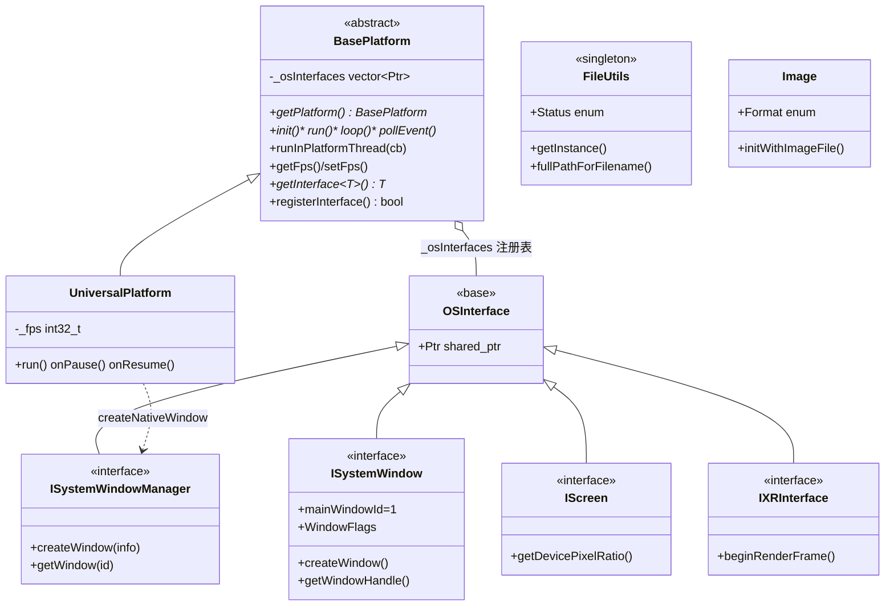

# platform 模块详解

> 根目录：`native/cocos/platform/` · 规模：~252 文件 · 语言：C++17
> 关联文档：[00-overview](./00-overview.md) · [01-architecture](./00-overview.md) · [02-sequence-diagrams](./application.md) · [application](./application.md) · [bindings](./bindings.md) · [ui](./ui.md)

`platform/` 是 Cocos Native 的**平台抽象层（PAL, Platform Abstraction Layer）**，用于隔离操作系统差异：窗口与输入、文件系统、图片解码、设备能力（电池、网络、屏幕、加速度计、振动、XR）等。其设计核心是「**通用接口 + 各 OS 实现**」模式——上层只依赖 `interfaces/` 下的纯接口，具体行为由当前编译目标的子目录（`win32/`、`android/`、`ios/`、`mac/`、`linux/`、`ohos/`、`openharmony/`、`qnx/`、`empty/`）提供。

## 1. 模块职责与定位

- **隔离 OS 差异**：让 `application/`、`renderer/`、`ui/`、`audio/` 等上层模块无需关心 Windows/macOS/Linux/Android/iOS/OpenHarmony 的实现细节。
- **统一能力接口**：通过 `OSInterface` 派生的一组 `I*` 接口（如 `ISystemWindow`、`IScreen`、`INetwork`）暴露系统能力，运行时按平台绑定实现。
- **平台主循环驱动**：`BasePlatform::run`/`loop`/`pollEvent` 是引擎主循环的 OS 端入口，`Engine::tick` 即在其 `runInPlatformThread` 回调中被调用。
- **平台入口配套**：每个 OS 子目录下含各自 `main()`/入口与设备模块实现（WebView 等 UI 组件的实现则位于 `ui/webview/`）。

## 2. 目录树与子目录说明

```
native/cocos/platform/
├── BasePlatform.h/.cpp        # 平台基类（接口 + 通用逻辑）
├── UniversalPlatform.h/.cpp   # 通用平台实现（桌面参考实现）
├── FileUtils.h/.cpp           # 文件系统抽象（路径解析/资源读取/可写目录）
├── Image.h/.cpp              # 图片解码（png/jpg/webp/PVR/ETC/ETC2/ASTC/压缩）
├── SAXParser.h/.cpp          # 轻量 XML 解析器
├── SDLHelper.h/.cpp          # 基于 SDL 的桌面平台辅助
├── StdC.h                     # 跨平台 C 标准库封装
├── interfaces/                # ★ 通用接口（与 OS 无关）
│   ├── OSInterface.h          # 系统接口基类
│   └── modules/               # 能力接口
│       ├── ISystem.h/.cpp     # 系统信息（OSType/SDK 版本）
│       ├── ISystemWindow.h     # 窗口接口 + WindowFlags 枚举
│       ├── ISystemWindowManager.h # 窗口管理（创建/查找/事件）
│       ├── IScreen.h           # 屏幕/分辨率/DPR
│       ├── INetwork.h          # 网络状态
│       ├── IAccelerometer.h    # 加速度计
│       ├── IBattery.h          # 电池
│       ├── IVibrator.h         # 振动
│       ├── Device.h/.cpp       # 设备信息聚合
│       ├── IXRInterface.h      # XR 接口
│       └── canvas/            # 2D Canvas 上下文接口
│           ├── ICanvasRenderingContext2D.h
│           └── CanvasRenderingContext2D.h/.cpp
├── win32/  android/  ios/  mac/  apple/  linux/  ohos/  openharmony/  qnx/  empty/
└── java/                      # Android JNI 桥接（与 android/ 配套）
```

各 OS 子目录规模（文件数）：`android 12`、`apple 9`、`ios 7`、`mac 9`、`linux 5`、`ohos 7`、`openharmony 10`、`qnx 3`、`win32 8`、`empty 3`、`java 2`。其中 `apple/` 为 iOS/macOS 共享的 Objective-C++ 实现；`java/` 为 Android 的 JNI 桥接层。

## 3. 关键类 / 结构体

### BasePlatform（`platform/BasePlatform.h`）
平台抽象基类，全引擎通过 `static BasePlatform *getPlatform()` 获取当前实例（内部 `createDefaultPlatform()` 按 `CC_PLATFORM` 选择实现，`UniversalPlatform` 为通用实现）。关键接口：
- `init()` / `run(argc, argv)` / `loop()` / `pollEvent()` / `exit()`：平台生命周期与消息泵。
- `runInPlatformThread(ThreadCallback)`：把任务投入平台线程（多数平台即主线程；Android 为非主线程）。`Engine::run` 正是把 `tick` 作为该回调注册。
- `getFps()` / `setFps()`：主循环频率；`Engine::setPreferredFramesPerSecond` 会转发到此。
- `getOSType()` / `getSdkVersion()`：返回 `ISystem::OSType`。
- **接口注册表**：`registerInterface(OSInterface::Ptr)` / `unregisterInterface` / `unregisterAllInterfaces`，以及模板 `getInterface<T>()`——遍历 `_osInterfaces`，用 `dynamic_cast` 取出所需能力接口（非空安全由调用方保证）。
- 宏 `START_PLATFORM(argc, argv)`：在 `main` 中调用，`getPlatform()->init()` 失败则 fatal，否则 `platform->run()`（`BasePlatform.h` 末尾）。

### UniversalPlatform（`platform/UniversalPlatform.h`）
`BasePlatform` 的通用实现，提供 `run/onPause/onResume/onClose/onDestroy/runTask` 虚钩子与 `_fps{60}`、`_mainTask` 成员，是桌面平台的参考实现基类。

### OSInterface（`platform/interfaces/OSInterface.h`）
所有系统能力接口的基类，仅含构造/析构与 `using Ptr = std::shared_ptr<OSInterface>`。各 `I*` 接口均继承它，从而可被 `BasePlatform::getInterface<T>()` 检索。

### FileUtils（`platform/FileUtils.h`）
文件系统抽象（单例 `getInstance()`），核心能力：
- 路径解析：`fullPathForFilename()`、`setSearchPaths()`/`addSearchPath()`、`getDefaultResourceRootPath()`、`getWritablePath()`（纯虚，由子平台实现）。
- 读取：`getStringFromFile()`、`getDataFromFile()`、`getContents(filename, T*)`（模板，配合 `ResizableBuffer`/`ResizableBufferAdapter` 支持 `ccstd::string`/`vector`/`Data`）。
- 增删查：`isFileExist` / `isDirectoryExist` / `listFiles` / `createDirectory` / `removeFile` / `renameFile` / `getFileSize`。
- 状态枚举 `FileUtils::Status{ OK, NOT_EXISTS, OPEN_FAILED, READ_FAILED, NOT_INITIALIZED, TOO_LARGE, OBTAIN_SIZE_FAILED }`。
- 工厂 `createFileUtils()` 返回当前平台实现（如 `FileUtilsAndroid`）。

### Image（`platform/Image.h`）
图片解码，继承 `RefCounted`。`Format` 枚举：`JPG/PNG/WEBP/PVR/ETC/ETC2/ASTC/COMPRESSED/RAW_DATA/UNKNOWN`；`initWithImageFile/Data/RawData` 入口，内部按格式分派 `initWithPngData/initWithWebpData/initWithPVRv3Data/initWithETC2Data/initWithASTCData/...`；`saveToFile()` 支持导出 PNG/JPG。提供 `getWidth/getHeight/getData/getRenderFormat` 等访问器及 `getMipmapLevelDataSize()`。

### ISystemWindow / ISystemWindowManager（`platform/interfaces/modules/`）
- `ISystemWindow`：窗口抽象，含 `static constexpr uint32_t mainWindowId = 1`、枚举 `WindowFlags`（`CC_WINDOW_FULLSCREEN=0x1`、`CC_WINDOW_RESIZABLE=0x20`、`CC_WINDOW_VULKAN=0x10000000` 等）、`createWindow(...)`、`getWindowId`/`getWindowHandle`/`getViewSize`/`setCursorEnabled` 等。
- `ISystemWindowManager`：窗口管理，`ISystemWindowInfo{ title,x,y,width,height,flags,externalHandle }`、`SystemWindowMap`(id→window 映射)、`init()`/`processEvent()`/`createWindow(info)`/`getWindow(id)`/`getWindows()`。

### 2D Canvas 接口（`platform/interfaces/modules/canvas/`）
`ICanvasRenderingContext2D` + `CanvasRenderingContext2D`：提供文本与图形绘制的平台无关接口，供 `ui` 模块使用。

### 能力接口清单（`interfaces/modules/`）

| 接口 | 关键方法 / 职责 |
| --- | --- |
| `ISystem` | `OSType` 枚举、`getSdkVersion()`，标识当前操作系统 |
| `ISystemWindow` | 窗口创建、句柄、`getViewSize/setViewSize`、`setCursorEnabled` |
| `ISystemWindowManager` | `init()`、`processEvent()`、`createWindow(info)`、`getWindow(id)`、`getWindows()` |
| `IScreen` | `getDevicePixelRatio()`、分辨率与方向相关接口 |
| `INetwork` | 网络类型/可达性查询 |
| `IAccelerometer` | 加速度计数据 |
| `IBattery` | 电池电量/充电状态 |
| `IVibrator` | 设备振动 |
| `Device` | 聚合设备信息（`Device.h/.cpp`） |
| `IXRInterface` | XR 会话：`beginRenderFrame()`/`endRenderFrame()` 等 |
| `ICanvasRenderingContext2D` | 2D 绘制上下文（文本/图形） |

### 各 OS 实现目录职责
- `win32/`：Windows 入口、`SystemWindow`、设备模块、`jsb_platform_win32.cpp`。
- `android/` + `java/`：Android `main`/Activity 桥接、`FileUtilsAndroid`、JNI（`java/`）。
- `ios/` + `apple/`：iOS 实现，`apple/` 为 iOS/macOS 共享的 Objective-C++。
- `mac/`：macOS 实现（含 `NSBundle` 资源路径处理）。
- `linux/`：Linux 桌面实现（常基于 SDL）。
- `ohos/` + `openharmony/`：OpenHarmony 实现与 NAPI 桥接。
- `qnx/`：QNX 车载平台实现。
- `empty/`：最小占位实现（无真实 OS 时的编译兜底）。

## 4. 关键枚举 / 常量

- `ISystemWindow::WindowFlags`：窗口创建标志位（见 §3，位掩码风格，如 `CC_WINDOW_VULKAN`）。
- `Image::Format`：`JPG/PNG/WEBP/PVR/ETC/ETC2/ASTC/COMPRESSED/RAW_DATA/UNKNOWN`。
- `FileUtils::Status`：`OK=0 … TOO_LARGE=5 / OBTAIN_SIZE_FAILED=6`。
- `OSType`：定义在 `ISystem.h`，经 `BasePlatform::OSType` 暴露（各平台 `getOSType()` 返回）。
- `ISystemWindow::mainWindowId = 1`：主窗口固定 ID，被 `CC_GET_MAIN_SYSTEM_WINDOW()` 用作取窗口依据。

## 5. 类关系图（Mermaid classDiagram）



### 关键接口方法速查

| 类 | 方法 | 说明 |
| --- | --- | --- |
| `BasePlatform` | `getPlatform()` | 取得当前平台单例 |
| `BasePlatform` | `getInterface<T>()` | 取某能力接口（`dynamic_cast` 遍历 `_osInterfaces`） |
| `BasePlatform` | `registerInterface(OSInterface::Ptr)` | 注册系统能力实现 |
| `BasePlatform` | `runInPlatformThread(cb)` | 把任务投入平台线程（驱动 `tick`） |
| `BasePlatform` | `setFps(int32_t)` / `getFps()` | 主循环频率 |
| `ISystemWindow` | `getWindowHandle()` / `getViewSize()` | 供 GFX 创建 Surface / 计算逻辑尺寸 |
| `ISystemWindowManager` | `createWindow(info)` / `getWindow(id)` | 窗口生命周期管理 |
| `FileUtils` | `fullPathForFilename()` / `getWritablePath()` | 路径解析（纯虚由子类实现） |

## 6. 与上下层交互

**「接口 + 各 OS 实现」模式**

```mermaid
flowchart TB
    subgraph Upper["上层（平台无关）"]
        APP["application/engine (Engine::tick)"]
        REND["renderer (gfx Device)"]
        UI["ui (Canvas / WebView)"]
    end
    subgraph Iface["platform/interfaces （通用接口）"]
        OSI["OSInterface"]
        WIN["ISystemWindow"]
        SCR["IScreen"]
        XR["IXRInterface"]
    end
    subgraph Impl["各 OS 实现"]
        W["win32/"] A["android/"] I["ios/"] M["mac/"] L["linux/"] O["ohos/openharmony/"]
    end
    APP -->|CC_GET_PLATFORM_INTERFACE| Iface
    REND -->|swapchain surface| WIN
    UI -->|draw| Iface
    Iface -->|运行时绑定| Impl
    Impl -->|OS API| OS["操作系统 / 驱动"]
```

- **下行访问**：上层通过 `BaseEngine::getInterface<T>()` 或宏 `CC_GET_PLATFORM_INTERFACE(cc::IScreen)` 拿到能力接口，例如 `Engine::setCanvasCallback` 用 `CC_GET_MAIN_SYSTEM_WINDOW()` 取窗口句柄与 `IScreen::getDevicePixelRatio()`（`engine/Engine.cpp`）。
- **上行事件**：平台把 OS 窗口/输入事件转成 `engine/EngineEvents.h` 的事件（见 [application](./application.md) 的 `redirectWindowEvent`），再广播给 TS/JS 层。
- **主循环**：`Engine::run` 调用 `BasePlatform::runInPlatformThread(tick)`（`engine/Engine.cpp`）；平台在 `loop()` 中 `pollEvent()` 并周期性回调 `tick`。
- **文件/图片**：`Engine::init` 通过 `createFileUtils()` 获得平台 `FileUtils`；资源加载最终落到 `FileUtils` 与 `Image`。

## 7. 修改 / 扩展要点

- **新增平台**：在 `platform/<newos>/` 实现 `BasePlatform` 子类（含 `main()`、`createNativeWindow`、`runInPlatformThread`），并实现所需 `I*` 接口（如 `ISystemWindowManager`、`IScreen`、`FileUtils`），再通过 `BasePlatform::createDefaultPlatform()` 的编译分支接入。同时可在 `empty/` 参考最小占位实现。
- **新增系统能力**：在 `interfaces/modules/` 定义新的 `OSInterface` 派生接口，在对应 OS 子目录提供实现，并 `registerInterface()` 注册；上层即可用 `getInterface<T>()` 获取，无需改平台基类。
- **扩展文件/图片格式**：`Image` 的 `detectFormat` 与 `initWithXxxData` 是分派点；新格式需加 `Format` 枚举值并实现对应解码函数。`FileUtils` 子类可覆写 `isFileExistInternal`/`getWritablePath` 等以适配新文件系统。
- **窗口/输入**：`WindowFlags` 已覆盖常见需求；新增窗口行为应优先复用枚举位，避免改动 `ISystemWindow` 已有虚签名（会牵动所有 OS 实现）。
- **注意线程模型**：`runInPlatformThread` 在不同平台语义不同（Android 非主线程），新增每帧任务需保证线程安全；`getInterface` 注释标明「非线程安全」。
- **避免改动**：`BasePlatform` 的 `_osInterfaces` 注册表与 `START_PLATFORM` 宏是全平台统一入口；`OSInterface` 基类是接口检索的基础，改动需同步所有派生接口与实现。

### 新增系统能力接口示例

```cpp
// 1) 在 interfaces/modules/IMyCapability.h 定义接口
class IMyCapability : public OSInterface {
public:
    virtual int doSomething() = 0;
};

// 2) 在 platform/<os>/ 提供实现，并在平台构造/初始化时注册
platform->registerInterface(std::make_shared<MyCapabilityImpl>());

// 3) 上层按需获取（非线程安全）
auto* cap = CC_GET_PLATFORM_INTERFACE(cc::IMyCapability);
if (cap) cap->doSomething();
```

该模式保证上层代码完全平台无关：`interfaces/` 只声明契约，具体行为由各 OS 子目录兑现，新增平台只需补齐对应实现。
