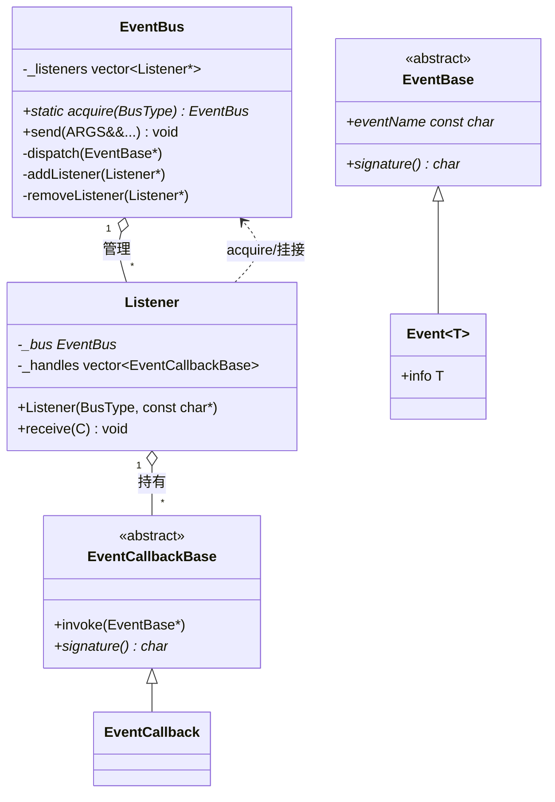
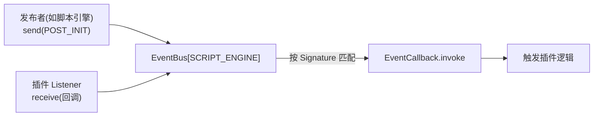

# 插件事件总线模块详解

> 根目录：`native/cocos/plugins/` · 规模：~5 文件 · 语言：C++17
> 关联文档：[00-overview](./00-overview.md) · [base](./base.md) · [bindings](./bindings.md)

## 1. 模块职责与定位

`plugins/` 提供一个**轻量、类型安全的发布/订阅事件总线（EventBus）**，用于插件与引擎各子系统之间的**解耦通信**。典型场景：脚本引擎完成初始化后向订阅者广播 `POST_INIT` 事件，让插件在合适时机挂接逻辑，而无需引擎核心直接 `#include` 插件代码。

- 这是一个「胶水层」而非重逻辑模块：纯内存、同线程回调，无额外运行时依赖。
- 插件**加载入口**（`cc_load_all_plugins` / `CC_PLUGIN_ENTRY`）也定义于此，负责把外部（静态链接或动态库）插件挂入引擎。
- 本仓库版本中总线基于 `BusType` + `EventBus` + `Listener` 实现；插件注册通过 `CC_PLUGIN_ENTRY` 宏导出 `cc_load_plugin_<name>()` 函数，由引擎在启动时统一调用 `cc_load_all_plugins()`。

## 2. 目录树与子目录说明

```text
native/cocos/plugins/
├── Plugins.h            // 插件装配入口宏 CC_PLUGIN_ENTRY / cc_load_all_plugins 声明
├── Plugins.cpp          // cc_load_all_plugins 的空实现（CC_USE_PLUGINS=0 时）
└── bus/                 // 事件总线实现
    ├── BusTypes.h       // 总线分区 BusType 与事件枚举 ScriptEngineEvent
    └── EventBus.h       // 类型安全的模板化事件总线（Listener / EventBus / Event）
```

| 子目录 / 文件 | 内容 |
| --- | --- |
| `bus/BusTypes.h` | 定义 `enum class BusType`（当前仅 `SCRIPT_ENGINE`）与 `enum class ScriptEngineEvent`（当前仅 `POST_INIT`） |
| `bus/EventBus.h` | 核心：模板 `Signature<T>` 把参数类型编码为单字符签名；`EventBus` 按 `BusType` 分区，`Listener` 注册回调，`send()` 据此匹配派发 |
| `Plugins.h` | `CC_PLUGIN_DLL_EXPORT` 导出宏、`CC_PLUGIN_STATIC` 下的 `CC_PLUGIN_ENTRY(name, load_func)` 宏、`extern "C" cc_load_all_plugins()` |
| `Plugins.cpp` | 未开启 `CC_USE_PLUGINS` 时 `cc_load_all_plugins()` 为空实现 |

## 3. 关键类 / 结构体

| 类型 | 位置 | 说明 |
| --- | --- | --- |
| `EventBus` | `plugins/bus/EventBus.h:156` | 事件总线主体，`static EventBus* acquire(BusType)` 按分区获取单例；`template void send(ARGS&&...)` 派发 |
| `Listener` | `plugins/bus/EventBus.h:132` | 订阅者句柄，`Listener(BusType type, const char* name)` 构造并自动挂到对应总线；`template void receive(C callback)` 注册回调（每个 Listener 仅允许注册一次回调，`CC_DEBUG` 下断言 `_callbackAdded`） |
| `EventBase` | `plugins/bus/EventBus.h:43` | 事件基类，含 `eventName` 与虚函数 `signature()` |
| `Event<T>` | `plugins/bus/EventBus.h:107` | 携带 `T info` 的具体事件，`signature()` 返回由参数元组推导的签名串 |
| `EventCallback` | `plugins/bus/EventBus.h:242` | 回调包装，保存 `wrap_fn_type` 与 `SIGNATURE`，`invoke()` 时把 `Event` 还原为元组再调用用户函数 |

导出/注册宏（位于 `Plugins.h`）：
- `CC_PLUGIN_ENTRY(name, load_func)`：导出 `extern "C" cc_load_plugin_<name>()`，静态链接版直接内联调用 `load_func()`，动态库版加 `CC_PLUGIN_DLL_EXPORT`。
- `cc_load_all_plugins()`：引擎启动时调用，逐个触发各插件的 `cc_load_plugin_<name>()` 完成注册。

## 4. 关键枚举 / 常量

```cpp
namespace cc::plugin {
enum class BusType {          // 总线分区
    SCRIPT_ENGINE
};

enum class ScriptEngineEvent { // 脚本引擎生命周期事件
    POST_INIT
};
}
```

类型签名映射（`PARAMETER_TYPES` 宏展开，见 `EventBus.h:82`）：
`char c` · `int8_t b` · `uint8_t B` · `uint16_t S` · `int16_t s` · `uint32_t I` · `int32_t i` · `uint64_t J` · `int64_t j` · `float f` · `double d` · `const char* s` · `void* v`；枚举类型统一映射为 `E`（`Char<true>::VALUE`）。这些单字符组成事件的编译期签名串，用于发布/订阅双方的类型匹配。

## 5. 类关系图





## 6. 与上下层交互

- **发布方（引擎子系统）**：例如脚本引擎初始化完成后调用 `cc::plugin::send(BusType::SCRIPT_ENGINE, ScriptEngineEvent::POST_INIT)`（自由函数 `send` 在 `EventBus.h:287`）。`send` 把实参打包成 `Event<std::tuple<...>>`，`dispatch` 时遍历 `_listeners` 逐个 `invoke`。
- **订阅方（插件）**：插件在 `load_func()` 中创建 `Listener(BusType::SCRIPT_ENGINE, "插件名")`，`receive([](ScriptEngineEvent e){ ... })`。回调签名经 `FunctionSignature` / `EventCallbackImpl` 提取为单字符 `SIGNATURE`，与事件的 `ExactSignature` 比对，类型不匹配直接编译/链接期报错。
- **装配层（`bindings` 层）**：引擎启动时调用 `cc_load_all_plugins()`，遍历所有 `cc_load_plugin_<name>()` 导出符号完成插件注册；静态链接（`CC_PLUGIN_STATIC`）与动态库两种形态通过 `CC_PLUGIN_ENTRY` 统一。
- **无下行走访**：总线本身不依赖渲染/场景，仅依赖 `base` 标准容器与 `<typeinfo>/<tuple>` 等 STL，是干净的横向解耦设施。

## 7. 修改 / 扩展要点

- **新增一类事件总线**：在 `BusTypes.h` 的 `BusType` 增加枚举值，`EventBus::acquire` 按分区返回对应单例；不同分区互不干扰。
- **新增事件**：只需在对应 `enum class`（如 `ScriptEngineEvent`）追加枚举项—签名机制对参数类型自动编码，无需改动总线核心。
- **新增插件**：在插件侧用 `CC_PLUGIN_ENTRY(my_plugin, my_load)` 导出加载函数，在 `my_load` 中创建 `Listener` 并 `receive` 关心的事件；引擎侧 `cc_load_all_plugins()` 会自动调用。
- **类型安全注意**：`receive` 回调的参数类型必须与 `send` 方完全一致，否则 `SIGNATURE` 不匹配而静默失效（无回调触发）。`CC_DEBUG` 下 `Listener::receive` 会断言「同一 Listener 只能注册一次回调」。
- **线程模型**：当前为同线程同步回调（发布即触发），不要在回调中做阻塞或跨线程操作；若需跨线程，应在回调外自行中转。
- **规模控制**：本模块刻意保持极小（~5 文件），新增能力应优先以「事件 + 回调」方式接入，避免把业务逻辑塞进总线本身。
