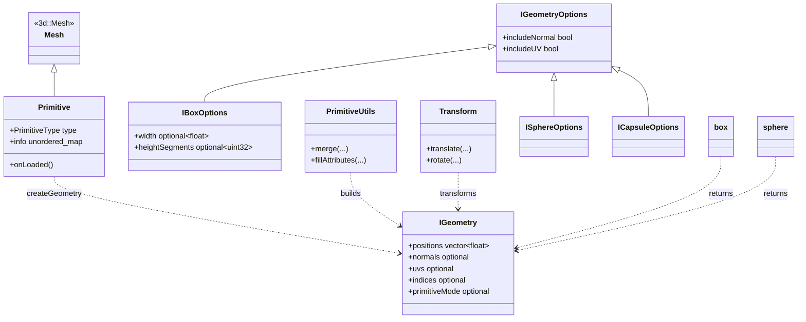

# primitive 模块详解

> 根目录：`native/cocos/primitive/` · 规模：~25 文件 · 语言：C++17
> 关联文档：[00-overview](./00-overview.md) · [3d](./3d.md) · [core](./core.md) · [math](./math.md)

## 1. 模块职责与定位

`primitive` 模块生成 **程序化的基础几何体网格**（盒子、球、圆柱、圆锥、胶囊、圆环、圆、平面、四边形），供编辑器与运行时快速创建标准模型，无需外部资源文件。

核心定位：
- **几何体生成器**：每个几何体一个 `.h/.cpp`（如 `Box.cpp` 的 `box()`），产出 `IGeometry`（顶点位置/法线/UV/索引）。
- **统一入口**：`Primitive` 继承 `3d::Mesh`，通过 `PrimitiveType` + 参数 `info` 在 `onLoaded()` 时构建对应网格。
- **参数与工具**：`PrimitiveDefine.h` 定义 `IGeometryOptions`/`IBoxOptions`/... 等参数结构；`PrimitiveUtils` 提供顶点生成与合并工具；`Transform` 提供几何变换辅助。

它与 [3d](./3d.md) 的关系：`Primitive` 直接继承 `3d::Mesh`，生成的 `IGeometry` 经 `createGeometry()` 封装为 `Mesh`，最终以 `scene::Model` 身份参与渲染。

## 2. 目录树与子目录说明

```
primitive/
├── Primitive.h/.cpp      # 统一入口（继承 3d::Mesh）+ createGeometry() 工厂
├── PrimitiveDefine.h     # 类型/参数定义（IGeometry / IGeometryOptions / 各 *Options）
├── PrimitiveUtils.h/.cpp # 顶点生成与合并工具（merge / 属性填充）
├── Transform.h/.cpp      # 几何体变换辅助（平移/旋转/缩放顶点）
├── Box.h/.cpp            # 立方体
├── Sphere.h/.cpp         # 球体
├── Capsule.h/.cpp        # 胶囊体
├── Cylinder.h/.cpp       # 圆柱
├── Cone.h/.cpp           # 圆锥
├── Circle.h/.cpp         # 圆（平面圆盘）
├── Plane.h/.cpp          # 平面
├── Quad.h/.cpp           # 四边形
└── Torus.h/.cpp          # 圆环
```

> 每个几何体文件对外暴露一个自由函数（返回 `IGeometry`）与一个参数结构（继承 `IGeometryOptions`，如 `IBoxOptions`）。

## 3. 关键类 / 结构体

| 类 / 结构体 | 关键成员（真实签名摘要） | 职责 |
| --- | --- | --- |
| `Primitive` | `PrimitiveType type`、`ccstd::unordered_map<string,float> info`、`onLoaded()` | 统一入口：继承 `3d::Mesh`，按 `type`+`info` 构建网格 |
| `IGeometry` | `positions`、`normals`、`uvs`、`tangents`、`colors`、`indices`、`primitiveMode`、`minPos/maxPos`、`boundingRadius` | 几何体数据载体（可构建 Mesh） |
| `IGeometryOptions` | `bool includeNormal{true}`、`bool includeUV{true}` | 基础选项：是否生成法线/UV |
| `IBoxOptions` | `width/height/length`、`widthSegments/heightSegments/lengthSegments` | 立方体参数（尺寸 + 各轴分段数） |
| `IDynamicGeometry` | `Float32Array positions/normals/uvs`、`indices16/indices32`、`primitiveMode` | 动态几何（运行时更新，用于 `Mesh::updateSubMesh`） |
| `CustomAttribute` / `DynamicCustomAttribute` | `gfx::Attribute attr`、`vector<float>/Float32Array values` | 自定义顶点属性 |
| `PrimitiveOptions` | `variant<IGeometryOptions, IBoxOptions, ICapsuleOptions, ...>` | 选项联合类型 |
| `PrimitiveUtils` | 顶点生成/合并/属性填充工具 | 被各几何体函数复用 |
| `Transform` | 顶点平移/旋转/缩放 | 几何变换辅助 |

各几何体自由函数（返回 `IGeometry`）：`box()`、`sphere()`、`capsule()`、`cylinder()`、`cone()`、`circle()`、`plane()`、`quad()`、`torus()`。分段数（segments）越高越平滑但顶点更多。

各几何体参数结构均继承 `IGeometryOptions`，在基类的 `includeNormal/includeUV` 之上增加几何专属字段（命名与 `IBoxOptions` 一致：`*Segments` 控制平滑度，`width/height/length/radius/...` 控制尺寸），例如：`ISphereOptions{ radius, widthSegments, heightSegments }`、`ICapsuleOptions{ radius, height, sides, capsSegments, ... }`、`ICylinderOptions{ radiusTop, radiusBottom, height, radialSegments, ... }`、`IConeOptions{ radius, height, radialSegments, ... }`、`ITorusOptions{ radius, tube, radialSegments, tubularSegments, ... }`、`IPlaneOptions{ width, length, widthSegments, lengthSegments }`、`ICircleOptions{ radius, segments }`。`PrimitiveUtils` 与 `Transform` 被这些生成函数复用，统一处理属性填充与坐标变换。`Primitive::createGeometry(type, options)` 的 `options` 参数为 `ccstd::optional<PrimitiveOptions>`，缺省（`nullopt`）时使用各几何体的默认尺寸/分段；`PrimitiveType` 的枚举值与 `primitive/` 下文件名一一对应，新增类型必须同步该枚举与 `createGeometry()` 的分派分支。`Transform` 提供对已有 `IGeometry` 顶点的平移/旋转/缩放，用于把标准几何体摆放到任意局部坐标系（如把 `plane` 抬到某高度、旋转朝向）。`PrimitiveUtils` 还负责多子几何的合并与属性数组（`CustomAttribute`/`DynamicCustomAttribute`）的填充，保证输出 `IGeometry` 可直接被 `Mesh` 消费。

## 4. 关键枚举 / 常量

```cpp
// Primitive.h
enum class PrimitiveType {
    BOX=0, SPHERE=1, CYLINDER=2, CONE=3,
    CAPSULE=4, TORUS=5, PLANE=6, QUAD=7
};
using PrimitiveOptions = ccstd::variant<
    IGeometryOptions, IBoxOptions, ICapsuleOptions, ICircleOptions,
    ICylinderOptions, IConeOptions, IPlaneOptions, ISphereOptions, ITorusOptions>;

// PrimitiveDefine.h —— IGeometry 关键字段
struct IGeometry {
    ccstd::vector<float> positions;
    ccstd::optional<ccstd::vector<float>> normals;
    ccstd::optional<ccstd::vector<float>> uvs;
    ccstd::optional<ccstd::vector<float>> tangents;
    ccstd::optional<ccstd::vector<float>> colors;
    ccstd::optional<ccstd::vector<uint32_t>> indices;   // 索引绘制时
    ccstd::optional<gfx::PrimitiveMode> primitiveMode;  // 默认 TRIANGLE_LIST
    ccstd::optional<bool> doubleSided;                  // 背面射线检测
};
```

每个具体选项（如 `IBoxOptions`）继承 `IGeometryOptions` 并增加尺寸/分段字段；`PrimitiveType` 与 `primitive/` 下的文件一一对应。

`IGeometry` 字段语义：`positions` 必填（3 分量/顶点）；`normals/uvs/tangents/colors` 为 `optional`，由选项 `includeNormal/includeUV` 或生成函数控制是否产出；`indices` 为 `optional<uint32_t>`——存在则索引绘制，不存在则按顶点顺序绘制；`attributes` 可显式指定顶点属性布局（覆盖默认）；`minPos/maxPos` 用于 `Mesh` 计算包围盒（若不提供，`Mesh` 会自行遍历顶点推算）；`boundingRadius` 为包围球半径（LOD/视锥剔除用）；`primitiveMode` 默认 `TRIANGLE_LIST`，也可设为 `LINE_LIST`/`POINT_LIST` 等；`doubleSided` 控制背面射线检测。生成函数应保证 `positions` 与各属性数组长度一致，且 `indices` 范围不越界。

## 5. 类关系图



## 6. 与上下层交互

- **上游（math / 输入）**：顶点计算基于 `math::Vec3`/`Vec2`/`Vec4`（见 [math](./math.md)）；参数由编辑器或 JS 侧以 `PrimitiveType` + `info` 表传入。
- **下游（3d / scene）**：`Primitive` 继承 `3d::Mesh`，`createGeometry(type, options)` 生成的 `IGeometry` 被封装为 `Mesh`；最终经 `core::assets::RenderingSubMesh` 进入 `scene::Model` 渲染（见 [3d](./3d.md)、[scene](./scene.md)）。
- **动态几何**：`IDynamicGeometry` 对应 `Mesh::IDynamicStruct`/`IDynamicInfo`，供运行时 `Mesh::updateSubMesh()` 增量更新顶点（如 `Graphics` 动态重绘）。
- **GPU 资源**：真正的顶点/索引缓冲由 `3d::Mesh` 经 `gfx::Device` 创建（见 [03-gfx-deep-dive](./renderer.md)），本模块只产出 CPU 侧几何数据。

**典型数据流**：调用方构造 `PrimitiveOptions`（如 `IBoxOptions{ width, height, length, segments }`）→ `Primitive::createGeometry(type, options)` 分派到对应 `box()/sphere()/...` 生成 `IGeometry` → `Primitive`（或 `Mesh`）据 `IGeometry` 在 `onLoaded()` 组装顶点块/子网格 → `Mesh::initialize()` 创建 `RenderingSubMesh` 与 GPU 缓冲 → 以 `scene::Model` 渲染。动态场景（如 `Graphics`/自定义网格）可直接用 `IDynamicGeometry` + `Mesh::updateSubMesh()` 增量更新 `positions/normals/uvs/indices16/indices32`。

## 7. 修改 / 扩展要点

1. **新增几何体类型**：在 `primitive/` 增加 `<Name>.h/.cpp`，定义 `INameOptions`（继承 `IGeometryOptions`）与自由函数 `name(optional<INameOptions>)` 返回 `IGeometry`；在 `Primitive.h` 的 `PrimitiveType` 增加枚举并在 `createGeometry()` 注册分支，同时把选项类型加入 `PrimitiveOptions` 联合。
2. **参数扩展性**：所有选项继承 `IGeometryOptions` 的 `includeNormal/includeUV`；新增几何参数请用 `ccstd::optional<T>`，保持未指定时使用默认值（如 `Box.h` 的 `width/height/length`）。
3. **顶点布局一致性**：各生成函数须保证 `positions` 与 `normals/uvs` 长度匹配，并在 `indices` 存在时采用索引绘制；`primitiveMode` 默认 `TRIANGLE_LIST`。
4. **性能与内存**：分段数直接决定顶点规模，生成时应避免重复分配；`PrimitiveUtils` 提供的合并工具可在多个子几何拼装时复用缓冲。
5. **与 Mesh 协同**：`Primitive::onLoaded()` 在加载期构建，修改生成逻辑后需确认 `Mesh::initialize()` 能正确生成 `RenderingSubMesh` 与包围盒（`minPos/maxPos`）。
6. **动态几何索引位宽**：`IDynamicGeometry` 同时支持 `indices16`（`Uint16Array`）与 `indices32`（`Uint32Array`），选择应基于顶点数；超过 65535 顶点必须用 32 位索引，否则 `Mesh::updateSubMesh()` 会越界。
7. **双面与射线检测**：`IGeometry::doubleSided` 控制来自几何体背面的射线是否命中（用于拾取），生成函数默认不开启；若几何体用于可拾取对象，需在 `IGeometryOptions` 派生结构中显式置位。
