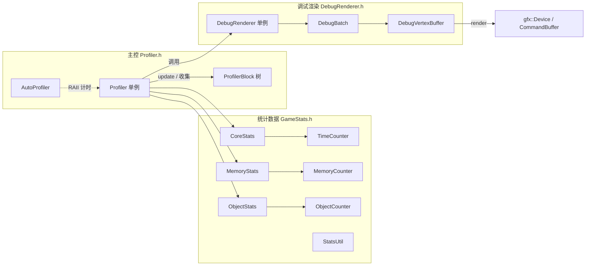

# 性能剖析与调试渲染模块详解

> 根目录：`native/cocos/profiler/` · 规模：~5 文件 · 语言：C++17
> 关联文档：[00-overview](./00-overview.md) · [base](./base.md) · [renderer](./renderer.md) · [scene](./scene.md)

## 1. 模块职责与定位

`profiler/` 是引擎的**运行期性能剖析与调试信息可视化**设施：统计帧耗时、内存、对象数量、渲染性能，并把统计文本/图形绘制到屏幕（左上角性能面板）。

- 完全**可选、对核心逻辑无侵入**：所有能力被宏 `CC_USE_PROFILER` 守护。关闭时 `CC_PROFILER_*` 宏展开为空，零运行时开销。
- 由三块组成：**统计模型**（`GameStats.h`）、**剖析主控**（`Profiler.h/.cpp`，单例）、**调试渲染器**（`DebugRenderer.h/.cpp`，负责把文字/四边形上屏）。
- 提供区块级计时（`beginBlock/endBlock` → `ProfilerBlock` 树），用于定位热点函数。

## 2. 目录树与子目录说明

```text
native/cocos/profiler/
├── GameStats.h          // 统计数据结构：TimeCounter / MemoryCounter / ObjectCounter /
│                       //   CoreStats / MemoryStats / ObjectStats / StatsUtil
├── Profiler.h           // 剖析器单例 + AutoProfiler + CC_PROFILER_* 宏
├── Profiler.cpp         // beginFrame/endFrame/update/区块计时/聚合
├── DebugRenderer.h      // 调试渲染器单例：addText / render / 字体管理
└── DebugRenderer.cpp    // 顶点缓冲、字体图集、文字四边形生成
```

| 文件 | 职责 |
| --- | --- |
| `GameStats.h` | 纯数据 + `StatsUtil` 格式化工具（字节/时间/缩进），无引擎依赖 |
| `Profiler.h` | 主控单例、`ShowOption` 开关、宏定义、RAII 式 `AutoProfiler` |
| `Profiler.cpp` | 帧/区间/累计三级时间窗聚合、`ProfilerBlock` 树收集（`gatherBlocks`）、`doIntervalUpdate`/`printStats` |
| `DebugRenderer.h` | 调试文字渲染：以 `gfx::Device` 上的 `DebugVertexBuffer`/`DebugBatch` 把文字画到屏幕 |
| `DebugRenderer.cpp` | 字体加载、按字形生成 `addQuad` 文本四边形、每帧 `render` 提交命令缓冲 |

## 3. 关键类 / 结构体

| 类型 | 位置 | 说明 |
| --- | --- | --- |
| `Profiler` | `profiler/Profiler.h:49` | **单例**（`static getInstance()`），`beginFrame()/endFrame()/update()` 主流程；`_root`/`_current` 指向 `ProfilerBlock` 树 |
| `AutoProfiler` | `profiler/Profiler.h:97` | RAII 助手：构造调 `beginBlock(name)`、析构调 `endBlock()`，配合 `CC_PROFILE(name)` 自动计时代码块 |
| `ProfilerBlock` / `ProfilerBlockDepth` | `Profiler.h:35-36`（前向声明） | 区块计时节点；`gatherBlocks(parent, depth, out)` 按深度收集用于展示 |
| `TimeCounter` | `profiler/GameStats.h:38` | 三级时间窗：`当前帧`(max/time/count) · `区间`(interval*) · `累计`(total*) 以及用于显示的 `*Display` 快照 |
| `MemoryCounter` | `profiler/GameStats.h:108` | 内存计数：`total`/`count`/`totalMax`（`operator= += -=`） |
| `ObjectCounter` | `profiler/GameStats.h:131` | 对象计数：`total`/`lastTotal`/`totalMax`，支持 `onFrameBegin/onFrameEnd` |
| `CoreStats` | `profiler/GameStats.h:160` | 核心信息：`fps`、`frameTime`、`gfx`（后端名）、`multiThread`/`occlusionQuery`/`shadowMap` 开关、`screenWidth/Height` |
| `MemoryStats` | `profiler/GameStats.h:171` | `unordered_map<string,MemoryCounter> memories`，带 `std::mutex` 线程安全更新 |
| `ObjectStats` | `profiler/GameStats.h:193` | `renders`(drawcall/三角形等) 与 `objects` 两组计数，主线程更新 |
| `StatsUtil` | `profiler/GameStats.h:220` | `formatBytes`/`formatTime`/`formatName` 静态格式化 |
| `DebugRenderer` | `profiler/DebugRenderer.h:77` | **单例**（`getInstance()`），`activate(device,info)`/`render(renderPass,cmdBuff,sceneData)`/`addText(...)`/`update()`/`destroy()` |
| `DebugRendererInfo` / `DebugTextInfo` / `DebugFontInfo` | `DebugRenderer.h:49/56/68` | 渲染配置：字号/最大字符数、文字颜色/加粗/斜体/阴影、字体图集与反纹理尺寸 |
| `DebugBatch` / `DebugVertexBuffer` | `DebugRenderer.h:47/46`（前向声明的友元） | 内部：一组待绘制文本四边形与底层顶点缓冲 |

## 4. 关键枚举 / 常量

```cpp
enum class ShowOption : uint32_t {        // 统计分类开关（位掩码）
    CORE_STATS       = 0x01,
    MEMORY_STATS     = 0x02,
    OBJECT_STATS     = 0x04,
    PERFORMANCE_STATS = 0x08,
    ALL = CORE_STATS | MEMORY_STATS | OBJECT_STATS | PERFORMANCE_STATS,
};
```

```cpp
constexpr uint32_t DEBUG_FONT_COUNT = 4U;            // DebugRenderer 支持 4 种字体
using DebugFontArray = ccstd::array<DebugFontInfo, DEBUG_FONT_COUNT>;
```

辅助宏（`Profiler.h` 末尾，受 `CC_USE_PROFILER` 守卫）：`CC_PROFILER`、`CC_PROFILER_SET_ENABLE` / `IS_ENABLED`、`CC_PROFILER_BEGIN_FRAME` / `END_FRAME` / `UPDATE`、`CC_PROFILE(name)`、`CC_PROFILE_MEMORY_UPDATE/INC/DEC`、`CC_PROFILE_RENDER_UPDATE/INC/DEC`、`CC_PROFILE_OBJECT_UPDATE/INC/DEC`。关闭 `CC_USE_PROFILER` 时全部为空，无副作用。

## 5. 类关系图



## 6. 与上下层交互

- **驱动方（主循环）**：每帧由主循环调用 `CC_PROFILER_BEGIN_FRAME` → 各子系统 `CC_PROFILE(...)`/`CC_PROFILE_OBJECT_*`/`CC_PROFILE_RENDER_*` → `CC_PROFILER_END_FRAME` → `CC_PROFILER_UPDATE`，最终 `DebugRenderer::render` 提交到屏幕。
- **数据来源（各子系统）**：渲染管线写入 `ObjectStats.renders`（drawcall、三角形等，经 `CC_PROFILE_RENDER_*`），资源/内存模块写入 `MemoryStats.memories`（`CC_PROFILE_MEMORY_*`），场景/对象写入 `ObjectStats.objects`。均已通过 `isMainThread()` 校验只在主线程更新（内存统计额外加 `std::mutex`）。
- **向下层（GFX / 渲染）**：`DebugRenderer` 依赖 `gfx::Device`（建顶点缓冲/字体图集）、`gfx::RenderPass`/`gfx::CommandBuffer`（每帧绘制），并读取 `pipeline::PipelineSceneData` 定位屏幕坐标，把文字四边形作为 UI 叠加层绘制。
- **与被测模块解耦**：所有采集都走宏，关闭 `CC_USE_PROFILER` 后编译期即消失，不影响 `renderer`/`scene` 性能，也不改变其控制流。

## 7. 修改 / 扩展要点

- **新增统计指标**：在 `GameStats.h` 给 `CoreStats`/`MemoryStats`/`ObjectStats` 增加字段，并补一个 `CC_PROFILE_*` 宏 + 对应采集点即可；显示逻辑在 `Profiler.cpp::printStats` 与 `DebugRenderer::addText` 中扩展。
- **新增分类开关**：在 `ShowOption` 增加位，更新 `ALL` 掩码，并在 `setEnable`/`isEnabled` 之外按需过滤显示。
- **扩展区块计时**：用 `CC_PROFILE(name)` 自动包围热点代码（RAII），或显式 `beginBlock/endBlock` 构造嵌套 `ProfilerBlock` 树；注意 `begin/end` 必须成对，层级由 `_current` 指针维护。
- **调试渲染定制**：`DebugRenderer` 支持 4 种字体（`DEBUG_FONT_COUNT`）与加粗/斜体/阴影文字（`DebugTextInfo`），可扩展为其绘制其它调试图元（线框、包围盒等）而复用同一套顶点缓冲机制。
- **性能与风险**：本模块纯属调试设施，改动风险低；但 `MemoryStats` 的 `mutex` 在高并发采集下需留意，新增跨线程写入务必走 `update/inc/dec` 而非直接改 `memories`。关闭 `CC_USE_PROFILER` 时务必保证所有 `CC_PROFILER_*` 宏为空，否则会引入运行开销。
