# renderer 模块详解

> 根目录：`native/cocos/renderer/` · 规模：~569 文件 · 语言：C++17
> 关联文档：[00-overview](./00-overview.md) · [core](./core.md) · [scene](./scene.md) · [base](./base.md) · [math](./math.md)

`renderer` 是 Cocos Native 引擎的**渲染子系统**，横跨「图形抽象层（GFX）→ 设备装饰器链 → 多后端实现 → 渲染管线」四层。本文件是 `renderer` 模块的**唯一权威文档**，将 GFX 抽象、Vulkan 后端、设备装饰器链、多线程代理、FrameGraph、传统管线（Flow/Stage/Queue）、Forward/Deferred/Shadow、自定义 RenderGraph 管线的全部内容内联于此，便于一站式查阅。

本文内容组织如下：先讲「图形抽象 + 后端 + 装饰器」（第 3–5 节），再讲「渲染管线」（第 6–9 节），最后给出速查表、关系图与扩展要点。

---

## 1. 模块职责与定位

`renderer` 模块承担三件事：

1. **后端无关的图形抽象（GFX）**：用一套统一的 C++ 接口（`Device`/`Buffer`/`Texture`/`CommandBuffer`/`Shader`/`RenderPass`/`DescriptorSet` 等）屏蔽 Vulkan / OpenGL ES / Metal / WebGPU 的差异，上层逻辑只面向抽象编程。
2. **多后端实现 + 设备装饰器链**：在抽象之下提供 Vulkan / GLES3 / GLES2 / Metal / WebGPU / Empty 等具体后端；并通过 `DeviceAgent`（多线程代理）与 `DeviceValidator`（调试期校验）两层装饰器透明包裹真实后端。
3. **渲染管线**：把 `scene/` 的世界（相机、灯光、可见对象）通过剔除、排序、录制，组织成 GFX 抽象命令并提交给 `Device`。

模块在引擎中的定位：上层 `core/Root` 持有 `gfx::Device` 与 `pipeline::RenderPipeline`，驱动整个渲染；`renderer` 本身不直接依赖 `scene/`、`2d/` 之外的业务逻辑，只通过接口交互。

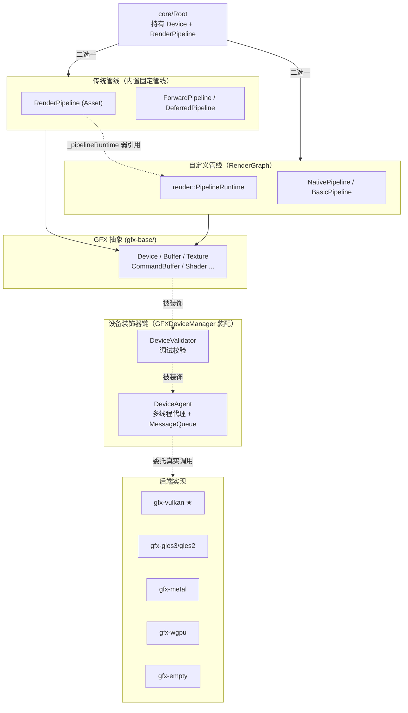

---

## 2. 目录树与子目录说明

```text
native/cocos/renderer/
├── GFXDeviceManager.h        # 后端选择 + 装饰器装配入口（唯一顶层 .h）
├── core/                     # 渲染核心工具（材质/Pass/Program 实例化）
├── frame-graph/              # 传统管线的帧图（资源虚拟化/别名/裁剪）
├── gfx-base/                 # GFX 抽象基类 + 枚举/结构体定义（后端无关）
│   └── states/               # Sampler / Barrier 等不可变状态对象
├── gfx-agent/                # 设备装饰器：多线程渲染代理（Agent 模板）
├── gfx-validator/            # 设备装饰器：调试期参数校验层
├── gfx-empty/                # 空后端（无渲染，测试/工具用）
├── gfx-gles2/                # OpenGL ES 2.0 后端
├── gfx-gles3/                # OpenGL ES 3.0 后端
├── gfx-gles-common/          # GLES 后端的公共胶水（eglw / gles*w）
├── gfx-metal/                # Apple Metal 后端（.mm 实现）
├── gfx-vulkan/               # ★ Vulkan 后端（volk + VMA）
│   └── states/               # Vulkan 专属状态对象
├── gfx-wgpu/                 # WebGPU 后端
└── pipeline/                 # 渲染管线
    ├── forward/              # 前向管线（ForwardPipeline/Flow/Stage）
    ├── deferred/             # 延迟管线（G-Buffer/光照/Bloom/后处理）
    ├── shadow/               # 阴影流程（CSM / ShadowFlow / ShadowStage）
    ├── helper/               # 管线通用工具
    ├── reflection-probe/     # 反射探针流程
    ├── xr/                   # XR/AR 渲染流程
    └── custom/               # 可编程 RenderGraph 管线（新架构）
        └── details/          # RenderGraph 内部图算法/序列化实现
```

> 注：`pipeline/render-graph/` 与 `pipeline/enum/` 目录当前为空；新的 RenderGraph 实现统一位于 `pipeline/custom/`，全局管线枚举集中在 `pipeline/Enum.h` 与 `pipeline/Define.h`。

### 各子目录职责与关键文件

| 子目录 | 职责 | 关键文件 |
| --- | --- | --- |
| `gfx-base/` | 后端无关 GFX 抽象基类与全部枚举/结构体定义 | `GFXDevice.h`、`GFXDef-common.h`、`GFXObject.h`、`GFXBuffer.h`… |
| `gfx-base/states/` | 不可变状态对象（采样器、各类 Barrier） | `GFXSampler.h`、`GFXGeneralBarrier.h`、`GFXTextureBarrier.h`、`GFXBufferBarrier.h` |
| `gfx-agent/` | 装饰器：把 GFX 调用跨线程投递到渲染线程（`Agent<T>` 模板 + `MessageQueue`） | `DeviceAgent.h`、`QueueAgent.h`、`CommandBufferAgent.h`、`BufferAgent.h`… |
| `gfx-validator/` | 装饰器：调试期对每个 GFX 对象做合法性/一致性校验 | `DeviceValidator.h`、`CommandBufferValidator.h`、`TextureValidator.h`… |
| `gfx-vulkan/` | ★ Vulkan 后端（volk 动态加载 + VMA 显存分配 + GPU Hub/Pool） | `VKDevice.h`、`VKCommands.h`、`VKPipelineCache.h`、`VKUtils.h`、`vk_mem_alloc.h` |
| `gfx-gles3/` `gfx-gles2/` `gfx-gles-common/` | OpenGL ES 3/2 后端及公共胶水（EGL、函数指针封装） | `GLES3Device.h`、`GLES2Device.h`、`eglw.h`、`gles3w.h` |
| `gfx-metal/` | Apple Metal 后端（Obj-C++ `.mm` 实现） | `MTLDevice.h/.mm`、`MTLCommandBuffer.h` |
| `gfx-wgpu/` | WebGPU 后端 | `WGPUDevice.h`、`WGPUDef.h` |
| `gfx-empty/` | 空后端（不实际渲染，供 CI/工具/无 GPU 环境） | `EmptyDevice.h` 及一整套 `Empty*` 类 |
| `core/` | 渲染侧核心工具：材质/Pass 实例化、Shader Program 库、纹理缓冲池 | `MaterialInstance.h`、`PassInstance.h`、`ProgramLib.h`、`PassUtils.h`、`TextureBufferPool.h` |
| `frame-graph/` | 传统管线使用的帧图：声明虚拟资源、Pass 依赖裁剪、瞬时资源别名/复用 | `FrameGraph.h`、`DevicePass.h`、`PassNode.h`、`Resource.h`、`Blackboard.h` |
| `pipeline/` | 渲染管线基类与通用组件（Flow/Stage/Queue/UBO/裁剪） | `RenderPipeline.h`、`RenderFlow.h`、`RenderStage.h`、`RenderQueue.h`、`PipelineUBO.h`、`SceneCulling.h` |
| `pipeline/forward/` `pipeline/deferred/` `pipeline/shadow/` | 具体管线实例与阶段 | `ForwardPipeline.h`、`DeferredPipeline.h`、`ShadowFlow.h` |
| `pipeline/custom/` | 可编程 RenderGraph 新管线（图驱动、布局图、资源图、执行器） | `NativePipelineTypes.h`、`FrameGraphDispatcher.h`、`NativeRenderGraph.h`、`NativeExecutor*.h` |

---

## 3. GFX 图形抽象层

GFX（Graphics Foundation eXtension）是整个 `renderer` 的**设计核心**：采用**面向接口编程**，上层（渲染管线、Root、场景）只依赖 `gfx-base` 定义的抽象类（`Device` / `CommandBuffer` / `Buffer` / `Texture` ...），运行期由 `DeviceManager` 组装真实后端与可选的功能装饰层。

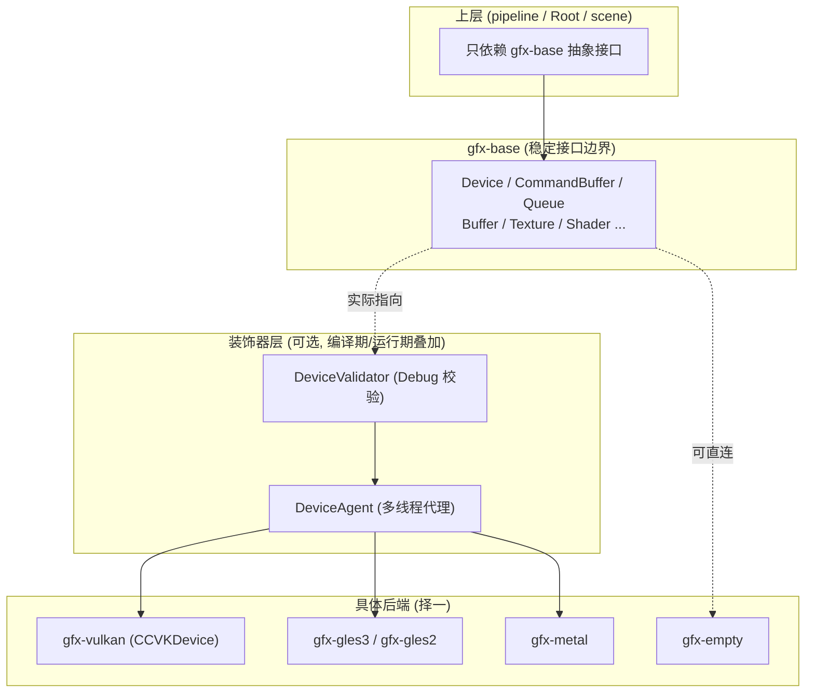

**要点**：`DeviceValidator` 与 `DeviceAgent` 本身也继承自 `Device`，因此对上层完全透明——上层拿到的 `Device*` 可能是 `Validator → Agent → CCVKDevice` 的多层包装。

### 3.1 Device：资源工厂 + 帧控制

[GFXDevice.h](file:///e:/AIProMax/github/cocos4-vulkan/native/cocos/renderer/gfx-base/GFXDevice.h) 中的 `gfx::Device` 是整个 GFX 的入口，承担两类职责：

**① 帧生命周期控制（纯虚，后端实现）**

| 方法 | 作用 |
| --- | --- |
| `frameSync()` | 帧同步，确保 CPU 领先 GPU 不超过设定帧数 |
| `acquire(swapchains, count)` | 获取交换链下一个可用后备缓冲 |
| `present()` | 提交呈现 |
| `flushCommands(cmdBuffs, count)` | 刷新命令缓冲 |

**② 资源创建工厂（模板方法模式）**

公有 `createXXX(info)` 为内联包装：先调用后端的**受保护纯虚** `createXXX()` 构造对象，再 `initialize(info)`。这样后端只需实现无参构造，初始化逻辑统一在基类。

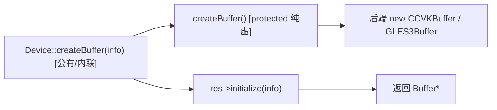

可创建的资源对象：`CommandBuffer`、`Queue`、`QueryPool`、`Swapchain`、`Buffer`、`Texture`、`Shader`、`InputAssembler`、`RenderPass`、`Framebuffer`、`DescriptorSet`、`DescriptorSetLayout`、`PipelineLayout`、`PipelineState`。

而 `Sampler` / `GeneralBarrier` / `TextureBarrier` / `BufferBarrier` 采用**缓存复用**（`getXXX` + `unordered_map`），因为它们是不可变状态对象。

**设备能力查询**：`getCapabilities()` / `hasFeature()` / `getFormatFeatures()` / `getGfxAPI()`，供上层做特性降级。

### 3.2 CommandBuffer：命令录制接口

[GFXCommandBuffer.h](file:///e:/AIProMax/github/cocos4-vulkan/native/cocos/renderer/gfx-base/GFXCommandBuffer.h) 定义了一套贴近现代图形 API（Vulkan/Metal）的命令录制接口：

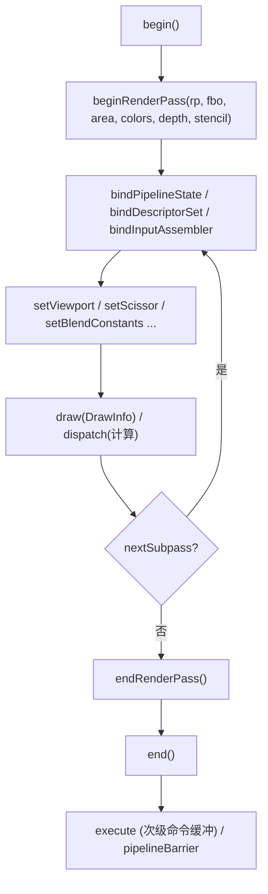

- 支持**主/次命令缓冲**（`CommandBufferType::PRIMARY/SECONDARY`）与 `execute` 嵌套。
- `pipelineBarrier` 显式管理资源同步屏障（Vulkan 风格）。
- `customCommand` 允许注入自定义 lambda 命令。
- 统计 `getNumDrawCalls / getNumInstances / getNumTris`。

### 3.3 GFXObject：统一对象标识

所有 GFX 资源基类 [GFXObject](file:///e:/AIProMax/github/cocos4-vulkan/native/cocos/renderer/gfx-base/GFXObject.h) 提供 `ObjectType` + 全局唯一 `ObjectID` + 类型内 `TypedID`，用于调试、哈希与资源追踪。绝大多数对象同时继承 `RefCounted` 走引用计数管理。

### 3.4 关键枚举与常量（gfx-base）

GFX 的全部枚举与位标志定义在 `gfx-base/GFXDef-common.h`（结构体定义在 `gfx-base/GFXDef.h`）。下列为最常用的一组：

| 枚举 | 位置 | 说明 |
| --- | --- | --- |
| `ObjectType` | `GFXDef-common.h:118` | GFX 对象类型（SWAPCHAIN/BUFFER/TEXTURE/SHADER/…），用于运行时识别 |
| `API` | `GFXDef-common.h:149` | 后端类型枚举（GLES2/GLES3/METAL/VULKAN/NVN/WEBGPU…），即“设备类型” |
| `Status` | `GFXDef-common.h:142` | 初始化状态（UNREADY/FAILED/SUCCESS） |
| `Format` | `GFXDef-common.h:187` | 像素/顶点格式（UNKNOWN/A8/R8/RGBA8/…），含压缩格式 |
| `FormatType` | `GFXDef-common.h:342` | 格式类别（UNORM/SNORM/FLOAT/INT/…） |
| `Filter` | `GFXDef-common.h:559` | 采样过滤（NONE/POINT/LINEAR/ANISOTROPY） |
| `Address` | `GFXDef-common.h:567` | 纹理寻址（WRAP/CLAMP/MIRROR/…） |
| `BufferUsageBit` | `GFXDef-common.h:421` | 缓冲用途位标志（VERTEX/INDEX/UNIFORM/INDIRECT/…） |
| `TextureUsageBit` | `GFXDef-common.h:484` | 纹理用途位标志（COLOR_ATTACHMENT/DEPTH_STENCIL_ATTACHMENT/SAMPLE/…） |
| `MemoryUsageBit` | `GFXDef-common.h:450` | 显存用途位（GPU/CPU 可见等），指导 VMA 分配 |
| `ColorMask` | `GFXDef-common.h:627` | 颜色写入掩码（R/G/B/A/ALL） |
| `ShaderStageFlagBit` | `GFXDef-common.h:637` | 着色器阶段位（VERTEX/FRAGMENT/COMPUTE/…），用于描述符可见性 |
| `LoadOp` / `StoreOp` | `GFXDef-common.h:650` / `:657` | 渲染通道附件的载入/存储操作 |
| `DescriptorType` | `GFXDef-common.h:778` | 描述符类型（UNIFORM_BUFFER/SAMPLER/TEXTURE/…） |
| `QueueType` | `GFXDef-common.h:792` | 队列类型（GRAPHICS/COMPUTE/TRANSFER） |
| `PrimitiveMode` | `GFXDef-common.h:718` | 图元模式（POINT/LINE/TRIANGLE/…） |
| `CullMode` / `BlendFactor` / `BlendOp` / `ComparisonFunc` | `GFXDef-common.h` | 光栅化/混合/深度比较相关枚举 |
| `BarrierType` / `AccessFlagBit` | `GFXDef-common.h:823` / `:663` | 资源屏障类型与访问标志 |

> 完整列表与取值含义见 `gfx-base/GFXDef-common.h`。管线侧全局枚举集中在 `pipeline/Enum.h`、宏与常量在 `pipeline/Define.h`（如 `bindingMappingInfo` 绑定映射，被 `GFXDeviceManager` 用于构造 `DeviceInfo`）。

---

## 4. 设备装饰器链与多线程

### 4.1 装饰器组装（DeviceManager）

[GFXDeviceManager.h](file:///e:/AIProMax/github/cocos4-vulkan/native/cocos/renderer/GFXDeviceManager.h) 的 `tryCreate<T>()` 是装饰器组装点：

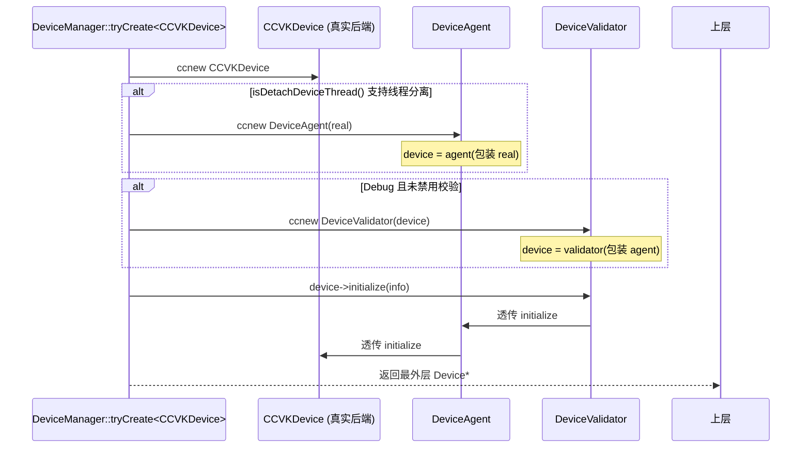

- **组装顺序**：真实设备 → (可选) `DeviceAgent` → (可选) `DeviceValidator`。最外层暴露给上层。
- **控制开关**（`DeviceManager` 内静态常量）：`DETACH_DEVICE_THREAD`、`FORCE_DISABLE_VALIDATION`、`FORCE_ENABLE_VALIDATION`。
- 校验层仅在 `CC_DEBUG > 0` 且非 `CC_SERVER_MODE` 时启用。

### 4.2 gfx-agent 多线程渲染代理

这是 GFX 高性能的关键：**主线程录制命令、渲染线程执行**，二者通过消息队列解耦。

[base/Agent.h](file:///e:/AIProMax/github/cocos4-vulkan/native/cocos/base/Agent.h) 定义 `Agent<Actor> : public Actor`，持有一个 `_actor`（真实对象）。所有 `XxxAgent` 都是「继承接口 + 转发到 actor」的代理：

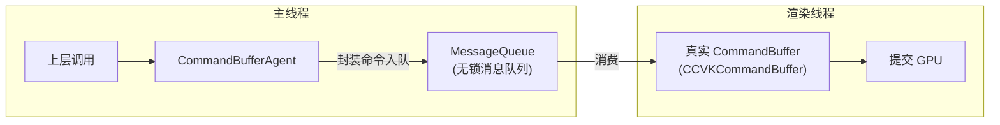

**DeviceAgent 帧节流**（[DeviceAgent.h](file:///e:/AIProMax/github/cocos4-vulkan/native/cocos/renderer/gfx-agent/DeviceAgent.h)）：

| 成员 | 作用 |
| --- | --- |
| `MAX_CPU_FRAME_AHEAD = 1` | CPU 最多领先 GPU 1 帧 |
| `MAX_FRAME_INDEX = 2` | 双缓冲帧索引 |
| `_mainMessageQueue` | 主线程 → 渲染线程命令队列 |
| `_frameBoundarySemaphore` | 帧边界信号量，节流 CPU/GPU 提前量 |
| `_cmdBuffRefs` | 管理所有 `CommandBufferAgent` |
| `_currentIndex` | 当前帧在环形缓冲中的索引 |

- `setMultithreaded(bool)`：动态开关多线程模式。
- `presentWait()` / `presentSignal()` + `_frameBoundarySemaphore`：构成帧同步栅栏，防止 CPU 跑太快淹没渲染线程。

**CommandBufferAgent**（[CommandBufferAgent.h](file:///e:/AIProMax/github/cocos4-vulkan/native/cocos/renderer/gfx-agent/CommandBufferAgent.h)）每个持有独立 `_messageQueue`，主线程调用（`draw`/`bindXXX`/`beginRenderPass`...）时不立即执行，而是打包成消息入队；渲染线程按序消费并调用 `_actor`（真实命令缓冲）。`flushCommands(count, cmdBuffs, multiThreaded)` 支持多线程并行录制多个命令缓冲。

每个 GFX 抽象类都有对应的 `XxxAgent`（`Agent<T>` 子类），负责把调用编码进 `MessageQueue`。代表性文件：`DeviceAgent`/`QueueAgent`/`CommandBufferAgent`（`gfx-agent/DeviceAgent.h`/`QueueAgent.h`/`CommandBufferAgent.h`）、`BufferAgent`/`TextureAgent`/`SwapchainAgent`、`ShaderAgent`/`PipelineStateAgent`/`PipelineLayoutAgent`、`DescriptorSetAgent`/`DescriptorSetLayoutAgent`/`InputAssemblerAgent`/`RenderPassAgent`/`FramebufferAgent`/`QueryPoolAgent`（同名 `gfx-agent/*.h`）。

### 4.3 gfx-validator 校验层

[DeviceValidator](file:///e:/AIProMax/github/cocos4-vulkan/native/cocos/renderer/gfx-validator/DeviceValidator.h) 及一系列 `XxxValidator`（Buffer/CommandBuffer/Texture/RenderPass...）在 Debug 构建下包裹真实对象，做**参数合法性、状态机、生命周期**校验后再转发，帮助在开发期暴露误用（如未 begin 就 draw、资源已销毁仍使用等）。`ValidationUtils.h` 提供公共校验工具。生产构建下该层被完全移除，零开销。

与 agent 一一对应的 `*Validator`（继承 `Agent<Device>`）在 Debug 下拦截非法用法，文件位于 `gfx-validator/`，类名与 `gfx-agent/` 镜像。

### 4.4 一次绘制的完整数据流（贯穿全链路）

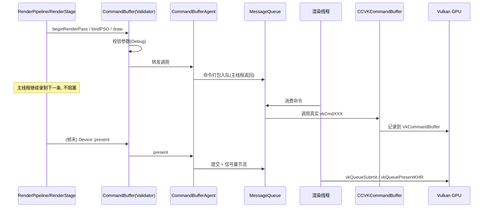

---

## 5. Vulkan 后端

### 5.1 目录构成

| 文件 | 职责 |
| --- | --- |
| `VKDevice.h/.cpp` | `CCVKDevice`，Vulkan 设备总入口 |
| `VKGPUObjects.h` | GPU 资源与管理器（1400 行，核心） |
| `VKCommandBuffer` / `VKCommands` | 命令录制与命令封装 |
| `VKSwapchain` / `VKQueue` / `VKQueryPool` | 交换链 / 队列 / 查询池 |
| `VKBuffer` / `VKTexture` / `VKShader` | 资源对象 |
| `VKPipelineState` / `VKPipelineLayout` / `VKPipelineCache` | 管线状态与缓存 |
| `VKDescriptorSet` / `VKDescriptorSetLayout` | 描述符集 |
| `VKRenderPass` / `VKFramebuffer` / `VKInputAssembler` | 渲染通道 / 帧缓冲 / 输入装配 |
| `VKUtils` / `VKStd` | 工具与格式转换 |
| `volk.h` | Vulkan 函数加载器（第三方） |
| `vk_mem_alloc.h` (VMA) | Vulkan 显存分配器（第三方，17k 行） |
| `thsvs_simpler_vulkan_synchronization.h` | 简化同步屏障（第三方） |

### 5.2 CCVKDevice 的 GPU 资源管理器（Hub / Pool 体系）

[VKDevice.h](file:///e:/AIProMax/github/cocos4-vulkan/native/cocos/renderer/gfx-vulkan/VKDevice.h) 持有一组 GPU 侧管理器，是 Vulkan 后端高效运作的关键：

```mermaid
graph TD
    DEV["CCVKDevice"] --> GPUDEV["CCVKGPUDevice<br/>(VkDevice 句柄封装)"]
    DEV --> CTX["CCVKGPUContext<br/>(VkInstance/物理设备)"]
    DEV --> TRANS["CCVKGPUTransportHub<br/>(批量传输命令)"]
    DEV --> BUFHUB["CCVKGPUBufferHub<br/>(跨帧 Buffer 更新)"]
    DEV --> DESCHUB["CCVKGPUDescriptorHub / DescriptorSetHub"]
    DEV --> SEMPOOL["CCVKGPUSemaphorePool<br/>(信号量池)"]
    DEV --> BARRIER["CCVKGPUBarrierManager<br/>(屏障合批)"]
    DEV --> IAHUB["CCVKGPUInputAssemblerHub"]
    DEV --> PCACHE["CCVKPipelineCache<br/>(管线缓存)"]
    DEV --> FENCE["CCVKGPUFencePool[]<br/>(每帧栅栏池)"]
    DEV --> RECYCLE["CCVKGPURecycleBin[]<br/>(延迟销毁回收站)"]
    DEV --> STAGING["CCVKGPUStagingBufferPool[]<br/>(暂存缓冲池)"]
```

- **Pool 数组（每帧一份）**：`FencePool`/`RecycleBin`/`StagingBufferPool` 按帧索引分组，配合 `MAX_FRAME_INDEX` 实现多缓冲，避免 CPU/GPU 争用。
- **RecycleBin**：延迟销毁——GPU 可能仍在用的资源不立即释放，等对应帧栅栏完成后回收。
- **TransportHub**：把 buffer/texture 上传等传输命令批量提交，减少提交开销。
- **VMA**：所有 `VkDeviceMemory` 分配交给 vk_mem_alloc 统一管理，避免碎片。
- `checkExtension()` / `initExtensionCapability()`：运行期探测扩展能力。

### 5.3 FrameGraph（渲染资源自动编排）

`renderer/frame-graph` 提供基于有向无环图的**瞬态资源自动管理**：

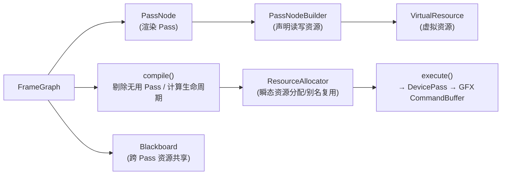

- **虚拟资源**：Pass 只声明读写关系，实际 GPU 资源在 `compile()` 后按生命周期分配，支持**别名复用**（不同 Pass 复用同一块显存）。
- **自动剔除**：无输出贡献的 Pass 被裁剪。
- `DevicePass` 是编译后真正对接 GFX 层执行的单元。

> 注：Cocos 4.x 同时存在传统 `pipeline` 与自定义管线 `pipeline/custom`（RenderGraph），FrameGraph 主要服务于传统内置管线；自定义管线用自己的 `FGDispatcher`。

---

## 6. 渲染管线体系

目录：`native/cocos/renderer/pipeline/`。定位：位于 **场景层（scene）** 与 **GFX 抽象层** 之间，负责把「场景中的可见对象」组织成「一帧的 GFX 绘制命令」。

### 6.1 两套管线体系

Cocos 4.x 原生同时保留了 **两套** 渲染管线实现，二者共存：

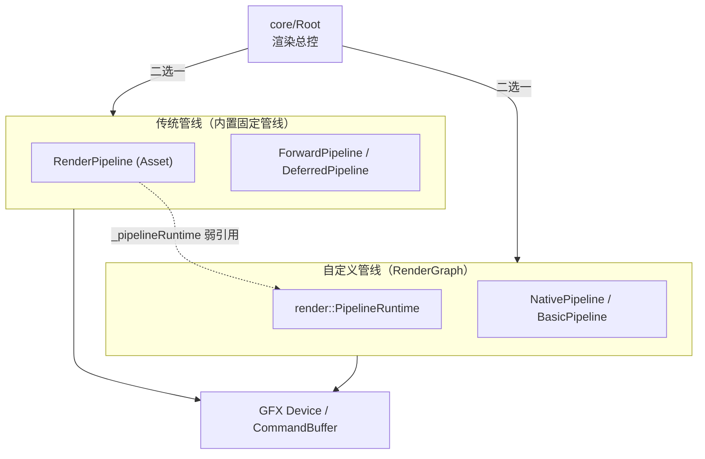

| 体系 | 入口 | 组织方式 | 特点 |
| --- | --- | --- | --- |
| **传统管线** | `RenderPipeline` | `Flow → Stage → Queue` 三层固定结构 | 结构固定（Forward/Deferred），配合 `FrameGraph` 做资源管理 |
| **自定义管线** | `render::PipelineRuntime`（`custom/`） | `RenderGraph` 有向图 + `LayoutGraph` | 脚本可编程，按需声明 Pass/资源，支持 Compute，是官方主推方向 |

> 说明：`RenderPipeline` 中持有 `render::PipelineRuntime *_pipelineRuntime`，运行期由 `Root` 决定走哪条路径。先讲传统管线（结构清晰、便于理解渲染语义），再讲自定义管线（RenderGraph）。

### 6.2 传统管线：核心抽象四层

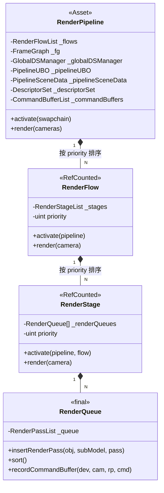

- **RenderPipeline**（继承 `Asset`，单例 `getInstance()`）：管线总容器，持有全局资源（DescriptorSet、UBO、SceneData、CommandBuffer、FrameGraph、Quad IA）。`render(cameras)` 是每帧入口。
- **RenderFlow**（继承 `RefCounted`）：一组阶段的集合，带 `priority`（决定执行顺序）与 `tag`。典型：`ShadowFlow`、`ForwardFlow`、`MainFlow`。
- **RenderStage**（继承 `RefCounted`）：真正干活的一步，持有若干 `RenderQueue`，负责录制某个 RenderPass 的命令。典型：`ForwardStage`、`GbufferStage`、`ShadowStage`。
- **RenderQueue**（`final`）：绘制对象的容器，负责 **插入 → 排序 → 录制命令**。按 `RenderQueueCreateInfo`（透明/不透明、phase、排序函数）分类。

### 6.3 数据流向（每帧一个 Camera）

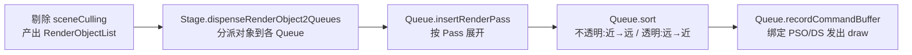

### 6.4 具体管线实现与目录

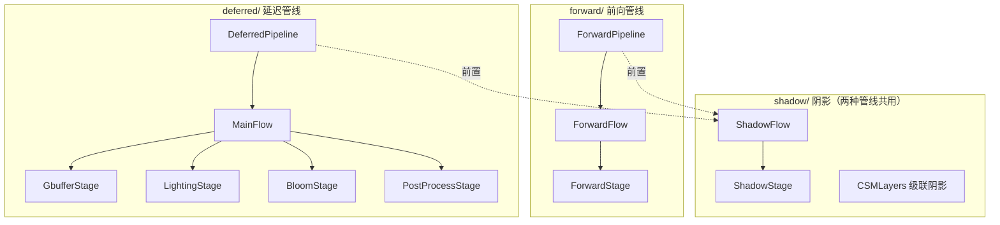

| 目录 | 关键类 | 职责 |
| --- | --- | --- |
| `forward/` | `ForwardPipeline` / `ForwardFlow` / `ForwardStage` | 前向渲染。ForwardStage 内含 `_instancedQueue`、`_additiveLightQueue`、`_planarShadowQueue`、`_uiPhase` |
| `deferred/` | `DeferredPipeline` / `MainFlow` + 4 个 Stage | 延迟渲染：GBuffer → Lighting → Bloom → PostProcess，含 `ReflectionComp`（反射） |
| `shadow/` | `ShadowFlow` / `ShadowStage` / `CSMLayers` | 阴影贴图生成，支持级联阴影 CSM，`lightCollecting` 收集投影光源 |

**ForwardStage 的队列分派**（`dispenseRenderObject2Queues`）是理解前向渲染的关键：把一帧 `RenderObject` 按材质/透明度/光照方式拆入不同 `RenderQueue`，再分别排序、录制。

---

## 7. 自定义管线 RenderGraph

自定义管线用 **图（Graph）** 描述一帧，替代固定的 Flow/Stage/Queue。核心分三张图：

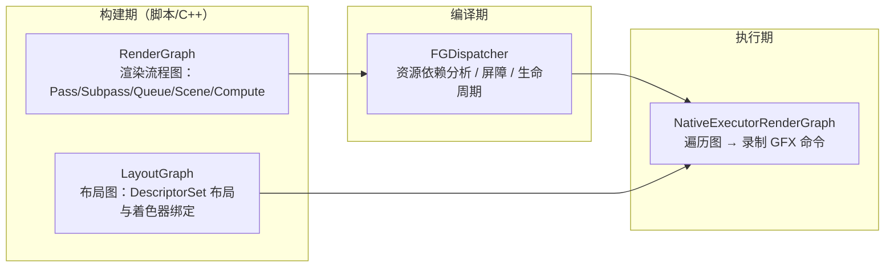

### 7.1 关键类型（`custom/` 目录）

| 文件 | 内容 |
| --- | --- |
| `RenderInterfaceTypes.h` | 对外接口：`PipelineRuntime`、`BasicPipeline`、`Pipeline`，以及各类 Builder |
| `RenderGraphTypes.h` / `RenderGraphGraphs.h` | RenderGraph 数据结构与图算法（4700+ 行，含节点遍历） |
| `LayoutGraphTypes.h` / `LayoutGraphGraphs.h` | 布局图：管线布局、DescriptorSet 布局推导 |
| `FGDispatcherTypes.h` / `FGDispatcherGraphs.h` | 帧图调度器：资源别名、屏障插入、pass 裁剪 |
| `NativePipelineTypes.h` | `NativePipeline` 具体实现（1800+ 行） |
| `NativeExecutorRenderGraph.h` | 图执行器：把图转成 GFX 命令 |

`NativePipeline`（`pipeline/custom/NativePipelineTypes.h:1579`）是新架构管线入口（继承 `Pipeline`），图驱动渲染；`NativeProgramLibrary`（`pipeline/custom/NativePipelineTypes.h:1482`）是适配自定义管线的 Program 库；`FrameGraphDispatcher`（`pipeline/custom/FrameGraphDispatcher.h`）把 RenderGraph 调度到执行器；`NativeRenderGraph`/`NativeResourceGraph`/`NativeRenderQueue` 是渲染图/资源图/渲染队列的具体实现；`NativeExecutor*` 是图执行器（资源分配、阶段执行、提交）；`LayoutGraph*` 是布局图（描述资源/绑定布局）；辅助类有 `NativeSceneCulling`/`NativeSetter`/`NativeFactory`/`NativePools`，数据结构有 `NativeTypes`/`CustomTypes`/`FGDispatcherTypes`。

### 7.2 构建接口（Builder 模式）

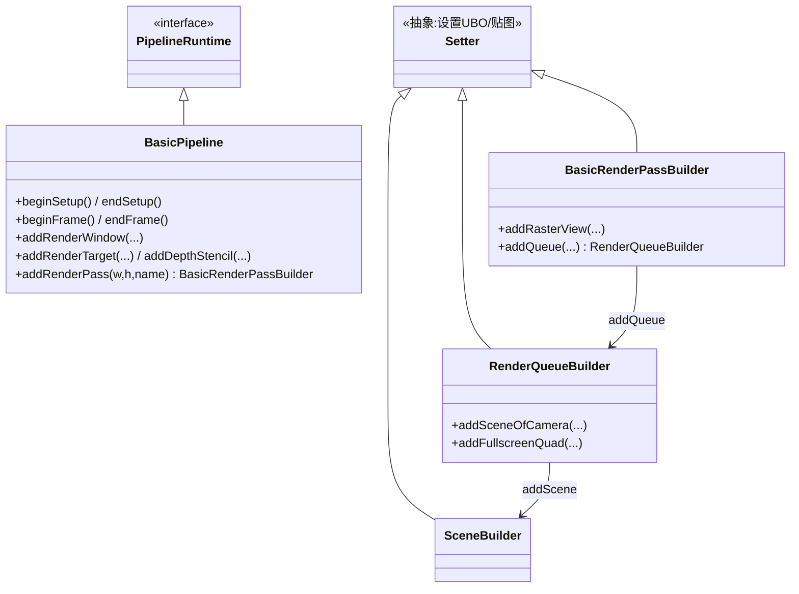

典型使用（伪代码，脚本侧调用）：
```
ppl.beginFrame()
auto *pass = ppl.addRenderPass(w, h, "forward")
pass.addRenderTarget("color", ...)   // 声明输出
pass.addDepthStencil("ds", ...)
auto *queue = pass.addQueue(QueueHint::RENDER_OPAQUE)
queue.addSceneOfCamera(camera, ...)  // 把相机场景塞进队列
ppl.endFrame()                       // 触发 编译→调度→执行
```

- **BasicPipeline**：基础接口，`addRenderPass` 返回 `BasicRenderPassBuilder`；再 `addQueue` 得到 `RenderQueueBuilder`；`addSceneOfCamera` / `addFullscreenQuad` 塞入绘制内容。
- **Pipeline**（进阶，继承 BasicPipeline）：额外支持 Subpass、Compute Pass（`ComputeQueueBuilder` / `ComputeSubpassBuilder`）、多重采样等。
- **Setter**：所有 Builder 的基类，提供设置 UBO 值 / 绑定贴图的通用能力。
- `endFrame()` 内部触发 **编译（FGDispatcher）→ 执行（NativeExecutorRenderGraph）**，最终落到 GFX `CommandBuffer`。

### 7.3 Pass 与 ComputePass

RenderGraph 中的节点类型包括 **Pass**（光栅化 Pass，含 RasterView / Queue）、**ComputePass**（计算 Pass，通过 `ComputeQueueBuilder` 添加计算任务）、Scene、Queue 等。`Pass` 在构建期通过 Builder 声明输入/输出资源（RasterView / RenderTarget / DepthStencil），编译期由 `FGDispatcher` 推导资源依赖、插入屏障、裁剪无贡献 Pass；`ComputePass` 则用于后处理、剔除、光照等不在渲染通道内的 GPU 计算。

### 7.4 编译与执行

- **编译期（FGDispatcher）**：分析 RenderGraph 中各 Pass 的资源读写依赖，推导 `VkBarrier`/同步点，对虚拟资源做别名复用与生命周期裁剪，决定真实 `VkImage`/`VkBuffer` 的分配方案。
- **执行期（NativeExecutorRenderGraph）**：按编译结果遍历图，把每个 Pass 转译为 GFX `CommandBuffer` 录制命令（beginRenderPass / bind / draw / dispatch / pipelineBarrier），最终由装饰后的 `gfx::Device` 提交给真实后端。

---

## 8. 场景数据与 UBO / 描述符集

### 8.1 数据关系

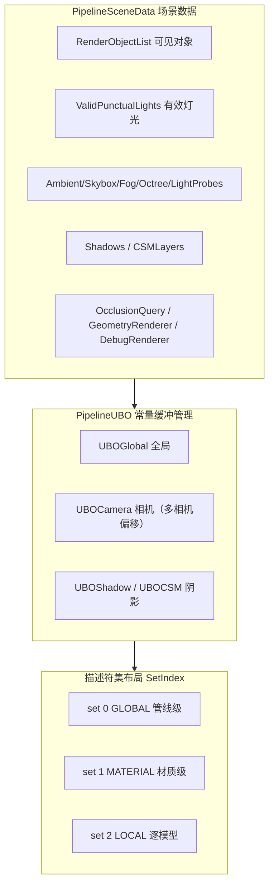

### 8.2 PipelineSceneData

每帧场景侧数据的聚合：可见对象列表、有效灯光、环境（Ambient/Skybox/Fog/Octree/LightProbes）、阴影与 CSM 级联、HDR 开关、`shadingScale`，以及遮挡查询/几何渲染器/调试渲染器等资源。`DeferredPipelineSceneData` 为延迟管线扩展版本。

### 8.3 PipelineUBO

统一常量缓冲（UBO）的更新与写入：
- `updateGlobalUBO` / `updateCameraUBO` / `updateShadowUBO`
- `updateMultiCameraUBO`：多相机场景下用 **动态偏移**（`getCurrentCameraUBOOffset` / `incCameraUBOOffset`）复用同一大 buffer。
- 内部维护 `UBOGlobal`、`UBOShadow`、`UBOCSM` 三个 CPU 端数组，再上传到 GFX buffer。

### 8.4 描述符集（Define.h）

`enum class SetIndex { GLOBAL, MATERIAL, LOCAL, COUNT }` —— 全引擎统一的三段式绑定模型：

| Set | 频率 | 内容 |
| --- | --- | --- |
| `GLOBAL` (0) | 每帧/每相机 | UBOGlobal、UBOCamera、UBOShadow、阴影贴图、环境贴图 |
| `MATERIAL` (1) | 每材质 | 材质参数、贴图 |
| `LOCAL` (2) | 每模型 | `UBOLocal`（世界矩阵）、`UBOLocalBatched`、`UBOWorldBound`、`UBOForwardLight`、蒙皮/关节纹理 |

`GlobalDSManager` 负责 GLOBAL set 的创建与生命周期；`Define.h` 集中定义所有 UBO 布局、binding 编号与 `RenderObject` / `RenderPass` 等基础结构。

---

## 9. 剔除与队列

### 9.1 剔除、队列与光照流程

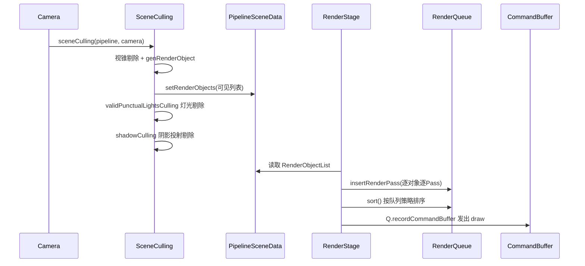

- **SceneCulling.h** 提供自由函数：`sceneCulling`（主视锥剔除）、`validPunctualLightsCulling`（点/聚光灯剔除）、`shadowCulling`（阴影投射体剔除）、`genRenderObject`（构造带深度的绘制对象）。
- **RenderQueue** 按 `RenderQueueCreateInfo` 区分：`isTransparent`、`phases`（渲染阶段位掩码）、`sortFunc`（排序函数）。不透明通常 `FRONT_TO_BACK`（减少 overdraw），透明 `BACK_TO_FRONT`（正确混合）。
- **光照队列**：前向渲染下 `RenderAdditiveLightQueue` 处理多光源叠加，`UBOForwardLight` 携带每 Pass 的灯光数据；灯光索引通过 `_lightIndexOffsets` / `_lightIndices` 关联到对象。

### 9.2 与其他层的关系

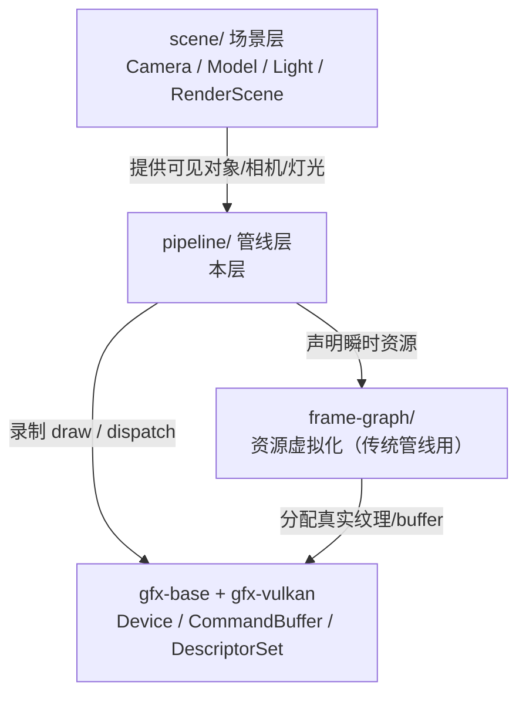

- **上游（scene）**：管线从 `RenderScene` 读取 `Model`/`Light`/`Camera`，经剔除得到 `RenderObject`。
- **下游（GFX）**：管线通过 `CommandBuffer` 录制命令，用 `DescriptorSet` 绑定资源，最终由 GFX 后端（Vulkan）提交。
- **frame-graph/**：传统管线的资源管理器；自定义管线用自己的 `FGDispatcher`。

---

## 10. 关键类速查表（按子系统）

> 路径均相对 `renderer/`。

### 10.1 设备装饰器链（装配入口）

| 类 | 文件 | 职责 |
| --- | --- | --- |
| `DeviceManager` | `GFXDeviceManager.h` | 依据编译宏（`CC_USE_VULKAN`/`CC_USE_GLES3`/…）选择后端并装配装饰器链 |
| `DeviceAgent` | `gfx-agent/DeviceAgent.h` | 装饰器：将 GFX 调用序列化进 `MessageQueue`，在渲染线程异步执行 |
| `DeviceValidator` | `gfx-validator/DeviceValidator.h` | 装饰器：调试期校验所有 GFX 对象的参数与状态 |
| `MessageQueue` | `base/threading/MessageQueue.h` | （位于 `base/`，非 `renderer/`）跨线程命令队列，gfx-agent 的底层载体 |

装配顺序（`DeviceManager::tryCreate`，见 `GFXDeviceManager.h:144`）：**真实 Device → DeviceAgent（可分离渲染线程时）→ DeviceValidator（Debug 且未禁用校验时）**，对上层完全透明。

### 10.2 GFX 抽象层（`gfx-base/`）

| 类 | 文件 | 职责 |
| --- | --- | --- |
| `GFXObject` | `gfx-base/GFXObject.h` | 所有 GFX 对象的抽象基类，维护 `ObjectType`/`objectID` |
| `Device` | `gfx-base/GFXDevice.h` | GFX 核心抽象：创建/管理全部 GPU 资源与队列 |
| `Swapchain` | `gfx-base/GFXSwapchain.h` | 抽象交换链（与窗口表面绑定） |
| `Buffer` | `gfx-base/GFXBuffer.h` | 抽象顶点/索引/Uniform 缓冲区 |
| `Texture` | `gfx-base/GFXTexture.h` | 抽象纹理与渲染目标 |
| `RenderPass` / `Framebuffer` | `gfx-base/GFXRenderPass.h` / `GFXFramebuffer.h` | 抽象渲染通道与帧缓冲附件 |
| `Shader` | `gfx-base/GFXShader.h` | 抽象着色器（含着色器表/属性/块描述） |
| `DescriptorSet` / `DescriptorSetLayout` | `gfx-base/GFXDescriptorSet.h` / `GFXDescriptorSetLayout.h` | 抽象描述符集与布局 |
| `PipelineLayout` / `PipelineState` | `gfx-base/GFXPipelineLayout.h` / `GFXPipelineState.h` | 抽象管线布局与可绘制状态对象 |
| `InputAssembler` | `gfx-base/GFXInputAssembler.h` | 抽象顶点数据装配配置 |
| `CommandBuffer` | `gfx-base/GFXCommandBuffer.h` | 抽象命令缓冲（录制绘制/绑定/屏障） |
| `Queue` | `gfx-base/GFXQueue.h` | 抽象提交队列（图形/计算/传输） |
| `QueryPool` | `gfx-base/GFXQueryPool.h` | 抽象查询池（遮挡/时间戳/管线统计） |
| `GFXBarrier` | `gfx-base/GFXBarrier.h` | 全局/纹理/缓冲屏障抽象基类 |
| `GFXSampler`（及各类 Barrier） | `gfx-base/states/` | 不可变状态对象，按值构造、跨帧复用 |
| `SPIRVUtils` | `gfx-base/SPIRVUtils.h` | SPIR-V 反射与跨后端重映射工具 |

### 10.3 Vulkan 后端（`gfx-vulkan/`）

| 类 | 文件 | 职责 |
| --- | --- | --- |
| `CCVKDevice` | `gfx-vulkan/VKDevice.h` | Vulkan 设备实现；聚合 `CCVKGPUDevice`/`CCVKGPUContext` 与各类 Hub/Pool |
| `CCVKBuffer` / `CCVKTexture` / `CCVKSwapchain` | 同名 `.h` | Vulkan 资源实现 |
| `CCVKCommandBuffer` | `gfx-vulkan/VKCommandBuffer.h` | Vulkan 命令缓冲实现 |
| `CCVKRenderPass` / `CCVKFramebuffer` / `CCVKShader` / `CCVKPipelineState` / `CCVKPipelineLayout` / `CCVKDescriptorSet` / `CCVKInputAssembler` / `CCVKQueryPool` | 同名 `.h` | Vulkan 各类对象实现 |
| `CCVKGPUContext` / `CCVKGPUDevice` | `gfx-vulkan/VKGPUObjects.h` | 底层 Vulkan 句柄与 GPU 状态容器 |
| `VKGPURecycleBin` | `gfx-vulkan/VKGPURecycleBin.cpp` | 延迟回收 Vulkan 对象（跨帧安全释放） |
| `VKPipelineCache` | `gfx-vulkan/VKPipelineCache.h` | Vulkan 管线缓存/缓存键管理 |
| `VKCommands` | `gfx-vulkan/VKCommands.h` | 命令编码辅助函数集合 |
| `VKUtils` | `gfx-vulkan/VKUtils.h` | Vulkan 枚举转换与工具 |
| `volk` / `VMA` | `gfx-vulkan/volk.h` / `vk_mem_alloc.h` | 第三方：Vulkan 动态加载 / 显存分配器 |

### 10.4 渲染核心工具（`core/`）

| 类 | 文件 | 职责 |
| --- | --- | --- |
| `MaterialInstance` | `core/MaterialInstance.h` | 材质实例（覆盖父材质属性的可绘制副本） |
| `PassInstance` | `core/PassInstance.h` | 单个 Pass 实例（继承 `scene::Pass`） |
| `ProgramLib` | `core/ProgramLib.h` | Shader Program 库：管理着色器变体与编译 |
| `PassUtils` | `core/PassUtils.h` | Pass 工具函数（创建/填充 Pass 参数） |
| `TextureBufferPool` | `core/TextureBufferPool.h` | 纹理缓冲池（高效复用 TBO 显存） |

### 10.5 传统渲染管线（`pipeline/`）

| 类 | 文件 | 职责 |
| --- | --- | --- |
| `RenderPipeline` | `pipeline/RenderPipeline.h` | 管线抽象基类（`Asset` 子类），定义 `render()` 流程骨架 |
| `RenderFlow` / `RenderStage` | `pipeline/RenderFlow.h` / `RenderStage.h` | 流程/阶段抽象（组合出完整渲染流程） |
| `RenderQueue` / `RenderInstancedQueue` / `RenderAdditiveLightQueue` | `pipeline/RenderQueue.h` / `RenderInstancedQueue.h` / `RenderAdditiveLightQueue.h` | 渲染队列与按批/按灯排序提交 |
| `PipelineUBO` | `pipeline/PipelineUBO.h` | 全局/相机/模型 UBO 数据维护与上传 |
| `GlobalDSManager` | `pipeline/GlobalDescriptorSetManager.h` | 全局描述符集（绑定/布局）管理 |
| `PipelineSceneData` | `pipeline/PipelineSceneData.h` | 管线级场景数据（阴影/环境光等） |
| `PipelineStateManager` | `pipeline/PipelineStateManager.h` | 复用 `PipelineState` 对象 |
| `InstancedBuffer` | `pipeline/InstancedBuffer.h` | 实例化绘制缓冲 |
| `SceneCulling` | `pipeline/SceneCulling.h` | 场景可见性剔除入口 |
| `ForwardPipeline` | `pipeline/forward/ForwardPipeline.h` | 前向管线实现 |
| `DeferredPipeline` / `DeferredPipelineSceneData` | `pipeline/deferred/DeferredPipeline.h` | 延迟管线实现（G-Buffer/光照/Bloom） |
| `ShadowFlow` / `ShadowStage` / `CSMLayers` | `pipeline/shadow/ShadowFlow.h` | 级联阴影流程 |
| `DebugView` / `GeometryRenderer` / `ClusterLightCulling` / `PlanarShadowQueue` | 同名 `.h` | 调试视图/几何渲染/聚簇光照剔除/平面阴影 |

### 10.6 自定义 RenderGraph 管线（`pipeline/custom/`）

| 类 | 文件 | 职责 |
| --- | --- | --- |
| `NativePipeline` | `pipeline/custom/NativePipelineTypes.h:1579` | 新架构管线入口（继承 `Pipeline`），图驱动渲染 |
| `NativeProgramLibrary` | `pipeline/custom/NativePipelineTypes.h:1482` | 适配自定义管线的 Program 库 |
| `FrameGraphDispatcher` | `pipeline/custom/FrameGraphDispatcher.h` | 把 RenderGraph 调度到执行器 |
| `NativeRenderGraph` / `NativeResourceGraph` / `NativeRenderQueue` | `pipeline/custom/NativeRenderGraph.h` / `NativeResourceGraph.cpp` / `NativeRenderQueue.cpp` | 渲染图/资源图/渲染队列的具体实现 |
| `NativeExecutor*` | `pipeline/custom/NativeExecutor*.h/.cpp` | 图执行器（资源分配、阶段执行、提交） |
| `LayoutGraph`（类型/序列化/工具） | `pipeline/custom/LayoutGraph*.h` | 布局图：描述资源/绑定布局 |
| `NativeSceneCulling` / `NativeSetter` / `NativeFactory` / `NativePools` | 同名 `.cpp/.h` | 剔除/Setter 写入/对象工厂/对象池 |
| `NativeTypes` / `CustomTypes` / `FGDispatcherTypes` | 同名 `.h` | 图节点与调度相关数据结构定义 |

---

## 11. 类关系图 (Mermaid)

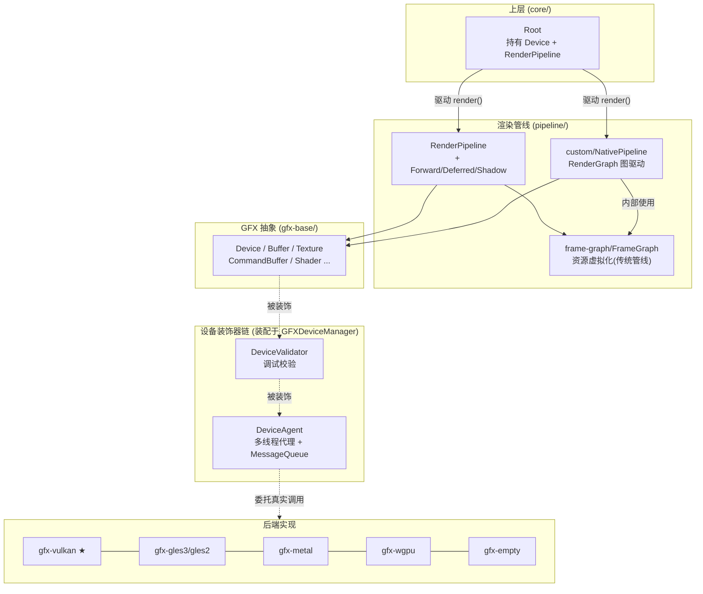

调用方向总览：上层 `Root` → 管线（`pipeline/`）→ GFX 抽象（`gfx-base/`）→ 装饰器链（`DeviceValidator` ⊃ `DeviceAgent`）→ 真实后端（如 `gfx-vulkan`）。装饰器对管线透明，管线只看到统一的 `gfx::Device` 接口。

---

## 12. 与上下层交互

**上层 —— `core/Root` 如何驱动渲染**（`core/Root.h`）：

- `Root` 构造时接收 `gfx::Device *device`（`Root.h:72`），并通过 `setRenderPipeline(pipeline::RenderPipeline*)`（`Root.h:88`）装载管线；成员 `_device`、`_pipeline` 分别暴露 `getDevice()`/`getRenderPipeline()`。
- 每帧 `Root::frameMove()` 调用管线的 `render()`，把 `scene/` 的可见对象喂入管线；管线最终通过 `gfx::Device` 提交命令。
- `DeviceManager::create()`（`GFXDeviceManager.h:70`）产出装饰后的 `gfx::Device`，由 `Root` 持有——即 `renderer` 对外的唯一设备入口。

**下层 —— 与 GFX / Vulkan 的连接**：

- 所有 GPU 资源创建、命令录制、提交都经由 `gfx::Device` 抽象接口，由 `gfx-base/` 定义。
- 生产环境通常装配为 `DeviceAgent(CCVKDevice)` 或 `(DeviceValidator(DeviceAgent(CCVKDevice)))`，Vulkan 后端通过 volk + VMA 落地到真实 API。
- 管线与 GFX 之间还有 `frame-graph/FrameGraph`（虚拟资源声明/别名）这一层，传统管线用它做资源生命周期管理。

**横向 —— 与其他模块的边界**：

- `renderer/core/` 的 `MaterialInstance`/`ProgramLib` 与 `scene/`、`material/` 协作，但不反向依赖业务模块。
- 2D 渲染（`2d/`）有独立 Batcher，但通过同一套 `gfx::Device` 输出；参见 [./00-overview.md](./00-overview.md)。

---

## 13. 修改 / 扩展要点

1. **新增一个 GFX 后端**（如新图形 API）：在 `renderer/` 下新建 `gfx-xxx/`，实现 `gfx-base/` 中每个抽象类；在 `GFXDeviceManager.h` 增加对应 `CC_USE_XXX` 宏分支与 `tryCreate<...>`；必要时在 `gfx-base/GFXDef-common.h` 的 `API` 枚举补充类型。
2. **修改 GFX 抽象接口**：改 `gfx-base/` 基类时，需同步更新所有后端（vulkan/gles/metal/wgpu/empty）以及 `gfx-agent`、`gfx-validator` 中对应的 `*Agent`/`*Validator` 转发，否则装饰器会漏转调用。
3. **新增/调整枚举或位标志**：只改 `gfx-base/GFXDef-common.h`；新增 `API` 值要同步 `DeviceManager::getGFXName()`。
4. **新增一条传统管线流程**：继承 `RenderPipeline`/`RenderFlow`/`RenderStage`，参考 `pipeline/forward` 与 `pipeline/deferred`；注意 `PipelineUBO`/`GlobalDSManager`/`SceneCulling` 的复用。
5. **扩展自定义 RenderGraph 管线**：以 `pipeline/custom/NativePipeline` 为入口，按 `NativeTypes`/`CustomTypes`/`LayoutGraph*` 的数据结构扩展图节点与 Setter；`details/` 内为图算法与序列化内部实现，一般无需改动。
6. **调试与性能开关**：装饰器链的装配由 `GFXDeviceManager.h` 的 `DETACH_DEVICE_THREAD` / `FORCE_ENABLE_VALIDATION` 等常量控制；分离渲染线程不支持 XR/AR/编辑器场景（见 `tryCreate` 内的 `isSupportDetachDeviceThread` 判断）。
7. **Vulkan 方向后续关注点**：

| 方向 | 入口 |
| --- | --- |
| 新增/修改 GFX 接口 | 先改 `gfx-base` 抽象，再同步各后端 + agent + validator |
| Vulkan 特性/扩展 | `CCVKDevice::initExtensionCapability` + `VKGPUObjects.h` |
| 显存/资源管理优化 | `CCVKGPUBufferHub` / `RecycleBin` / VMA 配置 |
| 多线程调度调优 | `DeviceAgent` / `MessageQueue` / `MAX_CPU_FRAME_AHEAD` |
| 渲染 Pass 编排 | `frame-graph` 或 `pipeline/custom` (RenderGraph) |
| 调试排错 | 开启 `FORCE_ENABLE_VALIDATION` + gfx-validator |

**阅读顺序建议**：先看第 3–5 节建立 GFX/装饰器/Vulkan 心智，再看第 6–9 节理解管线；改后端时从 `gfx-base` 接口对照 `gfx-vulkan` 实现入手。更宏观的引擎结构参考 [./00-overview.md](./00-overview.md)，场景侧数据结构参考 [./scene.md](./scene.md)，数学库参考 [./math.md](./math.md)。
