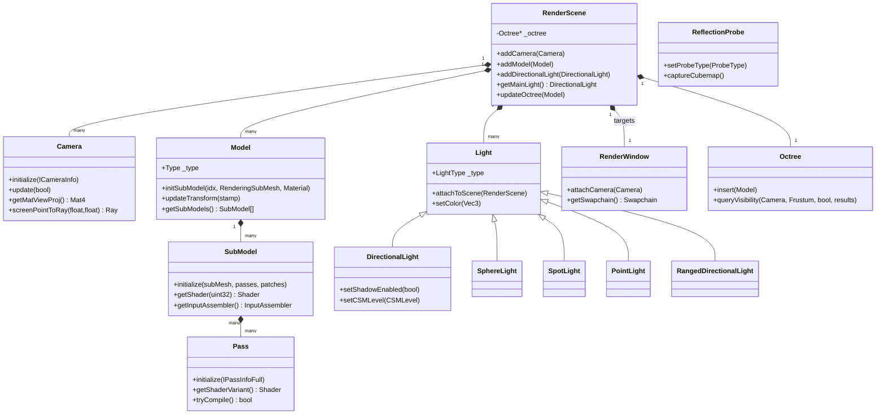

# scene 模块详解

> 根目录：`native/cocos/scene/` · 规模：~53 文件 · 语言：C++17
> 关联文档：[00-overview](./00-overview.md) · [core](./core.md) · [renderer](./renderer.md) · [2d](./2d.md) · [3d](./3d.md) · [gi](./gi.md) · [primitive](./primitive.md) · [04-pipeline-deep-dive](./renderer.md)

## 1. 模块职责与定位

`scene` 模块定义**渲染层的场景对象（render-scene objects）**，是 `core`（Node / Asset / 场景图）与 `renderer`/pipeline（渲染）之间的数据桥梁。它回答「这一帧要画什么、怎么画、用哪台相机、受哪些光照」。

核心定位：
- **容器与组织**：`RenderScene` 持有相机、模型、灯光、2D 批次的集合，供渲染管线遍历。
- **相机与视口**：`Camera` 提供视图/投影矩阵、视锥剔除、清屏、渲染目标（`RenderWindow`）。
- **绘制单位**：`Model` / `SubModel` 封装「网格 + 材质实例」，是管线剔除、排序、录制的基本单元；`Pass` 封装「Shader + 渲染状态 + 描述符集」，是 `core::Material` 展开后的实体。
- **光照与环境**：`Light` 家族（方向/球/聚光/点/带范围方向光）、`Shadows`、`Fog`、`Ambient`、`Skybox`、八叉树 `Octree` 剔除。
- **反射与细节**：`ReflectionProbe` / `ReflectionProbeManager` 提供烘焙/实时反射；`LODGroup` 做细节层次切换。

注意：`scene` 中的对象几乎都继承 `RefCounted`（见 [base](./base.md)），由 `IntrusivePtr<T>` 管理生命周期；它们持有 `core::Node` 的**弱引用**（仅存变换与层级信息），渲染状态（UBO、描述符集）由本模块自己维护。

## 2. 目录树与子目录说明

```
scene/
├── Define.h                  # 场景层结构体/枚举（IMacroPatch、BatchingSchemes）
├── RenderScene.h/.cpp        # 渲染场景容器（相机/模型/灯光集合）
├── Camera.h/.cpp             # 相机（视图/投影/视锥/清屏）
├── Model.h/.cpp              # 模型（绘制单位，含 SubModel 列表）
├── SubModel.h/.cpp           # 子模型（IA + Pass + 描述符集）
├── Pass.h/.cpp               # 渲染通道（Shader + 状态 + 描述符集）
├── Light.h/.cpp              # 灯光基类
├── DirectionalLight.h/.cpp   # 平行光（含 CSM 级联阴影）
├── SphereLight.h/.cpp        # 球面光（点光源带范围）
├── SpotLight.h/.cpp          # 聚光灯
├── PointLight.h/.cpp         # 点光源
├── RangedDirectionalLight.h/.cpp # 带范围平行光
├── RenderWindow.h/.cpp       # 渲染窗口（swapchain / framebuffer）
├── Octree.h/.cpp             # 八叉树场景管理（加速剔除）
├── LODGroup.h/.cpp           # 细节层次（LOD）
├── ReflectionProbe.h/.cpp            # 反射探针
├── ReflectionProbeManager.h/.cpp     # 反射探针管理（单例）
├── Ambient.h/.cpp            # 环境光
├── Skybox.h/.cpp             # 天空盒 / IBL
├── Fog.h/.cpp                # 全局雾
├── Shadow.h/.cpp             # 阴影（平面/ShadowMap/CSM）
├── PostSettings.h/.cpp       # 后处理设置
├── Skin.h/.cpp               # 蒙皮相关（供 3d 蒙皮模型使用）
├── DrawBatch2D.h/.cpp        # 2D 绘制批次（配合 2d/ 模块）
└── raytracing/               # 光线追踪描述（RayTracing/Description/Def）
```

> 说明：`skin`/`skeletal` 相关的蒙皮计算主要在 `3d/` 实现，`scene/Skin.h` 仅提供基础数据结构；真正的实时/烘焙蒙皮模型见 [3d](./3d.md)。

## 3. 关键类 / 结构体

| 类 / 结构体 | 关键成员（真实签名摘要） | 职责 |
| --- | --- | --- |
| `RenderScene` | `addCamera/addModel/addDirectionalLight/...`、`getMainLight()`、`updateOctree()`、`isCulledByLod()` | 渲染场景容器，聚合相机/模型/灯光/2D 批次；持有 `Octree` |
| `Camera` | `initialize(ICameraInfo)`、`update()`、`screenPointToRay()`、`worldToScreen()`、`getMatView/getMatProj/getMatViewProj`、`attachToScene()` | 相机：视图/投影矩阵、视锥、曝光（ISO/光圈/快门）、清屏标志 |
| `Model` | `initSubModel()`、`updateTransform()`、`updateUBOs()`、`getSubModels()`、`setReflectionProbeType()`、`updateOctree()` | 模型：持有 `SubModel` 列表、局部 UBO/SH UBO/世界包围盒 UBO |
| `SubModel` | `initialize(subMesh, passes, patches)`、`getShader()`、`getPass()`、`setInputAssembler()`、`getInstancedAttributeBlock()` | 子模型：一份 `RenderingSubMesh` + 一组 `Pass` + 描述符集 + IA |
| `Pass` | `initialize(IPassInfoFull)`、`getHandle()`、`setUniform()`、`bindTexture()`、`getShaderVariant()`、`tryCompile()` | 渲染通道：`Material` 展开后的 Shader 变体 + 渲染状态 + 描述符集 |
| `Light` | `attachToScene()`、`setColor()`、`setColorTemperature()`、`nt2lm()`、`colorTemperatureToRGB()` | 灯光基类：`LightType`、`_node`（弱引用）、颜色/色温 |
| `DirectionalLight` | `setShadowEnabled()`、`setCSMLevel()`、`setShadowBias()`、`getIlluminance()` | 平行光：CSM 级联阴影、阴影 PCF、光照度 |
| `ReflectionProbe` | `setProbeType()`、`captureCubemap()`、`renderPlanarReflection()`、`getBoundingBox()` | 反射探针：CUBE/PLANAR 两种类型，内置渲染相机 |
| `RenderWindow` | `initialize(IRenderWindowInfo)`、`attachCamera()`、`getSwapchain()`、`getFramebuffer()`、`getRenderWindowId()` | 渲染窗口：关联 swapchain / framebuffer / 颜色附件 |
| `Octree` / `OctreeNode` | `insert()`、`remove()`、`queryVisibility()`、`resize()` | 八叉树：视锥剔除加速，`OCTREE_CHILDREN_NUM=8` |
| `LODGroup` / `LODData` | `getVisibleLODLevel()`、`insertLOD()`、`getLodDataArray()` | 细节层次：按相机距离/屏幕尺寸切换模型 |
| `Shadows` / `Fog` / `Ambient` / `Skybox` | 见第 4 节枚举 | 全局环境与阴影参数 |

结构要点：`Model::Type` 区分 `DEFAULT / SKINNING / BAKED_SKINNING / BATCH_2D / PARTICLE_BATCH / LINE`；蒙皮/烘焙蒙皮模型由 `3d` 模块继承 `Model`/`MorphModel` 实现。`Model` 通过事件（`IMPL_EVENT_TARGET`）向管线广播 `UpdateTransform`、`UpdateUBO`、`GetMacroPatches` 等。

## 4. 关键枚举 / 常量

```cpp
// Camera.h
enum class CameraProjection { ORTHO, PERSPECTIVE, UNKNOWN };
enum class CameraFOVAxis    { VERTICAL, HORIZONTAL };
enum class CameraAperture   { F1_8, F2_0, ... F22_0 };   // 光圈（曝光计算）
enum class CameraISO        { ISO100, ISO200, ISO400, ISO800 };
enum class CameraShutter    { D1, D2, ... D4000 };
enum class CameraType       { DEFAULT=-1, LEFT_EYE=0, RIGHT_EYE=1, MAIN=2 }; // XR 双目
enum class TrackingType     { NO_TRACKING, POSITION_AND_ROTATION, POSITION, ROTATION };
enum class CameraUsage      { EDITOR, GAME_VIEW, SCENE_VIEW, PREVIEW, GAME=100 };

// Model.h
enum class UseReflectionProbeType { NONE, BAKED_CUBEMAP, PLANAR_REFLECTION,
                                    BLEND_PROBES, BLEND_PROBES_AND_SKYBOX };

// Light.h
enum class LightType { DIRECTIONAL, SPHERE, SPOT, POINT, RANGED_DIRECTIONAL, UNKNOWN };

// Shadow.h
enum class ShadowType { PLANAR=0, SHADOW_MAP=1, NONE };
enum class ShadowSize { LOW_256X256=256, MEDIUM_512X512=512,
                        HIGH_1024X1024=1024, ULTRA_2048X2048=2048 };
enum class PCFType    { HARD=0, SOFT=1, SOFT_2X=2, SOFT_4X=3 };
enum class CSMLevel   { LEVEL_1=1, LEVEL_2=2, LEVEL_3=3, LEVEL_4=4 };
enum class CSMOptimizationMode { NONE=1, REMOVE_DUPLICATES=2, DISABLE_ROTATION_FIX=3 };

// Fog.h
enum class FogType { LINEAR=0, EXP=1, EXP_SQUARED=2, LAYERED=3, NONE=4 };

// Skybox.h
enum class EnvironmentLightingType { HEMISPHERE_DIFFUSE=0,
        AUTOGEN_HEMISPHERE_DIFFUSE_WITH_REFLECTION=1, DIFFUSEMAP_WITH_REFLECTION=2 };

// ReflectionProbe.h
enum class ReflectionProbe::ProbeType { CUBE=0, PLANAR=1 };

// Pass.h / Define.h
enum class BatchingSchemes { NONE=0, INSTANCING=1 };
struct IMacroPatch { ccstd::string name; MacroValue value; };
```

常量：`Shadows::MAX_FAR{2000.F}`；`Octree` 默认 `DEFAULT_OCTREE_DEPTH=8`、`OCTREE_CHILDREN_NUM=8`、`USE_MULTI_THRESHOLD=1024`（并行剔除阈值）；`Ambient::SUN_ILLUM{65000.0F}`、`SKY_ILLUM{20000.0F}`。

## 5. 类关系图



## 6. 与上下层交互

- **上游（core）**：`Model::setNode()/setTransform()` 接收 `core::Node` 的世界变换（弱引用，不持有）；`Pass` 由 `core::Material` + `core::assets::EffectAsset` 展开（`PassUtils` 计算 handle）。顶点/索引来自 `core::assets::RenderingSubMesh`（由 `3d::Mesh` 创建，见 [3d](./3d.md)）。
- **下游（renderer / pipeline）**：渲染管线遍历 `RenderScene`，调用 `Camera` 做 `sceneCulling`（利用 `Octree::queryVisibility` 与 `Model` 的 `geometry::AABB` 世界包围盒），对 `Model`/`SubModel` 排序后录制绘制命令；`SubModel` 提供 `InputAssembler` 与 `DescriptorSet`，`Pass` 提供 `Shader` 与 `PipelineLayout` 给 GFX 层。
- **环境要素流入管线**：`Fog`/`Ambient`/`Skybox`/`Shadows` 通过 `pipeline::GlobalDSManager` 更新全局描述符集（如 `Skybox::updateGlobalBinding()`），光照数据写入光照 UBO。
- **2D 协作**：`RenderScene::addBatch(DrawBatch2D*)` 收集 `2d::Batcher2d` 生成的 2D 批次，由 UI 阶段统一绘制（见 [2d](./2d.md)）。
- **GI 协作**：`Model` 通过 `setUseLightProbe()` / `setTetrahedronIndex()` 与 [gi](./gi.md) 的光照探针交互，由 `updateSHUBOs()` 写入 SH 系数。

## 7. 修改 / 扩展要点

1. **新增光源类型**：继承 `Light`，实现 `initialize()/update()`，在 `RenderScene` 增加对应的 `addXxxLight/removeXxxLight` 并在管线光照收集处接入；`LightType` 枚举需同步。
2. **新增 Pass 状态/宏**：在 `Pass` 扩展 `setDynamicState()` 或宏补丁；Shader 变体由 `getShaderVariant(patches)` 生成，需注意 `getPassHash()` 命中缓存。
3. **模型类型扩展**：在 `Model::Type` 增加枚举；若需在 JS 侧实现，注意 `Model::isModelImplementedInJS()` 的判定（DEFAULT/SKINNING/BAKED_SKINNING 为 native 实现）。
4. **反射探针**：`ReflectionProbe::ProbeType` 增加类型时，需同步 `Model::UseReflectionProbeType` 与管线混合逻辑（BLEND_PROBES 等）。
5. **内存与生命周期**：所有场景对象为 `RefCounted` + `IntrusivePtr`；`Node` 仅弱引用（注释 `// weak reference`），不要对其调用 `IntrusivePtr` 持有；`RenderWindow` 的 `swapchain` 等由 `platform` 提供。
6. **性能敏感路径**：`Octree::queryVisibility` 在模型数 > `USE_MULTI_THRESHOLD` 时走并行剔除；新增剔除逻辑时注意线程安全。改动涉及 Shader/UBO 时必须确认与 [03-gfx-deep-dive](./renderer.md)、[04-pipeline-deep-dive](./renderer.md) 一致。
7. **跨平台/XR**：`CameraType`（LEFT_EYE/RIGHT_EYE）与 `TrackingType` 服务于 XR（见 [xr](./xr.md)），新增相机参数需兼容双目渲染路径。
