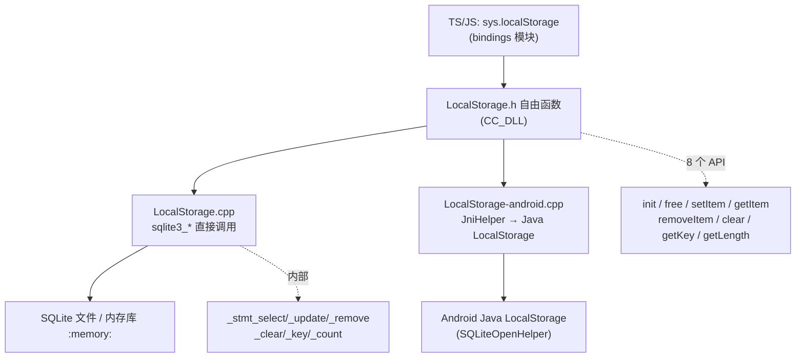

# Storage 本地存储模块详解

> 根目录：`native/cocos/storage/` · 规模：~3 文件 · 语言：C++17
> 关联文档：[00-overview](./00-overview.md) · [01-architecture](./00-overview.md) · [base](./base.md) · [bindings](./bindings.md) · [application](./application.md) · [platform](./platform.md)

Cocos Native 的本地存储模块非常轻量，本质是对 **SQLite** 的薄封装，提供 JS 绑定层（`localStorage`）所需的字符串型 key-value 持久化能力。它仅由三个文件组成：`storage/local-storage/LocalStorage.h`（公开 C 风格 API 声明）、`LocalStorage.cpp`（通用平台 SQLite 实现，约 230 行）、`LocalStorage-android.cpp`（Android 平台经 JNI 桥接到 Java 实现，约 123 行）。上层引擎的 `sys.localStorage` 直接调用这些函数。

## 1. 模块职责与定位

- **职责**
  - 以 SQLite 数据库文件为底层，提供字符串型 key-value 的增、查、删、清空、遍历。
  - 管理数据库生命周期：初始化（可指定路径，默认内存库）与释放。
  - 屏蔽 SQLite 调用细节，对 JS 绑定暴露一组 `CC_DLL` 自由函数。
  - Android 平台改走 JNI 调用 Java 层 `LocalStorage` 实现，复用系统 SQLite。
- **定位**：最底层的持久化设施，不依赖渲染或场景图。它是 `bindings` 模块中 JS `localStorage` 对象的 native 实现后端；数据落地为单文件 SQLite 数据库，便于跨会话保留用户配置、进度等小体量数据。

## 2. 目录树与子目录说明

```
storage/
└── local-storage/
    ├── LocalStorage.h            # 公开 API 声明（C 风格自由函数 + CC_DLL）
    ├── LocalStorage.cpp          # 通用平台 SQLite 实现（sqlite3_* 直接调用）
    └── LocalStorage-android.cpp  # Android 平台：经 JniHelper 桥接到 Java LocalStorage
```

- **local-storage/**：模块唯一子目录，命名源于历史 `localStorage` 语义。
- **通用实现 `LocalStorage.cpp`**：直接 `#include` 平台 SQLite（sqlite3），用准备好的语句（prepared statement）执行 SQL。
- **Android 实现 `LocalStorage-android.cpp`**：不直接链接 SQLite，而是用 `JniHelper` 调用 Java 静态方法（类 `JCLS_LOCALSTORAGE` 即 `org/cocos2dx/lib/Cocos2dxLocalStorage`），由 Android 侧 `SQLiteOpenHelper` 管理数据库，从而遵循 Android 存储规范。
- **平台差异极小**：调用方始终只看到 `LocalStorage.h` 的统一 API，实现分支由构建系统按平台选择 `.cpp`。

## 3. 关键函数（无类，全是自由函数）

本模块**没有类**，全部以 `CC_DLL` 自由函数形式提供（声明于 `LocalStorage.h`）：

| 函数 | 说明 |
|---|---|
| `localStorageInit(const ccstd::string &fullpath = "")` | 初始化数据库；`fullpath` 为空时打开内存库 `":memory:"`，否则 `sqlite3_open(fullpath)`；随后建表并准备 6 条语句 |
| `localStorageFree()` | 释放资源：`sqlite3_finalize` 全部语句并 `sqlite3_close(_db)`（`CC_ASSERT` 关闭成功） |
| `localStorageSetItem(const ccstd::string &key, const ccstd::string &value)` | 写入/覆盖一条键值对（REPLACE） |
| `localStorageGetItem(const ccstd::string &key, ccstd::string *outItem)` | 读取；命中返回 `true` 并通过 `outItem` 输出，否则 `false` |
| `localStorageRemoveItem(const ccstd::string &key)` | 删除指定键 |
| `localStorageClear()` | 清空所有键值对（`DELETE FROM data;`） |
| `localStorageGetKey(const int nIndex, ccstd::string *outKey)` | 按 `ROWID` 顺序取第 `nIndex` 个键名 |
| `localStorageGetLength(int &outLength)` | 取键总数（`COUNT(*)`） |

### 3.1 SQLite 内部结构（`LocalStorage.cpp`）

模块维护一组文件级静态变量：

```cpp
static int          _initialized = 0;
static sqlite3     *_db;
static sqlite3_stmt *_stmt_select, *_stmt_remove, *_stmt_update,
                    *_stmt_clear, *_stmt_key, *_stmt_count;
```

建表与语句（`localStorageCreateTable` / `localStorageInit`）：

| 用途 | SQL |
|---|---|
| 建表 | `CREATE TABLE IF NOT EXISTS data(key TEXT PRIMARY KEY, value TEXT);` |
| 查询 | `SELECT value FROM data WHERE key=?;`（`_stmt_select`） |
| 写入/覆盖 | `REPLACE INTO data (key, value) VALUES (?,?);`（`_stmt_update`） |
| 删除 | `DELETE FROM data WHERE key=?;`（`_stmt_remove`） |
| 清空 | `DELETE FROM data;`（`_stmt_clear`） |
| 取键 | `SELECT key FROM data ORDER BY ROWID ASC;`（`_stmt_key`） |
| 计数 | `SELECT COUNT(*) FROM data;`（`_stmt_count`） |

要点：`localStorageSetItem` 用 `sqlite3_bind_text(..., SQLITE_TRANSIENT)` 绑定参数后 `sqlite3_step` + `sqlite3_reset`；`localStorageGetItem` 通过 `sqlite3_column_text` 取列并通过 `outItem->assign(...)` 回写；所有语句在 `localStorageInit` 中 `sqlite3_prepare_v2` 一次，在 `localStorageFree` 中统一 `finalize`。

### 3.2 Android JNI 桥接（`LocalStorage-android.cpp`）

Android 不链接原生 SQLite，而走 JNI：

- `localStorageInit(fullpath)`：若 `fullpath` 非空，调用 `JniHelper::callStaticBooleanMethod(JCLS_LOCALSTORAGE, "init", fullpath, "data")` 在 Java 侧建库（第二参数为表名 `data`）；释放时 `callStaticVoidMethod(JCLS_LOCALSTORAGE, "destroy")`。
- 其余函数一一对应 Java 静态方法：`setItem(key,value)`、`getItem(key)`→`jstring2string`、`removeItem(key)`、`clear()`、`getKey(nIndex)`、`getLength()`。
- 依赖 `platform/java/jni/JniHelper.h` 与 `JniMethodInfo` 做方法查找与字符串转换。

## 4. 关键枚举 / 常量

本模块为纯函数式封装，**无自定义枚举或常量**。值类型统一为 `ccstd::string`（键与值均为字符串）；`localStorageInit` 的 `fullpath` 为空字符串即触发内存库（`:memory:`）语义。底层错误码来自 SQLite 的 `SQLITE_OK` / `SQLITE_DONE` / `SQLITE_ROW`，仅在 `printf`/`CC_LOG_ERROR` 中用于诊断。

## 5. 类关系图

由于模块不含类，用流程图表示调用链、底层依赖与平台分支：



## 6. 与上下层交互

- **上层（引擎/绑定）**：`bindings` 模块把 JS 的 `localStorage.getItem/setItem/removeItem/clear` 映射到本模块的 `localStorageGetItem/SetItem/RemoveItem/Clear`；`sys.localStorage` 的初始化在应用启动阶段由引擎调用 `localStorageInit(path)`。
- **生命周期**：必须在应用退出前调用 `localStorageFree()` 释放 SQLite 连接（`sqlite3_close` 以 `CC_ASSERT` 保证成功），否则可能损坏或未落盘数据；初始化路径通常来自 `application`/`platform` 提供的可写目录。
- **底层依赖**：通用实现直接依赖 SQLite（第三方库），经由 `base` 提供的 `ccstd::string` 与 `CC_DLL` 导出宏（`base/Macros.h`、`base/Log.h`）。Android 实现依赖 `platform/java/jni/JniHelper.h`。
- **平台路径**：通用平台由调用方传入 `fullpath`（落盘文件）；Android 通过 `LocalStorage-android.cpp` 把 `fullpath` 与表名 `data` 传给 Java 侧，由 `SQLiteOpenHelper` 决定沙箱内的实际文件位置。
- **线程模型**：模块本身无锁、无独立线程，SQL 调用在调用方线程同步执行；`localStorageInit` 受 `_initialized` 守卫，重复调用不重复打开。

## 7. 修改 / 扩展要点

1. **新增 API**：在 `LocalStorage.h` 声明并加 `CC_DLL`，分别在 `LocalStorage.cpp` 与 `LocalStorage-android.cpp` 实现，保持「出参用指针、返回布尔/void」的风格一致；通用端需新增对应 prepared statement 并在 `localStorageFree` 中 `finalize`。
2. **切换/升级底层存储**：当前绑定 SQLite；若需换其他 KV 引擎，只需改写 `LocalStorage.cpp` 内部实现，保持 8 个公开函数签名不变即可，上层 `bindings` 无需改动。Android 端则相应修改 JNI 目标类/方法。
3. **线程安全**：模块无锁。若存在多线程并发读写，应在调用侧或新增统一互斥保护——尤其 SQLite 连接默认线程亲和，避免同一 `_db` 跨线程使用。
4. **内存库语义**：`localStorageInit("")` 打开 `:memory:`，适合临时/会话级数据，进程退出即丢失；正式持久化务必传入有效文件路径（通用端）或有效 `fullpath`（Android 端）。
5. **平台适配**：新增平台特殊逻辑时，仿照 `LocalStorage-android.cpp` 提供同名函数实现并由构建系统按平台链接，不要在 `LocalStorage.h` 中做平台分支。
6. **使用注意**：
   - `localStorageGetItem` 经 `outItem` 出参返回，**调用前应判空返回值**（函数返回 `bool`）再使用 `outItem` 内容。
   - 批量遍历用 `localStorageGetLength` + `localStorageGetKey(nIndex)` 组合，`nIndex` 从 0 起、按 `ROWID` 升序。
   - `localStorageSetItem` 使用 `REPLACE`，重复 key 会静默覆盖旧值。
   - Android 端 `localStorageInit` 的 Java `init` 返回 `boolean`，返回失败时应视作存储不可用。
