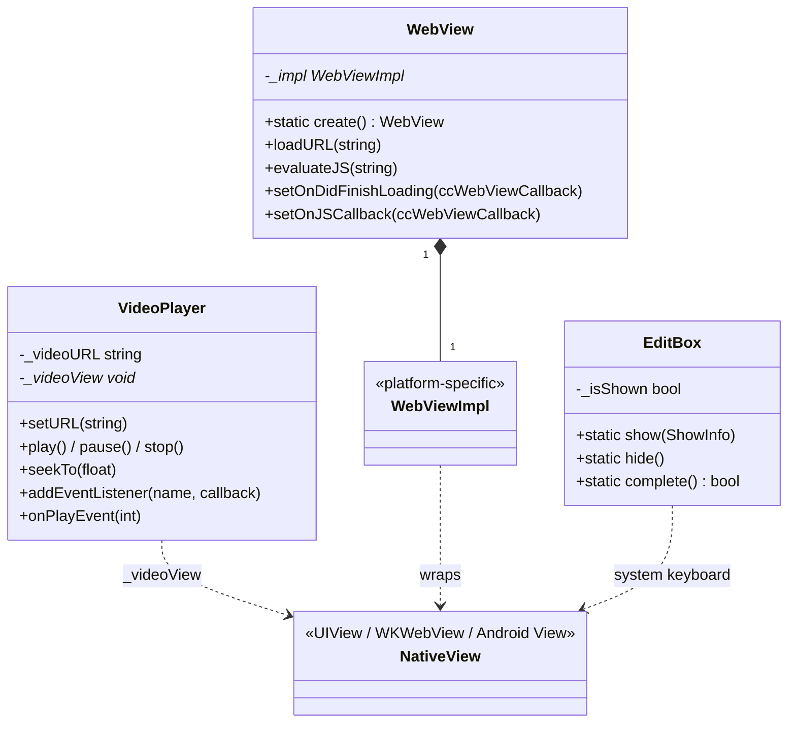

# ui 模块详解

> 根目录：`native/cocos/ui/` · 规模：~21 文件 · 语言：C++17（含 Obj-C++ `.mm` / Java 桥接）
> 关联文档：[00-overview](./00-overview.md) · [2d](./2d.md) · [platform](./platform.md) · [bindings](./bindings.md)

## 1. 模块职责与定位

`ui` 模块封装 **依赖操作系统原生控件** 的 UI 元素：文本输入框（`EditBox`）、视频播放（`VideoPlayer`）、网页视图（`WebView`）。这些控件**无法用引擎渲染管线绘制**，必须调用各平台原生 API，再以系统视图的形式叠加在游戏渲染画布之上。

> 与 [2d](./2d.md) 区分：`2d/` 是引擎**自绘**的 UI 批渲染后端；`ui/` 是**系统原生控件**的桥接层。`ui/` 控件渲染在游戏画面之上，由平台窗口系统管理层级与生命周期。

核心定位：
- **跨平台接口**：通用头文件定义平台无关的 C++ 接口（`EditBox`/`VideoPlayer`/`WebView`）。
- **平台实现隔离**：各 OS 的实现放在 `*-<os>.cpp/.mm` 或通过 `platform/` 下的原生层完成。
- **JS 桥接**：通过 `bindings` 暴露给 Cocos Creator 脚本层（见 [bindings](./bindings.md)）。

## 2. 目录树与子目录说明

```
ui/
├── edit-box/
│   ├── EditBox.h            # 通用接口（show/hide + ShowInfo）
│   ├── EditBox-openharmony.h/.cpp  # OpenHarmony 实现
│   ├── EditBox-android.cpp  # Android 实现
│   ├── EditBox-ios.mm       # iOS 实现（Obj-C++）
│   ├── EditBox-mac.mm       # macOS 实现
│   ├── EditBox-linux.cpp    # Linux 实现
│   ├── EditBox-win32.cpp    # Windows 实现
│   └── EditBox-ohos.cpp     # OHOS 实现
├── videoplayer/
│   ├── VideoPlayer.h        # 通用接口（EventType/Source + 播放控制）
│   ├── VideoPlayer-ios.mm   # iOS 实现
│   └── VideoPlayer-java.cpp # Android 实现
└── webview/
    ├── WebView.h            # 通用接口（create/load*/evalJS + 回调）
    ├── WebView-inl.h        # 内联实现/共享逻辑
    ├── WebViewImpl-android.cpp / -java.h  # Android 实现
    ├── WebViewImpl-ios.h/.mm           # iOS 实现
    ├── WebViewImpl-ohos.cpp / -openharmony.cpp / -openharmony.h # OpenHarmony
    └── WebViewImpl-...                 # 其他平台实现
```

> 说明：原生控件的具体视图对象（`void* _videoView`、`WebViewImpl* _impl`）由平台实现持有；通用头仅暴露 C++ 接口，平台差异全部隔离在 `*-<os>` 文件中。

## 3. 关键类 / 结构体

| 类 / 结构体 | 关键成员（真实签名摘要） | 职责 |
| --- | --- | --- |
| `EditBox` | `static show(ShowInfo)`、`static hide()`、`static complete()`、`enum TextAlignment{LEFT,CENTER,RIGHT}`、`struct ShowInfo` | 原生输入框：以静态方法弹出/隐藏系统输入法；`ShowInfo` 携带位置/尺寸/字体/颜色/对齐等 |
| `VideoPlayer` | `setURL()`、`play()`/`pause()`/`stop()`、`seekTo()`、`setFullScreenEnabled()`、`addEventListener()`、`onPlayEvent()`、`enum EventType` | 视频播放器：基于系统媒体框架，支持事件回调（PLAYING/PAUSED/.../READY_TO_PLAY） |
| `WebView` | `static create()`、`loadURL()/loadHTMLString()/loadData()`、`evaluateJS()`、`setOnDidFinishLoading()`、`setOnJSCallback()`、`enum ccWebViewCallback` | 内嵌浏览器：系统 WebView 封装，支持 JS 回调与历史导航 |
| `WebViewImpl` | （各平台）`WebViewImpl* _impl` | 平台实现：把 `WebView` 通用接口映射到 `WKWebView`/Android `WebView`/OpenHarmony 等 |
| `EditBox::ShowInfo` | `defaultValue/confirmType/inputType/maxLength/x/y/width/height/fontSize/fontColor/isBold/...` | 输入框展示参数（含 NEW PROPERTIES 字体/样式字段） |

## 4. 关键枚举 / 常量

```cpp
// EditBox.h
enum TextAlignment { LEFT, CENTER, RIGHT };
struct EditBox::ShowInfo {
    ccstd::string defaultValue, confirmType, inputType;
    int maxLength = 0, x = 0, y = 0, width = 0, height = 0;
    bool confirmHold = false, isMultiline = false;
    uint32_t fontSize = 20, fontColor = 0, backColor = 0, backgroundColor = 0;
    bool isBold = false, isItalic = false, isUnderline = false;
    uint32_t underlineColor = 0, textAlignment = LEFT;
};

// VideoPlayer.h
enum class VideoPlayer::EventType {
    PLAYING=0, PAUSED, STOPPED, COMPLETED,
    META_LOADED, CLICKED, READY_TO_PLAY, UPDATE
};
enum class VideoPlayer::Source { FILENAME=0, URL };  // protected

// WebView.h
using ccWebViewCallback = std::function<void(WebView*, const ccstd::string&)>;
```

`EditBox` 为静态工具类（`_isShown` 标记当前是否显示），无实例生命周期；`VideoPlayer`/`WebView` 为 `RefCounted` 对象，持有平台视图的弱指针（`void* _videoView` / `WebViewImpl* _impl`）。

接口能力对照：`VideoPlayer` 提供 `setURL()`/`play()`/`pause()`/`stop()`/`seekTo()`/`currentTime()`/`duration()`，以及 `setKeepAspectRatioEnabled()`/`setFullScreenEnabled()`/`setPlaybackRate()`/`setMute()`/`setLoop()`/`setVisible()`/`setFrame()`；事件通过 `EventType{ PLAYING, PAUSED, STOPPED, COMPLETED, META_LOADED, CLICKED, READY_TO_PLAY, UPDATE }` 经 `onPlayEvent(int)` 分发，监听以 `addEventListener(name, callback)` 注册。`WebView` 提供 `loadURL()/loadFile()/loadHTMLString()/loadData(data, mimeType, encoding, baseURL)`、`stopLoading()/reload()`、`canGoBack()/canGoForward()/goBack()/goForward()`、`evaluateJS()`、`setScalesPageToFit()`/`setBounces()`/`setBackgroundTransparent()`；JS↔Native 通信通过 `setJavascriptInterfaceScheme()` + `setOnJSCallback()`（拦截以该 scheme 开头的 URL）。

平台文件映射（当前仓库）：`EditBox` 覆盖 android/ios/mac/linux/win32/ohos/openharmony；`VideoPlayer` 覆盖 ios（`.mm`）与 android（`.cpp`，经 JNI）；`WebView` 覆盖 android（`WebViewImpl-java.h`/`-android.cpp`）、ios（`WebViewImpl-ios.h`/`.mm`）、openharmony（`WebViewImpl-openharmony.h`/`-openharmony.cpp`/`-ohos.cpp`）。通用头（`EditBox.h`/`VideoPlayer.h`/`WebView.h`）不含任何平台 `#ifdef` 实现细节，所有平台差异隔离在 `*-<os>` 文件；`WebView` 通过 `friend class WebViewImpl` 让平台实现访问受保护成员。`void* _videoView` 与 `WebViewImpl* _impl` 是**原生对象弱引用**，C++ 侧不应在控件销毁后访问。

平台实现要点：
- **EditBox**：`EditBox.h` 仅定义 `show(ShowInfo)`/`hide()`/`complete()`；各 OS 在 `EditBox-<os>.cpp/.mm` 中按 `ShowInfo` 弹出系统输入法并回填文本；OpenHarmony 额外有 `EditBox-openharmony.h` 配对。
- **VideoPlayer**：`VideoPlayer.h` 为抽象基类，`setURL()/play()/pause()/stop()/seekTo()/setFullScreenEnabled()` 为 `virtual`，平台子类（如 `VideoPlayer-ios.mm`、`VideoPlayer-java.cpp`）实现；`_eventCallback` 以 `name→callback` 映射存储事件监听。
- **WebView**：`WebView.h` 暴露 C++ 接口，`WebViewImpl-<os>` 实现具体平台 WebView；`WebView-inl.h` 承载跨平台共享的内联逻辑；回调通过 `setOnShouldStartLoading/DidFinishLoading/DidFailLoading/JSCallback` 注入 `std::function`。

## 5. 类关系图



## 6. 与上下层交互

- **上游（bindings / JS）**：Cocos Creator 的 `EditBox`/`VideoPlayer`/`WebView` 组件通过 `bindings` 调用本模块 C++ 接口（见 [bindings](./bindings.md)）；`EditBox::complete()` 用于把输入完成事件回传 JS。
- **下游（platform）**：各控件的真实视图来自 `platform/<os>` 的系统 API（如 iOS `WKWebView`、Android `WebView`、系统输入法）。平台差异全部封装在 `*-<os>` 实现文件中，通用头不感知。
- **与渲染层关系**：原生控件由系统窗口管理，**绘制在引擎画布之上**，不参与 `2d/` 的批渲染，也不进入 `scene::RenderScene`；但需与游戏视图同步位置/尺寸/可见性（如 `setFrame()`/`setVisible()`）。
- **事件回流**：`VideoPlayer::onPlayEvent()`、`WebView` 的 `ccWebViewCallback` 系列把平台事件异步回传 JS 逻辑层。

**典型数据流（WebView）**：JS 创建 `WebView` → `WebView::create()` 分配 C++ 对象并构造 `WebViewImpl` → `loadURL()/loadHTMLString()` 触发平台加载 → 平台 WebView 加载完成时回调 `setOnDidFinishLoading` → JS 处理逻辑；`evaluateJS()` 可在页面上下文执行脚本，`setOnJSCallback` 接收以 `javascript interface scheme` 开头的 URL（用于 JS↔Native 通信）。
**典型数据流（EditBox）**：JS 调用 `EditBox::show(ShowInfo)` → 平台弹出系统输入法（位置/尺寸来自 `ShowInfo`）→ 用户输入完成 → `EditBox::complete()` 把结果回传 JS → `EditBox::hide()` 收起输入法。

## 7. 修改 / 扩展要点

1. **新增平台支持**：仿照现有 `*-<os>` 文件实现对应控件（如 `EditBox-newos.cpp`、`WebViewImpl-newos.cpp`），保持通用头接口不变；OpenHarmony 已有 `.h` + `.cpp` 配对，新增平台建议同样成对。
2. **扩展输入框能力**：`EditBox::ShowInfo` 已含字体/样式（isBold/isItalic/isUnderline/underlineColor 等「NEW PROPERTIES」），扩展字段时需在 `show()` 的所有平台实现中同步处理。
3. **视频/网页事件**：`VideoPlayer::EventType` 与 `WebView` 的回调类型（`ccWebViewCallback`/`onShouldStartLoading`）是 JS 与 Native 的契约，新增事件类型需同步 `bindings` 暴露与 JS 侧处理。
4. **生命周期与内存**：`VideoPlayer`/`WebView` 为 `RefCounted`，`destroy()` 必须正确移除平台视图避免泄漏；`void* _videoView` / `WebViewImpl* _impl` 为**原生对象弱引用**，不要在 C++ 侧长期持有导致悬空。
5. **坐标系**：原生控件坐标基于系统窗口（可能与引擎 OpenGL/Vulkan 视口方向不同），`setFrame()` 的 x/y/width/height 需按平台转换；跨平台改动后务必在目标平台真机验证叠加位置。
6. **不要与 2d 混淆**：这些控件不走批渲染，性能开销来自系统合成层；如仅需在引擎内绘制文本/图像，应优先使用 [2d](./2d.md) 的自绘路径。
7. **输入法/键盘遮挡**：移动平台输入框常需处理软键盘抬升导致的画面遮挡，`EditBox::ShowInfo` 的 `x/y/width/height` 应与可见视口对齐；不同平台键盘行为差异大，新增能力时需在 Android/iOS/OpenHarmony 三端验证。
8. **视频/网页资源释放**：`VideoPlayer::destroy()` 与 `WebView::destroy()` 必须停止播放/加载并移除平台视图，避免媒体资源或 WebView 进程泄漏；`setVisible(false)` 通常仅隐藏视图而非释放，切换场景时应显式 `destroy()`。
