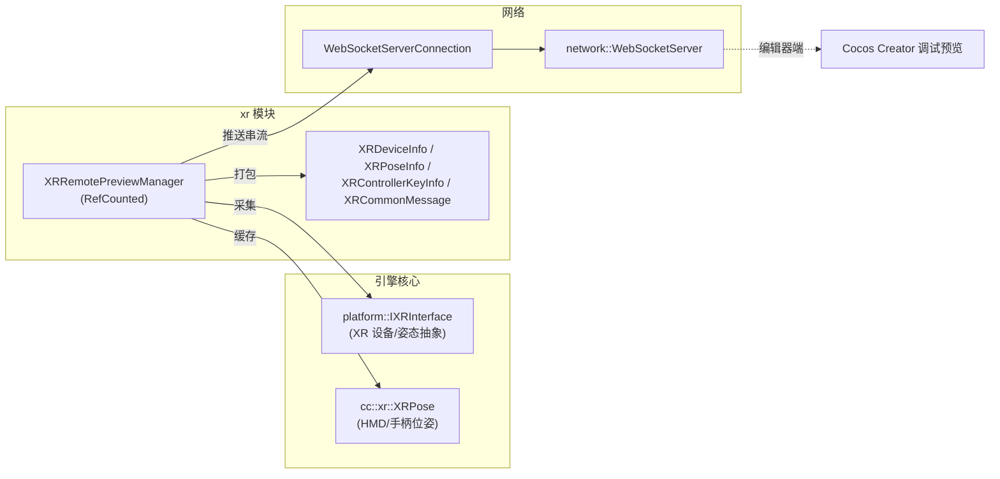

# 扩展现实（XR）模块详解

> 根目录：`native/cocos/xr/` · 规模：~2 文件 · 语言：C++17
> 关联文档：[00-overview](./00-overview.md) · [platform](./platform.md) · [renderer](./renderer.md)

## 1. 模块职责与定位

`xr/` 是原生侧非常薄的 **XR（VR/AR）远程预览**辅助模块，仅用于把 XR 设备的姿态/输入数据通过 WebSocket 串流到编辑器端做**远程调试预览**。

- 真正的 XR 运行时能力（设备姿态、双目投影、手柄输入、立体渲染）并不在本目录，而是抽象在 `platform/interfaces/modules/IXRInterface.h`，由具体平台或插件实现。
- 本模块充当一个「数据采集 + 网络串流」的旁路，独立于主渲染管线：它从 `IXRInterface` 拉取每帧姿态，打包成紧凑二进制后经 `WebSocketServer` 推送给编辑器。
- 整个模块被 `#if CC_USE_XR` 守卫，未启用 XR 时编译为空。

## 2. 目录树与子目录说明

```text
native/cocos/xr/
├── XRRemotePreviewManager.h   // 远程预览管理器声明
└── XRRemotePreviewManager.cpp // 实现：采集、打包、串流
```

文件和规模都很小，没有再分子目录。`XRCommon.h`（`platform` 子模块）提供共享基础类型（如 `cc::xr::XRPose`），被 `XRRemotePreviewManager.h` 包含。

## 3. 关键类 / 结构体

| 类型 | 位置 | 说明 |
| --- | --- | --- |
| `XRRemotePreviewManager` | `xr/XRRemotePreviewManager.h:97` | 远程预览管理器，**继承 `cc::RefCounted`**；单实例管理预览会话，负责 start/stop、每帧 `tick()`、消息打包与发送 |
| `XRCommonMessage` | `xr/XRRemotePreviewManager.h:55` | 通用消息壳：`int16_t type` + `ccstd::string message`，`#pragma pack(1)` 紧凑布局 |
| `XRDeviceInfo` | `xr/XRRemotePreviewManager.h:62` | 设备信息：设备名、厂商类型 `xrVendorType`、左右眼 FOV（`leftEyeFov`/`rightEyeFov`，各 4 个 float 表示 L-R-D-U） |
| `XRPoseInfo` | `xr/XRRemotePreviewManager.h:73` | 位姿信息：HMD 与左右手柄的朝向 `hmdOrientation`/位置 `hmdPosition`（各 4/3 个 float） |
| `XRControllerKeyInfo` | `xr/XRRemotePreviewManager.h:85` | 手柄按键/摇杆/触摸事件：区分 `stickAxisCode/Value`、`stickKeyCode`、`stickTouchCode`、`isButtonPressed` |

核心方法（`XRRemotePreviewManager`）：
- 生命周期：`start()` / `stop()` / `pause()` / `resume()` / `isStarted()` / `tick()`
- 数据发送：`sendDeviceInfo(const XRDeviceInfo&)`、`sendPoseInfo(const XRPoseInfo&)`、`sendControllerKeyInfo(const ControllerInfo::ButtonInfo&|AxisInfo|TouchInfo)`
- 私有打包：`packCommonMessageData` / `packDeviceInfoData` / `packDevicePoseData` / `packControllerKeyData`（均 `static`，写入裸 `char*` 缓冲区）

## 4. 关键枚举 / 常量

```cpp
enum class XRDataPackageType {            // 数据包类型
    DPT_MSG_DEVICE_INFO = 1,
    DPT_MSG_POSE_DATA,
    DPT_MSG_CONTROLLER_KEY,
    DPT_MSG_STRING
};

enum class XRKeyEventType {               // 手柄事件类型
    KET_CLICK,
    KET_STICK,
    KET_GRAB,
    KET_TOUCH,
};
```

另有一组 `IXRInterface *_xr`、`cc::xr::XRPose` 四元组（`_leftEyePose`/`_rightEyePose`/`_leftControllerPose`/`_rightControllerPose`，构造时分别指定 `XRPose::Type::VIEW_LEFT/VIEW_RIGHT/HAND_LEFT/HAND_RIGHT`）用于缓存最近一次采集的位姿。

> 注：以上枚举/结构体仅在 `#if CC_USE_XR` 与 `#if CC_USE_WEBSOCKET_SERVER` 之下存在，部分成员（如 `_webSocketServer`、`onConnection`）还受 `CC_USE_WEBSOCKET_SERVER` 二次守卫。

## 5. 类关系图



## 6. 与上下层交互

- **向下（平台层）**：`XRRemotePreviewManager` 持有一个 `IXRInterface *_xr` 指针，每帧 `tick()` 时从接口读取设备信息、双目位姿与手柄输入，再转成上述紧凑结构体。
- **横向（网络层）**：依赖 `cc::network::WebSocketServer` 与 `WebSocketServerConnection`（受 `CC_USE_WEBSOCKET_SERVER` 守卫）。`onConnection`/`onClientConnected`/`onClientDisconnected` 维护一个 `_wssConnections` 连接列表，所有连接都会收到同一份串流数据。
- **向上（业务/编辑器）**：本模块是编辑器「XR 远程预览」功能的原生端，把数据推到 Creator 桌面端实时显示，不参与 `renderer` 的立体渲染（立体渲染由 `renderer` 依据 `IXRInterface` 提供的左右眼投影处理）。
- **线程/生命周期**：`start()` 建立 WebSocket 服务并进入预览态，`stop()`/`pause()`/`resume()` 控制会话；`_isStarted` / `_isConnectionChanged` 跟踪状态。

## 7. 修改 / 扩展要点

- **新增串流数据类型**：在 `XRDataPackageType` 增加枚举值，并新增对应的 `XRxxxInfo` 结构体（注意 `#pragma pack(1)` 保持紧凑）+ `packXxxData` 静态打包函数 + `sendXxxInfo` 发送入口；编辑器端需同步解析。
- **扩展输入维度**：手柄事件目前覆盖 click/stick/grab/touch，若要新增交互（如眼动、手势），扩展 `XRKeyEventType` 与 `XRControllerKeyInfo` 字段即可。
- **平台对接**：本模块不实现 XR 能力，新增 XR 硬件支持应在 `platform/interfaces/modules/IXRInterface.h` 的派生实现中完成，本模块仅消费其产出。
- **与事件总线协同**：若需在插件层响应 XR 事件，可走 `plugins/` 的 `EventBus`（详见 [plugins](./plugins.md)），但当前 `xr/` 直接使用 WebSocket 推流，未接入总线。
- **注意守卫宏**：任何改动都要保留 `CC_USE_XR` / `CC_USE_WEBSOCKET_SERVER` 守卫，否则会在非 XR / 无 WebSocket 构建中编译失败。
